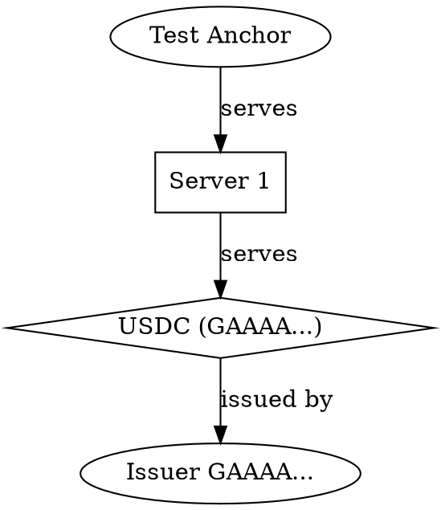

# stellar-toml-lint

Validate a Stellar Info File (`stellar.toml`) against **[SEP-1]** — offline, before you deploy it.

[](https://github.com/anchor-tools/stellar-toml-lint/actions/workflows/ci.yml)
[](https://www.npmjs.com/package/stellar-toml-lint)
[](./LICENSE)

Documentation website: [stellar-toml-lint docs](https://anchor-tools.github.io/stellar-toml-lint/)

```console
$ npx stellar-toml-lint public/.well-known/stellar.toml

public/.well-known/stellar.toml
  12:1      error    NETWORK_PASSPHRASE has stray whitespace; it must match the Public passphrase byte for byte  network/passphrase
            ↳ Replace it with exactly: Public Global Stellar Network ; September 2015
  31:1      error    CURRENCIES[0].issuer is not a valid Stellar account ID  currencies/issuer-or-contract
            ↳ Check for a transcription error — the checksum does not match.
  34:1      error    CURRENCIES[0] sets fixed_number and is_unlimited, but these issuance policies are mutually exclusive  currencies/issuance-exclusive
            ↳ SEP-1 requires exactly one of fixed_number, max_number, or is_unlimited.
  19:1      warning  DOCUMENTATION.ORG_PHONE_NUMBER is not in E.164 format  documentation/phone-e164
            ↳ Use a leading + and digits only, e.g. "+14155552671".

  4 problems (3 errors, 1 warning, 0 infos)
```

## Why this exists

The official [`@stellar/anchor-tests`][anchor-tests] suite is thorough, but it tests a **live
domain**. That means you find out your info file is broken _after_ you have shipped it — and you
cannot run it in the pull request that introduced the mistake.

`stellar-toml-lint` reads a local file. It runs in a pre-commit hook, in CI, or on your laptop before
a domain exists at all. It is complementary to `anchor-tests`, not a replacement: this catches
everything checkable from the file itself, then hands off to `anchor-tests` for the parts that need
running services.

|                                 | `stellar-toml-lint` | `@stellar/anchor-tests` |
| ------------------------------- | ------------------- | ----------------------- |
| Lints a local file              | ✅                  | ❌                      |
| Needs a deployed domain         | ❌                  | ✅                      |
| Line and column for each fault  | ✅                  | ❌                      |
| Validates key checksums         | ✅                  | partial                 |
| SARIF / code scanning output    | ✅                  | ❌                      |
| Tests live SEP-6/10/24/31 flows | ❌                  | ✅                      |

Because it validates Stellar keys with `@stellar/stellar-base`, it verifies the **CRC16 checksum** —
so a single transposed character in an issuer address is caught, which a `/^G[A-Z2-7]{55}$/` regex
would wave straight through.

## Install

```bash
npm install --save-dev stellar-toml-lint   # project dependency
npx stellar-toml-lint                      # or just run it
```

### Homebrew

```bash
brew install anchor-tools/tap/stellar-toml-lint
```

Homebrew installs a self-contained binary; Node.js is not required at runtime.

### Standalone binaries

Download the asset for your platform from the [GitHub Releases](https://github.com/anchor-tools/stellar-toml-lint/releases) page, verify it against `SHA256SUMS.txt`, and place it on your `PATH`:

```bash
curl -fLO https://github.com/anchor-tools/stellar-toml-lint/releases/latest/download/stellar-toml-lint-linux-x64
curl -fLO https://github.com/anchor-tools/stellar-toml-lint/releases/latest/download/SHA256SUMS.txt
sha256sum --check --ignore-missing SHA256SUMS.txt
chmod +x stellar-toml-lint-linux-x64
sudo install -m 0755 stellar-toml-lint-linux-x64 /usr/local/bin/stellar-toml-lint
```

Assets are published for Linux x64 (glibc and musl), Linux ARM64, macOS Intel, macOS Apple Silicon, and Windows x64. These binaries have no Node.js runtime dependency. The npm package remains available for Node.js 20+ users. Runtime dependencies for the npm package are `smol-toml`, `@stellar/stellar-base`, and the pure-JS `@noble/curves` and `@noble/hashes` that `@stellar/stellar-base` already installs.
Commit a `.stellartomlrc.json` next to your `stellar.toml` to record the project's rule policy once
instead of repeating `--off`/`--warn` flags in every workflow (see [Usage](#usage)).

## Usage

```bash
# Lint a local file (defaults to ./stellar.toml)
stellar-toml-lint public/.well-known/stellar.toml

# Fetch and lint a live site, including CORS, content-type, and image-asset checks
stellar-toml-lint --domain example.com

# Lint a local file *as if* served from a domain, enabling same-domain checks
stellar-toml-lint public/.well-known/stellar.toml --domain example.com

# Read from stdin
cat stellar.toml | stellar-toml-lint -

# Rewrite a file into canonical SEP-1 layout (comments kept)
stellar-toml-lint --format-file public/.well-known/stellar.toml

# Print version as JSON for toolchains and scripts
stellar-toml-lint --version --format json
```

Rule policy discovered from a config file needs no flags at all:

```bash
stellar-toml-lint   # honours .stellartomlrc.json found upward from ./stellar.toml
```

Patterns support `*`, `?`, `[...]`, and `**` across directories, and are expanded by the linter
rather than by the shell — so the same quoted argument works in bash, PowerShell, and CMD, where
whether the shell expands the pattern (or fails to) otherwise decides whether the run starts at
all. A pattern that matches nothing names itself and exits `2`. Hidden files and directories are
left alone unless the pattern names them, so `**` cannot walk `.git`.

Several files keep their own report, and the run closes with a single summary line:

```console
$ stellar-toml-lint "accounts/*/stellar.toml"
accounts/acme/stellar.toml
  No SEP-1 issues found.
accounts/globex/stellar.toml
  12:1      error    ...

Checked 4 files: 3 passed, 1 failed (2 errors, 3 warnings)
```

The exit code is `1` when any file fails and `0` when they all pass. The summary is appended by the
`text` reporter only, so `-f json`, `-f sarif`, and `-f junit` output stays exactly as parseable as
it was before.

### Options

| Flag                      | Effect                                                                          |
| ------------------------- | ------------------------------------------------------------------------------- |
| `-d, --domain <d>`        | Serving domain. Enables CORS, content-type, TLS, and `ORG_URL` checks           |
| `-f, --format <fmt>`      | `text` (default), `summary`, `json`, `sarif`, `github`, `junit`, `sonar`        |
| `--format-file`           | Rewrite files in place in canonical SEP-1 layout                                |
| `--semantic-hash`         | Print a SHA-256 of each file's data, ignoring whitespace, comments, key order   |
| `--strict`                | Treat warnings as errors                                                        |
| `--max-warnings <n>`      | Fail if warnings exceed `n`                                                     |
| `--check-network`         | Verify accounts, `HORIZON_URL`, `AUTH_SERVER`, and `ANCHOR_QUOTE_SERVER` online |
| `--audit-fees`            | Compare fee disclosures across SEP-1, SEP-6, SEP-24, and SEP-38                 |
| `--verify-postmessage`    | Inspect SEP-24 interactive `postMessage` callbacks                              |
| `--postmessage-url <url>` | Interactive SEP-24 URL to inspect                                               |
| `--off <rule>`            | Disable a rule (repeatable)                                                     |
| `--error <rule>`          | Raise a rule to error (repeatable)                                              |
| `--warn <rule>`           | Lower a rule to warning (repeatable)                                            |
| `-q, --quiet`             | Show errors only                                                                |
| `--count`                 | Print only problem count totals                                                 |
| `--silent-success`        | Print nothing on stdout when a run has no diagnostics                           |
| `--export-anchor-tests`   | Generate a JSON configuration for `@stellar/anchor-tests`                       |
| `--show-help-urls`        | Print the spec link for each finding                                            |
| `--list-rules`            | Print every rule and exit                                                       |
| `--explore-rules`         | Fuzzy-search rules interactively and preview `--off`/`--warn`/`--error` flags   |
| `--no-suggestions`        | Hide diagnostic suggestions in the output                                       |
| `--check-network`         | Validate `ORG_OFFICIAL_EMAIL` domain MX records for email deliverability        |

| Flag                      | Effect                                                                          |
| ------------------------- | ------------------------------------------------------------------------------- |
| `-d, --domain <d>`        | Serving domain. Enables CORS, content-type, TLS, and `ORG_URL` checks           |
| `-f, --format <fmt>`      | `text` (default), `summary`, `json`, `sarif`, `github`, `junit`, `sonar`        |
| `--strict`                | Treat warnings as errors                                                        |
| `--max-warnings <n>`      | Fail if warnings exceed `n`                                                     |
| `--check-network`         | Verify accounts, `HORIZON_URL`, `AUTH_SERVER`, and `ANCHOR_QUOTE_SERVER` online |
| `--webhook-slack <url>`   | POST a Slack Block Kit card with the run summary                                |
| `--webhook-discord <url>` | POST a Discord embed with the run summary                                       |
| `--off <rule>`            | Disable a rule (repeatable)                                                     |
| `--error <rule>`          | Raise a rule to error (repeatable)                                              |
| `--warn <rule>`           | Lower a rule to warning (repeatable)                                            |
| `-q, --quiet`             | Show errors only                                                                |
| `--count`                 | Print only problem count totals                                                 |
| `--silent-success`        | Print nothing on stdout when a run has no diagnostics                           |
| `--show-help-urls`        | Print the spec link for each finding                                            |
| `--list-rules`            | Print every rule and exit                                                       |
| `--explore-rules`         | Fuzzy-search rules interactively and preview `--off`/`--warn`/`--error` flags   |
| `--no-suggestions`        | Hide diagnostic suggestions in the output                                       |
| `--color`                 | Force colour on, overriding `NO_COLOR`                                          |
| `--no-color`              | Force colour off                                                                |
| `-i, --interactive`       | Full-screen dashboard to walk the findings (falls back to text)                 |

Exit codes: **0** no errors, **1** problems found, **2** bad usage or I/O failure.

| Flag                        | Effect                                                                                                                  |
| --------------------------- | ----------------------------------------------------------------------------------------------------------------------- |
| `-d, --domain <d>`          | Serving domain. Enables CORS, content-type, TLS, and `ORG_URL` checks                                                   |
| `-f, --format <fmt>`        | `text` (default), `summary`, `json`, `ndjson`, `sarif`, `github`, `junit`, `html`, `checkstyle`, `markdown`, `sonar`    |
| `--strict`                  | Treat warnings as errors                                                                                                |
| `--max-warnings <n>`        | Fail if warnings exceed `n`                                                                                             |
| `--check-network`           | Verify accounts, `HORIZON_URL`, SEP-8 flags, `ANCHOR_QUOTE_SERVER`, and SEP-6 `/info` online                            |
| `--verify-sep10`            | Verify SEP-10 nonce uniqueness and replay resistance (requires `--check-network`)                                       |
| `--audit-routing`           | Compare host announcements with public RPKI route data (requires `--check-network`)                                     |
| `--audit-security`          | Audit token binding and CAA endpoint policy (requires `--check-network`)                                                |
| `--audit-reserves`          | Compare external-chain collateral reserves with Stellar circulating supply (requires `--check-network`)                 |
| `--audit-routing`           | Compare host announcements with public RPKI route data (requires `--check-network`)                                     |
| `--verify-sep6`             | Run end-to-end programmatic SEP-6 integration tester (requires `--check-network`)                                       |
| `--verify-sep31`            | Audit SEP-31 cross-border payment lifecycle, schema, and webhook delivery (requires `--check-network`)                  |
| `--verify-sep30`            | Validate RECOVERY_SERVER /accounts endpoint and signer public keys (requires `--check-network`)                         |
| `--verify-sep8`             | Simulate SEP-8 regulated asset compliance approval server interaction (requires `--check-network`)                      |
| `--verify-sep38`            | Audit SEP-38 quote coverage, bid-ask spread, and quote expirations (requires `--check-network`)                         |
| `--verify-sep24`            | Audit SEP-24 hosted deposit/withdrawal flow against the transfer server (requires `--check-network`)                    |
| `--verify-sep12`            | Audit SEP-12 KYC customer verification against the KYC server (requires `--check-network`)                              |
| `--verify-sep12-deletion`   | Verify SEP-12 DELETE /customer endpoint (GDPR right-to-be-forgotten) (requires `--check-network`)                       |
| `--verify-sep24-quote-lock` | Audit SEP-24 interactive deposit fee quote stability across session (requires `--check-network`)                        |
| `--verify-clawback`         | Verify asset clawback authority (CAP-35) via Horizon and Soroban RPC (requires `--check-network`)                       |
| `--check-contracts`         | Verify Soroban contract/WASM TTL and the SEP-45 auth interface online                                                   |
| `--soroban-rpc <url>`       | Soroban RPC endpoint for `--check-contracts` (defaults from `NETWORK_PASSPHRASE`)                                       |
| `--evm-rpc <url>`           | EVM JSON-RPC endpoint for reading locked bridge reserves under `--check-network`                                        |
| `--simulate-soroban`        | With `--check-network`: dry-run the SEP-41 read calls against the Soroban RPC                                           |
| `--mock-fixtures <dir>`     | Serve network checks from recorded JSON fixtures under `<dir>`, never the network                                       |
| `--webhook-slack <url>`     | POST a Slack Block Kit card with the run summary                                                                        |
| `--webhook-discord <url>`   | POST a Discord embed with the run summary                                                                               |
| `--off <rule>`              | Disable a rule (repeatable)                                                                                             |
| `--error <rule>`            | Raise a rule to error (repeatable)                                                                                      |
| `--warn <rule>`             | Lower a rule to warning (repeatable)                                                                                    |
| `-q, --quiet`               | Show errors only                                                                                                        |
| `--count`                   | Print only problem count totals                                                                                         |
| `--silent-success`          | Print nothing on stdout when a run has no diagnostics                                                                   |
| `--show-help-urls`          | Print the spec link for each finding                                                                                    |
| `--list-rules`              | Print every rule and exit                                                                                               |
| `--explore-rules`           | Fuzzy-search rules interactively and preview `--off`/`--warn`/`--error` flags                                           |
| `--completion <shell>`      | Print a `bash`, `zsh`, or `fish` completion script and exit                                                             |
| `--install-hook <hook>`     | Write a native Git hook (`pre-commit` or `pre-push`) that lints `stellar.toml`                                          |
| `--uninstall-hook <hook>`   | Remove a hook this tool installed and restore any hook it replaced                                                      |
| `--no-suggestions`          | Hide diagnostic suggestions in the output                                                                               |
| `--color`                   | Force colour on, overriding `NO_COLOR`                                                                                  |
| `--no-color`                | Force colour off                                                                                                        |
| `-w, --watch`               | Watch files and re-run on changes                                                                                       |
| `-i, --interactive`         | Full-screen dashboard to walk the findings (falls back to text)                                                         |
| `--lsp`                     | Run as a Language Server on stdio (diagnostics, quick-fixes, hover, semantic tokens)                                    |
| `--graph <fmt>`             | Generate architecture diagram: `mermaid` or `dot`                                                                       |
| `--graph-contracts`         | Include Soroban contracts in diagram                                                                                    |
| `--graph-validators`        | Include validators in diagram                                                                                           |
| `--graph-color`             | Color nodes by protocol type                                                                                            |
| `--policy <file>`           | Evaluate enterprise policy file (JSON or YAML)                                                                          |
| `--export-ap-config`        | Export Anchor Platform YAML config to stdout                                                                            |
| `--generate-openapi <file>` | Generate an OpenAPI 3.1 spec (json or yaml extension)                                                                   |
| `--badge-svg <file>`        | Generate an SVG compliance badge                                                                                        |
| `--badge-json <file>`       | Generate a Shields.io JSON endpoint                                                                                     |
| `--json-schema`             | Print a JSON Schema (Draft 2020-12) for stellar.toml to stdout                                                          |
| Flag                        | Effect                                                                                                                  |
| --------------------------- | ----------------------------------------------------------------------------------------------------------------------- |
| `-d, --domain <d>`          | Serving domain. Enables CORS, content-type, TLS, and `ORG_URL` checks                                                   |
| `-f, --format <fmt>`        | `text` (default), `summary`, `json`, `ndjson`, `sarif`, `github`, `junit`, `html`, `checkstyle`, `markdown`, `sonar`    |
| `--strict`                  | Treat warnings as errors                                                                                                |
| `--max-warnings <n>`        | Fail if warnings exceed `n`                                                                                             |
| `--check-network`           | Verify accounts, CORS pre-flight responses, `HORIZON_URL`, SEP-8 flags, `ANCHOR_QUOTE_SERVER`, and SEP-6 `/info` online |
| `--verify-sep10`            | Verify SEP-10 nonce uniqueness and replay resistance (requires `--check-network`)                                       |
| `--check-contracts`         | Verify Soroban contract/WASM TTL and the SEP-45 auth interface online                                                   |
| `--soroban-rpc <url>`       | Soroban RPC endpoint for `--check-contracts` (defaults from `NETWORK_PASSPHRASE`)                                       |
| `--evm-rpc <url>`           | EVM JSON-RPC endpoint for reading locked bridge reserves under `--check-network`                                        |
| `--simulate-soroban`        | With `--check-network`: dry-run the SEP-41 read calls against the Soroban RPC                                           |
| `--mock-fixtures <dir>`     | Serve network checks from recorded JSON fixtures under `<dir>`, never the network                                       |
| `--webhook-slack <url>`     | POST a Slack Block Kit card with the run summary                                                                        |
| `--webhook-discord <url>`   | POST a Discord embed with the run summary                                                                               |
| `--off <rule>`              | Disable a rule (repeatable)                                                                                             |
| `--error <rule>`            | Raise a rule to error (repeatable)                                                                                      |
| `--warn <rule>`             | Lower a rule to warning (repeatable)                                                                                    |
| `-q, --quiet`               | Show errors only                                                                                                        |
| `--count`                   | Print only problem count totals                                                                                         |
| `--silent-success`          | Print nothing on stdout when a run has no diagnostics                                                                   |
| `--show-help-urls`          | Print the spec link for each finding                                                                                    |
| `--list-rules`              | Print every rule and exit                                                                                               |
| `--explore-rules`           | Fuzzy-search rules interactively and preview `--off`/`--warn`/`--error` flags                                           |
| `--completion <shell>`      | Print a `bash`, `zsh`, or `fish` completion script and exit                                                             |
| `--no-suggestions`          | Hide diagnostic suggestions in the output                                                                               |
| `--color`                   | Force colour on, overriding `NO_COLOR`                                                                                  |
| `--no-color`                | Force colour off                                                                                                        |
| `--lsp`                     | Run as a Language Server on stdio (diagnostics, quick-fixes, hover, semantic tokens)                                    |
| `--graph <fmt>`             | Generate architecture diagram: `mermaid` or `dot`                                                                       |
| `--graph-contracts`         | Include Soroban contracts in diagram                                                                                    |
| `--graph-validators`        | Include validators in diagram                                                                                           |
| `--graph-color`             | Color nodes by protocol type                                                                                            |
| `--policy <file>`           | Evaluate enterprise policy file (JSON or YAML)                                                                          |
| `--export-ap-config`        | Export Anchor Platform YAML config to stdout                                                                            |
| `--generate-openapi <file>` | Generate an OpenAPI 3.1 spec (json or yaml extension)                                                                   |
| `--badge-svg <file>`        | Generate an SVG compliance badge                                                                                        |
| `--badge-json <file>`       | Generate a Shields.io JSON endpoint                                                                                     |
| `--json-schema`             | Print a JSON Schema (Draft 2020-12) for stellar.toml to stdout                                                          |

Every flag above takes precedence over the [configuration file](#configuration-file).

Exit codes: **0** no errors, **1** problems found, **2** bad usage, an unmatched glob, or I/O
failure.

| Flag                               | Effect                                                                                                                                                                                                                                                          |
| ---------------------------------- | --------------------------------------------------------------------------------------------------------------------------------------------------------------------------------------------------------------------------------------------------------------- |
| `-d, --domain <d>`                 | Serving domain. Enables CORS, content-type, TLS, image-asset, and `ORG_URL` checks                                                                                                                                                                              |
| `-f, --format <fmt>`               | `text` (default), `summary`, `json`, `ndjson`, `sarif`, `github`, `junit`, `html`, `checkstyle`, `markdown`, `sonar`                                                                                                                                            |
| `--strict`                         | Treat warnings as errors                                                                                                                                                                                                                                        |
| `--max-warnings <n>`               | Fail if warnings exceed `n`                                                                                                                                                                                                                                     |
| `--fail-on <severity>`             | Exit `1` when any diagnostic meets or exceeds `error`, `warning`, or `info`; takes precedence over `--strict`                                                                                                                                                   |
| `--check-network`                  | Verify accounts, HSTS policies, fixed-supply issuer locks, CORS pre-flight responses, `HORIZON_URL`, SEP-8 flags, TLS certificate expiry, and declared endpoints online                                                                                         |
| `--verify-sep10`                   | Verify SEP-10 nonce uniqueness and replay resistance (requires `--check-network`)                                                                                                                                                                               |
| `--check-ipv6`                     | Resolve AAAA records for the anchor domain and every service endpoint, and verify each IPv6 address accepts a TCP connection (requires `--check-network`)                                                                                                       |
| `--audit-routing`                  | Resolve host routes and check origin ASNs against public RPKI data (requires `--check-network`)                                                                                                                                                                 |
| `--audit-routing`                  | Resolve host routes and check origin ASNs against public RPKI data (requires `--check-network`)                                                                                                                                                                 |
| `--verify-directory-sync`          | Compare ecosystem directory listings with `stellar.toml` (`ORG_NAME`, `ORG_URL`, `ACCOUNTS`, and SEP-6/24/31/38 capability flags) (requires `--check-network`)                                                                                                  |
| `--directory-feed <url>`           | Directory registry JSON endpoint to audit with `--verify-directory-sync` (repeatable; defaults to the Stellar Expert SEP-37 directory)                                                                                                                          |
| `--verify-sep31`                   | Audit SEP-31 cross-border payment lifecycle, schema, and webhook delivery (requires `--check-network`)                                                                                                                                                          |
| `--verify-sep8`                    | Simulate SEP-8 regulated asset compliance approval server interaction (requires `--check-network`)                                                                                                                                                              |
| `--verify-sep8-webhook`            | Simulate SEP-8 regulated asset post-signing approval webhook with idempotency and co-signature verification (requires `--check-network`)                                                                                                                        |
| `--verify-ipfs`                    | Verify IPFS CID pointers, multihash integrity, gateway reachability, and MIME type matching (requires `--check-network`)                                                                                                                                        |
| `--verify-sep30`                   | Validate RECOVERY_SERVER /accounts endpoint and signer public keys (requires `--check-network`)                                                                                                                                                                 |
| `--verify-sep38`                   | Audit SEP-38 quote coverage, bid-ask spread, and quote expirations (requires `--check-network`)                                                                                                                                                                 |
| `--verify-sep24`                   | Audit SEP-24 `/info`, fees, HTTPS sessions, and interactive-page framing policy (requires `--check-network`)                                                                                                                                                    |
| `--verify-sep12`                   | Audit SEP-12 KYC customer verification against the KYC server (requires `--check-network`)                                                                                                                                                                      |
| `--verify-sep12-deletion`          | Verify SEP-12 DELETE /customer endpoint for GDPR right-to-be-forgotten compliance (requires `--check-network`)                                                                                                                                                  |
| `--verify-sep24-quote-lock`        | Audit SEP-24 interactive deposit fee quote stability across session (requires `--check-network`)                                                                                                                                                                |
| `--verify-clawback`                | Verify asset clawback authority (CAP-35) via Horizon and Soroban RPC (requires `--check-network`)                                                                                                                                                               |
| `--audit-reserves`                 | Compare external-chain collateral reserves (Ethereum, Bitcoin, Solana, Stellar) with Stellar circulating supply; emits `security/collateral-reserve-deficit` and `security/unsupported-collateral-chain` (requires `--check-network`)                           |
| `--crawl-peers`                    | Discover validator peers with overlay `GET_PEERS` messages (requires `--check-network`)                                                                                                                                                                         |
| `--verify-buckets`                 | Download a sample of each archive's `currentBuckets`, verify the SHA-256 of the decompressed stream, and decode the XDR `BucketEntry` stream; range-read random buckets to check gzip headers, CRC32 trailers, and leading records (requires `--check-network`) |
| `--verify-history-gaps`            | Confirm every 64-ledger checkpoint across the last 10,000 archived ledgers is downloadable; missing runs emit `history/ledger-sequence-gap-detected` (requires `--check-network`)                                                                               |
| `--verify-overlay`                 | Complete the overlay TCP handshake with each `[[VALIDATORS]]` HOST and check its network, node ID, and protocol version, then verify an HKDF/ChaCha20-Poly1305 sealed frame exchange (requires `--check-network`)                                               |
| `--audit-quorum`                   | Solve `[[VALIDATORS]]` quorum sets for split-brain risk and BFT; also emits `validators/partition-vulnerability` and `validators/critical-bridge-node` (requires `--check-network`)                                                                             |
| `--audit-multisig`                 | Enumerate exact signer coalitions for low, medium, and high account thresholds (requires `--check-network`)                                                                                                                                                     |
| `--audit-dos`                      | Run ten sequential overlay connection attempts and verify graceful backoff (requires `--check-network`)                                                                                                                                                         |
| `--crawl-topology`                 | Crawl `GET_PEERS` and flag validator paths longer than three overlay hops (requires `--check-network`)                                                                                                                                                          |
| `--verify-dnssec`                  | Compare A/AAAA answers across Cloudflare, Google, and Quad9 DoH resolvers (requires `--check-network`)                                                                                                                                                          |
| `--follow-links`                   | Fetch and lint the `toml` pointers in `CURRENCIES` (implied by `--domain`)                                                                                                                                                                                      |
| `--check-contracts`                | Verify Soroban contracts exist on chain, their WASM is not evicted, their TTL, the SEP-45 auth interface, their dependency contracts, and their custom error codes                                                                                              |
| `--rpc-url <url>`                  | Soroban RPC endpoint for `--check-contracts` (defaults from `NETWORK_PASSPHRASE`; `--soroban-rpc` is an alias)                                                                                                                                                  |
| `--simulate-soroban`               | With `--check-network`: dry-run the SEP-41 read calls against the Soroban RPC without submitting a transaction                                                                                                                                                  |
| `--soroban-rent-audit`             | With `--check-network`: audit contract instance storage footprint, TTL expiration, and projected ledger rent costs                                                                                                                                              |
| `--soroban-instance-storage-audit` | With `--check-network`: audit Soroban contract instance storage key-value integrity (admin address type, decimal matching display_decimals)                                                                                                                     |
| `--serve-mock [port]`              | Serve the file and mock SEP-10/24/38 endpoints on localhost (default port `8080`); see [mock server](#local-mock-server-for-wallet-and-frontend-development)                                                                                                    |
| `--serve-metrics [port]`           | Serve Prometheus metrics on `GET /metrics` (default port `9464`); works with `--monitor` or standalone; see [Prometheus metrics exporter](#prometheus-metrics-exporter)                                                                                         |
| `--sla-store <file>`               | With `--monitor`: record every probe into a JSON SLA database and emit `monitor/sla-below-threshold` when the 30-day availability drops below 99.5%; see [SLA tracking](#sla-tracking-and-availability-metrics)                                                 |
| `--otel-endpoint <url>`            | Export this run's OTLP/HTTP JSON traces and metrics to an OpenTelemetry collector; see [OpenTelemetry exporter](#opentelemetry-exporter)                                                                                                                        |
| `--otel-service-name <name>`       | `service.name` reported to the collector (default `stellar-toml-lint`)                                                                                                                                                                                          |
| `--generate-jsonld [out.json]`     | Generate Schema.org JSON-LD structured data (prints to stdout with no file); see [JSON-LD structured data](#schemaorg-json-ld-structured-data)                                                                                                                  |
| `--mock-fixtures <dir>`            | Serve network checks from recorded JSON fixtures under `<dir>`, never the network                                                                                                                                                                               |
| `--webhook-slack <url>`            | POST a Slack Block Kit card with the run summary                                                                                                                                                                                                                |
| `--webhook-discord <url>`          | POST a Discord embed with the run summary                                                                                                                                                                                                                       |
| `--off <rule>`                     | Disable a rule (repeatable)                                                                                                                                                                                                                                     |
| `--error <rule>`                   | Raise a rule to error (repeatable)                                                                                                                                                                                                                              |
| `--warn <rule>`                    | Lower a rule to warning (repeatable)                                                                                                                                                                                                                            |
| `--preset <name>`                  | Start from a role's rule bundle: `validator`, `anchor-sep24`, or `issuer`                                                                                                                                                                                       |
| `-q, --quiet`                      | Show errors only                                                                                                                                                                                                                                                |
| `--count`                          | Print only problem count totals                                                                                                                                                                                                                                 |
| `--silent-success`                 | Print nothing on stdout when a run has no diagnostics                                                                                                                                                                                                           |
| `--show-help-urls`                 | Print the spec link for each finding                                                                                                                                                                                                                            |
| `--list-rules`                     | Print every rule and exit                                                                                                                                                                                                                                       |
| `--explore-rules`                  | Fuzzy-search every rule interactively and preview copy-ready `--off`/`--warn`/`--error` flags                                                                                                                                                                   |
| `--completion <shell>`             | Print a `bash`, `zsh`, or `fish` completion script and exit                                                                                                                                                                                                     |
| `--no-suggestions`                 | Hide diagnostic suggestions in the output                                                                                                                                                                                                                       |
| `--color`                          | Force colour on, overriding `NO_COLOR`                                                                                                                                                                                                                          |
| `--no-color`                       | Force colour off                                                                                                                                                                                                                                                |
| `-w, --watch`                      | Debounce saves, run offline checks immediately, and defer network audits until 3 seconds idle                                                                                                                                                                   |
| `-i, --interactive`                | Full-screen dashboard to walk the findings (falls back to text)                                                                                                                                                                                                 |
| `--lsp`                            | Run as a Language Server on stdio (diagnostics, quick-fixes, hover, semantic tokens)                                                                                                                                                                            |
| `--graph <fmt>`                    | Generate architecture diagram: `mermaid` or `dot`                                                                                                                                                                                                               |
| `--graph-contracts`                | Include Soroban contracts in diagram                                                                                                                                                                                                                            |
| `--contract-graph <fmt>`           | Print which declared contract calls which, as `json` or `mermaid`; needs a declared contract and a known RPC                                                                                                                                                    |
| `--graph-validators`               | Include validators in diagram                                                                                                                                                                                                                                   |
| `--graph-color`                    | Color nodes by protocol type                                                                                                                                                                                                                                    |
| `--policy <file>`                  | Evaluate enterprise policy file (JSON or YAML)                                                                                                                                                                                                                  |
| `--export-ap-config`               | Export Anchor Platform YAML config to stdout                                                                                                                                                                                                                    |
| `--generate-openapi <file>`        | Generate an OpenAPI 3.1 spec (json or yaml extension)                                                                                                                                                                                                           |
| `--badge-svg <file>`               | Generate an SVG compliance badge                                                                                                                                                                                                                                |
| `--badge-json <file>`              | Generate a Shields.io JSON endpoint                                                                                                                                                                                                                             |
| `--json-schema`                    | Print a JSON Schema (Draft 2020-12) for stellar.toml to stdout                                                                                                                                                                                                  |
| `--fix`                            | Automatically fix safe violations in place                                                                                                                                                                                                                      |
| `--dry-run`                        | Preview autofix or migration unified diff without modifying files on disk                                                                                                                                                                                       |

### Soroban contract audits

For every contract a file declares under `[[CURRENCIES]]`, on-chain audits run under
`--check-network`, the rent audit runs under `--check-network --soroban-rent-audit`, and the simulation sandbox runs under `--check-network --simulate-soroban`:

| Rule                                       | Severity | Fires when                                                                              |
| ------------------------------------------ | -------- | --------------------------------------------------------------------------------------- |
| `soroban/missing-env-meta`                 | warning  | The WASM embeds no `contractenvmetav0` environment metadata                             |
| `soroban/deprecated-protocol-version`      | error    | The contract was compiled against an older protocol than the network runs               |
| `soroban/event-topic-mismatch`             | warning  | A SEP-41 event uses non-standard topics                                                 |
| `soroban/event-data-type-invalid`          | error    | A SEP-41 event's amount is not an `i128`                                                |
| `soroban/single-signer-contract-admin`     | warning  | The contract's stored `admin`/`owner` is a single-signer account                        |
| `soroban/locked-admin-key`                 | warning  | An upgradeable contract's administrator is permanently locked                           |
| `soroban/simulation-failed`                | error    | A simulated SEP-41 call reverted on the Soroban RPC                                     |
| `soroban/excessive-resource-consumption`   | warning  | A simulated call uses more CPU or memory than the budget                                |
| `soroban/ttl-expiring-soon`                | error    | A contract instance or code entry TTL expires within 30 days                            |
| `soroban/high-storage-footprint`           | warning  | A contract's total storage footprint exceeds recommended limits                         |
| `soroban/missing-auth-parameter`           | error    | A state-mutating contract function lacks an Address authorization parameter             |
| `soroban/unsafe-unauthorized-mint`         | error    | An unparameterized or unauthorized mint function is exposed (SEP-42)                    |
| `soroban/corrupted-instance-storage-entry` | error    | Contract instance storage contains malformed SCVal (admin not Address, decimal not U32) |
| `soroban/instance-storage-data-mismatch`   | error    | Instance storage `decimal` disagrees with `display_decimals` in stellar.toml            |

The environment-metadata audit reads the `contractenvmetav0` custom section and compares the declared
interface (`protocol`) version against the network's. The event audit reads the `contractspecv0`
event declarations and queries `getEvents` for recent emissions, so a renamed topic or a string amount
is caught before wallets and indexers miss the balance change. The admin audit reads the
`admin`/`owner` instance-storage key, classifies the administrator as an account or another contract,
and inspects the account's signing weights via Horizon. The authorization security auditor verifies
that state-mutating methods (`set_admin`, `mint`, `burn`, `transfer`) require explicit `Address`
authorization parameters adhering to SEP-42 cross-contract authorization standards. The storage footprint
analyzer measures instance and code entry byte sizes, projects ledger rent costs per 100,000 ledgers,
and flags entries expiring within 30 days. The simulation sandbox builds
`InvokeHostFunctionOp` envelopes for `decimals()`, `name()`, `symbol()`, and a zero-value
`balance(...)` and dry-runs them with `simulateTransaction` — nothing is submitted and no fees are
spent. Every audit degrades to silence on an RPC or Horizon outage rather than failing the run, and
`--off`/`--warn`/`--error` apply to each rule as usual.

```bash
stellar-toml-lint stellar.toml --check-network --soroban-rent-audit --simulate-soroban --rpc-url https://my-rpc.example.com
```

### IPFS CID verification

When `--verify-ipfs` is passed with `--check-network`, the linter scans `DOCUMENTATION.ORG_LOGO`, currency `image` URLs, and contract `metadata` fields for IPFS gateway URLs (e.g., `https://ipfs.io/ipfs/Qm...`). Each CID (v0 Base58 `Qm...` or v1 Base32 `bafy...` / Base58 `z...`) is fetched through multiple public IPFS gateways. The downloaded content is cryptographically verified against the CID's multihash (SHA-256, SHA3-256, Blake2b-256, or SHA-512). MIME types are checked against the field context (image fields must return `image/*`, schema fields `application/json`). Gateway latency and partial reachability are reported.

| Rule                            | Severity | Fires when                                              |
| ------------------------------- | -------- | ------------------------------------------------------- |
| `ipfs/invalid-cid-format`       | error    | CID string is not valid CIDv0 or CIDv1                  |
| `ipfs/cid-unreachable`          | error    | CID cannot be fetched from any configured gateway       |
| `ipfs/cid-hash-mismatch`        | error    | Downloaded content does not match the CID's multihash   |
| `ipfs/cid-mime-mismatch`        | warning  | Content-Type does not match expected type for the field |
| `ipfs/cid-high-latency`         | warning  | Median gateway latency exceeds 10 seconds               |
| `ipfs/cid-partial-reachability` | warning  | CID unreachable on some but not all gateways            |

```bash
stellar-toml-lint stellar.toml --check-network --verify-ipfs
```

### SEP-8 post-signing approval webhook

When `--verify-sep8-webhook` is passed with `--check-network`, the linter generates synthetic payment transaction envelopes for every regulated asset (those with `approval_server` or the global `APPROVAL_SERVER`). Each envelope is POSTed to the approval server with an idempotency key derived from the transaction hash. The response is validated against the SEP-8 schema: status must be one of `success`, `revised`, `pending`, `rejected`, or `action_required`. For `revised` and `success` responses containing a `tx` field, the returned transaction XDR is verified to preserve the original payment operation and include only legitimate additional signatures from the approval server. Idempotency is tested by submitting the same envelope twice and asserting identical responses. Latency is measured and flagged if the median exceeds 5 seconds.

| Rule                                 | Severity | Fires when                                                                        |
| ------------------------------------ | -------- | --------------------------------------------------------------------------------- |
| `sep8/webhook-unresponsive`          | error    | Approval server is unreachable or returns non-200 HTTP                            |
| `sep8/invalid-webhook-response`      | error    | Response lacks valid JSON, status, or required status-specific fields             |
| `sep8/invalid-co-signed-transaction` | error    | Returned transaction XDR is malformed or does not preserve the original operation |
| `sep8/idempotency-violation`         | error    | Duplicate submissions with same idempotency key return different responses        |
| `sep8/webhook-high-latency`          | warning  | Median response latency exceeds 5 seconds                                         |

```bash
stellar-toml-lint stellar.toml --check-network --verify-sep8-webhook
```

### Horizon account data verification

When `--check-network` is active, the linter fetches the `SIGNING_KEY` and `ACCOUNTS` entries from Horizon and decodes their `data` dictionaries. It verifies that `stellar_toml_hash` matches the SHA-256 of the live `stellar.toml`, and that `org_domain` matches the serving domain.

| Rule                                           | Severity | Fires when                                                       |
| ---------------------------------------------- | -------- | ---------------------------------------------------------------- |
| `security/on-chain-toml-hash-mismatch`         | error    | On-chain `stellar_toml_hash` or `org_domain` disagrees with file |
| `security/missing-on-chain-verification-proof` | warning  | Account lacks `stellar_toml_hash` or `org_domain` data entry     |

This check runs automatically under `--check-network`; no additional flag is needed.

Every flag above takes precedence over the [configuration file](#configuration-file), and
`--preset` — being a flag — takes precedence over it too. `--fail-on` names the exit-code threshold
explicitly, so it — not `--strict` — decides when a run containing warnings fails.

Exit codes: **0** no errors, **1** problems found or a `--fail-on` threshold met, **2** bad usage,
an unmatched glob, or I/O failure.
Colour output follows the [NO_COLOR standard](https://no-color.org): setting `NO_COLOR` to any
non-empty value disables it, an empty value counts as unset, and stdout not being a terminal
disables it too. An explicit `--color` is the only thing that overrides `NO_COLOR`.

### Rule presets

Nobody is all of the ecosystem at once. A validator operator publishes `[[VALIDATORS]]` and little
else; a standalone issuer publishes `[[CURRENCIES]]` and `[DOCUMENTATION]` and runs no servers; a
SEP-24 anchor publishes service endpoints and the currencies they transfer. The default rule set
assumes the union of all three, so each role silences the rest — normally with a long `--off` chain
copied into every workflow, Makefile, and pre-commit hook, each copy drifting a little further from
the last.

`--preset` is that chain, written once and reviewed as a unit:

- **`validator`** — for node operators. `[[VALIDATORS]]` and the general file checks stay on; the
  currency issuance and anchor service rules are off. Two validators sharing a `HOST` or an `ALIAS`
  fails the build, because that is a quorum bug rather than a style note.
- **`anchor-sep24`** — for hosted anchors. SEP-24, SEP-10, and currency requirements at `error`: a
  `TRANSFER_SERVER` with no `[[CURRENCIES]]`, a half-declared SEP-45 pair, an anchored asset that
  does not say what backs it. Validator rules are off, since an anchor runs no validator nodes.
- **`issuer`** — for asset issuers. Currency, collateral, and documentation completeness at `error`.
  Anchor service rules are off, since a standalone issuer serves nothing.

```bash
# In CI, instead of --off currencies/... --off sep12/... --off sep38/... (x20)
stellar-toml-lint --preset validator public/.well-known/stellar.toml
```

A preset is a **baseline, not a policy**: an explicit `--off`, `--warn`, or `--error` on the same
command line still wins, whatever order the flags appear in, so the one-off deviation never needs a
new preset.

```bash
# The bundle says a duplicate validator host is an error; this run disagrees.
stellar-toml-lint --preset validator --warn validators/duplicate-host stellar.toml
```

An unknown name lists the available presets and exits `2`:

```console
$ stellar-toml-lint --preset valdator stellar.toml
Unknown preset "valdator". Available presets:
  validator     Validator operator: validator and general file checks, no anchor or currency rules
  anchor-sep24  SEP-24 anchor: SEP-24, SEP-10, and currency requirements at error
  issuer        Asset issuer: currency, collateral, and documentation completeness at error
Did you mean: validator?
```

### Configuration file

A `.stellartomlrc.json` next to your `stellar.toml` records the project's rule policy once, instead of
repeating `--off`/`--warn` flags in every workflow. It is discovered by walking up from the linted
file's directory (from the current directory for stdin and `--domain`), stopping at the filesystem
root, so a repository-level file covers everything beneath it.

```json
{
  "rules": {
    "general/unknown-field": "off",
    "currencies/regulated-missing-auth-revocable-flag": "error"
  },
  "strict": true,
  "maxWarnings": 10
}
```

`rules` maps rule ids to `off`, `error`, `warning`, or `info`; `strict` and `maxWarnings` mirror
`--strict` and `--max-warnings`. CLI flags always override the file, and so does `--preset`. A
malformed file, an unknown top-level field, or an unknown rule id exits `2` — a config that is
silently ignored is worse than one that fails, because the team believes the policy is recorded.

### Walking the findings in a terminal

```console
$ stellar-toml-lint public/.well-known/stellar.toml --interactive
```

A full-screen view for runs with more findings than fit on one screen: `j`/`k` or the arrow keys
move, `Enter` opens the details panel (message, suggestion, spec link), `s` cycles the severity
filter, `/` searches rule names, `f` asks for a fix, `q` quits.

It is deliberately quiet about where it cannot work. If stdout is not a terminal — a pipe, a CI log,
a redirected file — the text reporter is used instead, so nothing ever sprays box-drawing characters
into a build log. Combining `--interactive` with `--format` is refused for the same reason the flag
draws its own view: drop the format flag.

`--quiet` opens it already filtered to errors, which is the same view the text reporter gives with that flag.

`f` currently reports that no fix engine is wired up; #9 tracks the mechanical fixes it will call
into, and the dashboard already routes the keystroke through a callback so that lands as a one-line
change rather than a rewrite.

### Scoring wallet listing readiness

```console
$ stellar-toml-lint public/.well-known/stellar.toml --readiness

public/.well-known/stellar.toml — listing readiness

  Grade A+   95/100
  ███████████████████░

  Listing Readiness Checklist

  Protocol & Syntax Compliance 40/40
    [✓] File parses as valid TOML
    [✓] No SEP-1 protocol or syntax errors (40/40)

  Organization Identity & Trust 25/30
    [✓] ORG_NAME names the organization (5/5)
    [✗] Physical address attestation is published (0/3)
        No ORG_PHYSICAL_ADDRESS_ATTESTATION is set.
        ↳ Publish a signed document on your own domain proving your address.
  ...
```

SEP-1 notes that wallets and exchanges decide whether to list an asset "based on the completeness
of their Account Information and Documentation sections". A file can therefore have zero errors and
still be turned down, so `--readiness` grades it the way a listing review would: a 0–100 total and a
letter grade (**A+** 95–100, **A** 90–94, **B** 80–89, **C** 70–79, **D** 60–69, **F** below 60),
across three weighted pillars.

| Pillar                        | Points | What it weighs                                                                                                                                                                   |
| ----------------------------- | ------ | -------------------------------------------------------------------------------------------------------------------------------------------------------------------------------- |
| Protocol & Syntax Compliance  | 40     | 0 errors scores 40; each error costs 15; a file that will not parse scores 0                                                                                                     |
| Organization Identity & Trust | 30     | `ORG_NAME`, `ORG_URL`, a PNG `ORG_LOGO`, `ORG_OFFICIAL_EMAIL` on the `ORG_URL` domain and not a throwaway provider, and the physical/phone attestations                          |
| Asset & Anchor Transparency   | 30     | one issuance policy per currency, `anchor_asset_type`, `redemption_instructions`, `attestation_of_reserve`, and active `WEB_AUTH_ENDPOINT` / `TRANSFER_SERVER_SEP0024` endpoints |

Every check is listed in an actionable checklist: `[✓]` marks what passed, and `[✗]` names the
missing field together with the fix. `--score` is an alias, and `--readiness --format json` emits
the same report as JSON for a dashboard or score badge.

Readiness is purely local — it scores the parsed document and the diagnostics already computed, so
it adds no network traffic. The exit code still follows the diagnostics, so `--readiness` never
changes whether a build fails.

### Shell completion

`--completion <shell>` prints a script that teaches bash, zsh, or fish how to complete the linter's
flags, its output formats, and the rule ids accepted by `--off`/`--warn`/`--error`. The rule ids are
read from the same registry the linter runs, so they never drift.

```bash
# bash: append once, then restart the shell
echo 'eval "$(stellar-toml-lint --completion bash)"' >> ~/.bashrc

# zsh
echo 'eval "$(stellar-toml-lint --completion zsh)"' >> ~/.zshrc

# fish
stellar-toml-lint --completion fish > ~/.config/fish/completions/stellar-toml-lint.fish
```

An unsupported shell name is a usage error: it prints to stderr and exits `2`.

### Interactive rule explorer

```console
$ stellar-toml-lint --explore-rules
```

With over seventy lint and security rules, finding the exact id to pass to `--off`, `--warn`, or
`--error` is the slow part. `--explore-rules` opens a fuzzy-searchable list of every registered
rule. Type to narrow by id, category, or keyword; the highlight lands on the best match. The
details panel shows the rule's full description and a link to the SEP-1 section it comes from, and
pressing space cycles the highlighted rule through `--off`, `--warn`, `--error`, and back to its
default. On exit the collected flags are printed ready to paste:

```
--off currencies/duplicate-currency --error validators/public-key
```

Press `c` to clear all previewed overrides and `q` to quit. When stdout is not a terminal (a pipe
or a CI log) the same flag prints a plain catalogue of every rule instead, so `--explore-rules`
is still useful in a script.

### Editor integration (LSP)

```console
$ stellar-toml-lint --lsp
```

Speaks the Language Server Protocol on stdio so editors can show live diagnostics and offer
quick-fix code actions for mechanically safe findings (strip a trailing slash from an endpoint,
normalize a near-miss `NETWORK_PASSPHRASE`, reduce a social URL to a bare handle, format a phone
number as E.164). Unfixable parse errors never produce a code action. Point your editor's LSP
client at the `stellar-toml-lint` binary with `--lsp`.

Hovering a key or a table header shows the SEP-1 documentation for what is under the cursor: the
qualified name (`[[CURRENCIES]].display_decimals`), its type (`integer (0-7)`), the specification's
own description, the permitted values where SEP-1 enumerates them (`live`, `dead`, `test`,
`private`), and a link to the section of SEP-1 that defines the field. Hovering whitespace, a
comment, or a key SEP-1 does not define shows nothing at all.

The server also implements `textDocument/semanticTokens/full`, so editors that understand semantic
tokens colour each value by what it _means_ rather than by a regex. The legend classifies
`stellarAddress`, `contractId`, `endpointUrl`, `currencyCode`, `deprecatedKey`, and ordinary keys,
and applies an `invalid` modifier to a mistyped Ed25519 issuer or contract address and a
`deprecated` modifier to keys SEP-1 has retired. A valid `G...` issuer, an invalid one, a Soroban
`C...` contract, and a URL all look different at a glance, without waiting for a diagnostic to be
published.

#### VS Code extension

The official client lives in [`editors/vscode/`](./editors/vscode/) and is built on
`vscode-languageclient/node`. It activates for any file named `stellar.toml` or any
file inside `.well-known/`, launches `stellar-toml-lint --lsp` over stdio, and
contributes the `stellar-toml.lint`, `stellar-toml.format`, and
`stellar-toml.readiness` commands plus the `stellarToml.strict`,
`stellarToml.domain`, and `stellarToml.rules` settings and a `$(check)`/`$(error)`
status bar item. Package it with `npm run package:vscode` (wraps `vsce package`).

### Alerting a Slack or Discord channel

```console
$ stellar-toml-lint public/.well-known/stellar.toml \
    --webhook-slack "$SLACK_WEBHOOK" \
    --webhook-discord "$DISCORD_WEBHOOK"
```

One `POST` per channel summarises the whole run: a colour bar that follows the worst severity found
(red for errors, yellow for warnings only, green when clean), the error and warning counts, the most
frequent rules with a line number each, and links into SEP-1. Slack gets a Block Kit card with spec
buttons; Discord gets a Rich Embed with the links inline.

Delivery retries network errors, timeouts and 408/425/429/5xx twice with a 250 ms backoff, and every
request is capped at 5 s. A 4xx is not retried, because a rejected payload will not fix itself. The
exit code always follows the diagnostics and never the webhook: when delivery fails the problem is
reported on stderr and the verdict is unchanged, so a broken alert endpoint cannot turn a clean file
into a failing build.

### Live Monitor Daemon

```console
$ stellar-toml-lint --domain example.com --monitor --interval 500 --on-change-webhook "$WEBHOOK_URL"
```

The `--monitor` flag starts a polling daemon that reads the target — the `--domain` URL, a local
file, or `-` for stdin — at the specified interval (default 300 ms). Each response is hashed with
SHA-256 and compared against the previous response. When a change is detected, a JSON diff payload
is POSTed to the `--on-change-webhook` endpoint containing:

```json
{
  "timestamp": "2026-09-25T12:00:00.000Z",
  "url": "https://example.com/.well-known/stellar.toml",
  "added_fields": ["CURRENCIES[0].description"],
  "modified_fields": ["VERSION"],
  "deleted_fields": []
}
```

The daemon uses exponential backoff on transient network failures, capping at 30 seconds.
Pass `--interval <ms>` to control the polling frequency. Send `SIGINT` to stop the daemon.

The daemon samples each poll's latency, HTTP status, and any transport error — at most once a
minute, so a 300 ms change-poll interval does not flood the history — and doubles as an uptime
probe. With `--sla-store <file>` the history is persisted as JSON (atomic temp-file + rename
writes, so a crash cannot corrupt it), `Ctrl+C` leaves an inspectable file, and the next start
resumes the same history:

```console
$ stellar-toml-lint --domain example.com --monitor --sla-store sla.json
```

#### SLA tracking and availability metrics

`--sla-store` turns the probe history into the reliability numbers a listing review rates:
availability (`successful / total × 100`), MTBF (mean time between failures), and MTTR (mean time
to repair) for rolling 7-, 30-, and 90-day windows. The 30-day window is the one directories
quote, so when it falls below **99.5 %** the run emits `monitor/sla-below-threshold` (error):

```console
$ stellar-toml-lint --domain example.com --monitor --sla-store sla.json
monitor/sla-below-threshold  error  30-day availability is 98.7%, below the 99.5% SLA floor (4 of 301 probes failed)
```

A 2xx or 3xx response counts as available; a 4xx/5xx or transport error counts as a failure.

### Prometheus metrics exporter

`--serve-metrics [port]` exposes a `GET /metrics` endpoint in the Prometheus text exposition
format (`text/plain; version=0.0.4`) on Node's built-in `node:http` — no Prometheus client
dependency to audit. It works standalone or together with `--monitor`:

```console
$ stellar-toml-lint --domain example.com --monitor --interval 500 --serve-metrics
stellar-toml-lint metrics exporter listening on http://localhost:9464/metrics
```

| Metric                                 | Labels               | Meaning                                                                                |
| -------------------------------------- | -------------------- | -------------------------------------------------------------------------------------- |
| `stellar_toml_compliance_score_ratio`  | —                    | SEP-1 wallet listing readiness score as a 0.0–1.0 ratio                                |
| `stellar_toml_tls_cert_expiry_seconds` | `endpoint`           | Seconds until each declared endpoint's TLS certificate expires (negative once expired) |
| `stellar_toml_rule_violations`         | `rule_id`,`severity` | Current lint findings                                                                  |
| `stellar_toml_validator_online_status` | `validator`          | `1` when a declared `[[VALIDATORS]].HOST` port accepts TCP, `0` otherwise              |

The snapshot is collected lazily on every scrape, so Prometheus — not the linter — controls how
often the certificate and validator probes run, and the exported score always matches the latest
lint of the monitored body. The port defaults to `9464`; `--serve-metrics 0` picks an ephemeral one.
The endpoint also answers `HEAD` and rejects other paths with `404` / methods with `405`.

### OpenTelemetry exporter

`--otel-endpoint <url>` posts the run to an OpenTelemetry collector as **OTLP/HTTP JSON**
(`application/json`) using nothing but the global `fetch` — no OpenTelemetry SDK to audit or
to add to the dependency list:

```console
$ stellar-toml-lint --domain example.com --check-network --otel-endpoint http://127.0.0.1:4318
# nothing on stdout that the lint report did not print anyway; a collector that is
# not listening costs only a warning, and only on stderr:
Warning: OTLP traces export to http://127.0.0.1:4318/v1/traces failed: fetch failed
Warning: OTLP metrics export to http://127.0.0.1:4318/v1/metrics failed: fetch failed
```

| Metric                               | Type      | Attributes    | Meaning                                                             |
| ------------------------------------ | --------- | ------------- | ------------------------------------------------------------------- |
| `stellar_toml_lint_errors_total`     | counter   | `lint.target` | Findings at error severity in this run                              |
| `stellar_toml_lint_warnings_total`   | counter   | `lint.target` | Findings at warning severity in this run                            |
| `stellar_toml_lint_infos_total`      | counter   | `lint.target` | Findings at info severity in this run                               |
| `stellar_toml_lint_duration_seconds` | histogram | —             | Wall-clock duration of the whole run, in `0.05`–`10` second buckets |

`--otel-service-name <name>` sets `service.name` (default `stellar-toml-lint`) — worth setting
to the team or app name, since that is the attribute every collector indexes its search on.

The trace is one `stellar-toml-lint run` root span with a child per rule (`rule <id>`, carrying
`stellar.toml.rule.id` and `lint.rule.outcome`) and a `SpanKind.CLIENT` span per HTTP request the
linting made — the file, the federation, auth, transfer and quote servers, the branding images,
each account lookup. On a `--check-network` run those request spans are usually where the
ninety seconds went.

Three things about this are worth stating before you wire it into a pipeline:

- The endpoint is the collector's **HTTP** receiver (`4318` by default). Protobuf and gRPC are
  not implemented, and a `grpc://` URL is refused at parse time with that advice rather than
  silently exporting nothing.
- Every point is exported with **delta** temporality: one run reports what that run found. A
  dashboard wants a sum over the panel's interval rather than a cumulative series.
- **A failed export never changes the exit code**, the same rule `--webhook-slack` follows. An
  observability endpoint being down should not fail a build over a file that is fine.

The JSON is what an `otlp` receiver expects, including the parts that look wrong at a glance:
trace and span ids are **base64** (proto3 JSON maps `bytes` that way, not the hex a gRPC viewer
shows), and nanosecond timestamps and bucket counts are **strings**, because a 64-bit count of
nanoseconds does not fit exactly in a JSON number.

Export happens at the end of a lint run. `--monitor` and `--serve-metrics` hand over to the polling
daemon, which reports through Prometheus and `--sla-store` instead — a long-running daemon has no
"run" for a delta export to describe, so pairing one OTLP request per poll with that collector is a
separate design decision, not an oversight to work around with a flag.

### Local mock server for wallet and frontend development

`--serve-mock [port]` turns a local `stellar.toml` into a mock anchor, so a wallet, frontend, or SDK
client can be developed against the endpoints the file declares before any infrastructure exists. It
runs on Node's built-in `node:http` — no server framework is installed — and defaults to port
`8080`:

```console
$ stellar-toml-lint --serve-mock public/.well-known/stellar.toml
stellar-toml-lint mock server listening on http://localhost:8080

  GET  http://localhost:8080/.well-known/stellar.toml  The linted stellar.toml
  GET  http://localhost:8080/auth                      SEP-10 challenge transaction (?account=G...)
  GET  http://localhost:8080/sep24/info                SEP-24 assets from [[CURRENCIES]]
  GET  http://localhost:8080/sep38/info                SEP-38 assets from [[CURRENCIES]]
  GET  http://localhost:8080/sep38/prices              SEP-38 indicative prices
```

| Endpoint                        | Response                                                                                                                                                |
| ------------------------------- | ------------------------------------------------------------------------------------------------------------------------------------------------------- |
| `GET /.well-known/stellar.toml` | The file byte for byte, `text/plain` with `Access-Control-Allow-Origin: *`                                                                              |
| `GET /auth?account=G...`        | A SEP-10 challenge: sequence `0`, 15-minute time bounds, a `<home_domain> auth` nonce and `web_auth_domain` operation, signed, for `NETWORK_PASSPHRASE` |
| `GET /sep24/info`               | Every `[[CURRENCIES]]` code enabled for deposit and withdrawal                                                                                          |
| `GET /sep38/info`               | `stellar:CODE:ISSUER`, `stellar:native`, and `iso4217:XXX` (for fiat-anchored currencies) identifiers                                                   |
| `GET /sep38/prices`             | A flat mock price of `1` for every other declared asset (`?sell_asset=&sell_amount=` or `?buy_asset=&buy_amount=`)                                      |

Every response carries `Access-Control-Allow-Origin: *`, so a browser app on another port can call
it. `stellar.toml` publishes only the public `SIGNING_KEY`, so challenges are signed by an ephemeral
key (named in the banner) unless the matching secret is supplied:

```bash
STELLAR_TOML_MOCK_SIGNING_SECRET=S... stellar-toml-lint --serve-mock 9000 stellar.toml
```

Use a throwaway testnet key for this; never a production signing secret. `Ctrl+C` (`SIGINT`) or
`SIGTERM` closes the server and exits `0`.

### Schema.org JSON-LD structured data

`--generate-jsonld [out.json]` converts the file into Schema.org JSON-LD, so an anchor's
organization metadata and issued currencies become machine-readable structured data that search
engines index automatically. Without a file the document is printed to stdout (replacing the lint
report, exactly like `--export-ap-config`):

```console
$ stellar-toml-lint --generate-jsonld structured-data.json stellar.toml
```

```json
{
  "@context": "https://schema.org",
  "@graph": [
    {
      "@type": "Organization",
      "@id": "#organization",
      "name": "Example Anchor",
      "url": "https://example.com",
      "address": { "@type": "PostalAddress", "streetAddress": "1 Example Plaza" },
      "contactPoint": {
        "@type": "ContactPoint",
        "contactType": "customer support",
        "email": "support@example.com"
      },
      "member": [{ "@type": "Person", "name": "Ada Lovelace" }]
    },
    {
      "@type": ["FinancialProduct", "Currency"],
      "@id": "#currency-usd-0",
      "name": "USD",
      "identifier": "USD",
      "category": "fiat",
      "provider": { "@id": "#organization" },
      "additionalProperty": [
        {
          "@type": "PropertyValue",
          "name": "issuer",
          "propertyID": "stellar:issuer",
          "value": "G..."
        }
      ]
    }
  ]
}
```

`[DOCUMENTATION]` maps to the `Organization` node (`ORG_PHYSICAL_ADDRESS` → `PostalAddress`,
`ORG_SUPPORT_EMAIL` → `ContactPoint`, social handles → `sameAs` URLs), `[[PRINCIPALS]]` become
`Person` members, and every `[[CURRENCIES]]` entry becomes a `FinancialProduct`/`Currency` node
cross-linked to the organization. Fields Schema.org has no equivalent for (`issuer`, `contract`,
`status`, `anchor_asset_type`) travel as `PropertyValue` nodes instead of being dropped. The
generated document is validated before it is written: a wrong context, an unknown `@type`, a
missing required property, or an unserializable value exits `2` rather than publishing invisible
structured data.

### Code Migration Engine

`stellar-toml-lint` includes an AST-based code migration and deprecation autofix engine that rewrites legacy `stellar.toml` declarations to modern replacements.

#### `--migrate sep41`

Migrates legacy federation server declarations to the modern SEP-41 format:

- Converts `FEDERATION_SERVER` to `WEB_AUTH_CONTRACT_ID`
- Adds `AUTH_SERVER` if missing
- Queries Horizon to resolve missing contract attributes

```bash
stellar-toml-lint --migrate sep41 stellar.toml
```

#### `--migrate v2`

Migrates classic asset declarations to Soroban SAC contract IDs:

- Converts classic asset declarations with `issuer` to `contract` fields
- Queries Horizon to resolve asset attributes during migration

```bash
stellar-toml-lint --migrate v2 stellar.toml
```

#### `--dry-run` and `--fix`

Shows the unified diff preview for autofixes (`--fix`) or code migrations (`--migrate`) without modifying any files on disk:

```bash
stellar-toml-lint --fix --dry-run stellar.toml
stellar-toml-lint --migrate sep41 --dry-run stellar.toml
```

When passed with `--fix`, the linter calculates all safe mechanical fixes, outputs the unified diff of modifications to `stdout`, and exits without writing changes to the filesystem. When `--fix` is passed without `--dry-run`, fixes are written directly to the file. Both `--migrate` and `--dry-run` can be combined with any existing flags. When `--migrate` is set, the linter runs the migration first, shows the unified diff, and optionally writes the migrated source back to disk (unless `--dry-run` is specified). Diagnostics are emitted as `codemod/migration-conflict` (error) and `codemod/migration-applied` (info).

## In the browser

The linter itself is free of Node built-ins, so it also runs in a page or a worker under dedicated browser packages and bundles:

```ts
import { createVirtualFileSystem, lintBrowserFile } from 'stellar-toml-lint/browser';

const files = createVirtualFileSystem({ 'stellar.toml': textareaValue });
const result = await lintBrowserFile('stellar.toml', { files });
```

### Browser API & Bundles

- `lintBrowser(content, options)` — lint a string asynchronously.
- `lintBrowserFile(path, { files })` and `lintBrowserRun(paths, { files })` — lint out of an in-memory virtual file system (`createVirtualFileSystem`), replacing `node:fs`.
- `lintBrowserDomain(domain, { fetchImpl })` — fetch `/.well-known/stellar.toml` with the page's standard `globalThis.fetch`. CORS applies exactly as it does to a wallet, so a host without `Access-Control-Allow-Origin: *` produces the same `network/cors` finding.

Pre-bundled minified outputs are compiled to `dist/browser/`:

- `dist/browser/stellar-toml-lint.esm.min.js` (`index.js`): ESM bundle for bundlers, Vite, and ES module imports.
- `dist/browser/stellar-toml-lint.umd.min.js` (`index.umd.js`): UMD/IIFE bundle for direct browser script tags, exposing `window.stellarTomlLint`.
- `dist/browser/stellar-toml-lint.worker.min.js` (`worker.js`): Dedicated Web Worker script.

```html
<!-- Direct script tag usage -->
<script src="dist/browser/stellar-toml-lint.umd.min.js"></script>
<script>
  stellarTomlLint.lintBrowser('VERSION="2.0.0"\n').then((result) => {
    console.log('Valid:', result.ok, result.counts);
  });
</script>
```

### Web Worker

A worker wrapper is published as `stellar-toml-lint/worker` (and `dist/browser/worker.js`). Send `{ type: 'lint', content, options }` and get back `{ type: 'result', result }`, or `{ type: 'error', message }` when the request itself was malformed — the handler answers errors rather than throwing, because a worker that throws loses the request silently. `{ type: 'ping' }` lets a page check the worker is alive before a long run.

```ts
const worker = new Worker(new URL('stellar-toml-lint/worker', import.meta.url));
worker.onmessage = (e) => console.log('Lint result:', e.data.result);
worker.postMessage({ type: 'lint', content: tomlString });
```

### Web Worker thread pool

A single worker lints one file at a time. For a playground that imports a ZIP of
multi-tenant anchor files, or a monorepo holding many TOML configurations,
`WorkerPool` spins up `N` dedicated workers (`navigator.hardwareConcurrency`
by default) and batch-processes files off the main thread, so the UI never
stutters while a large batch is linted:

```ts
import { WorkerPool } from 'stellar-toml-lint/browser';

const pool = new WorkerPool();
const entries = await pool.lintFiles(
  [
    { path: 'accounts/acme/stellar.toml', content: acmeToml },
    { path: 'accounts/globex/stellar.toml', content: globexToml },
  ],
  {
    onProgress: (progress) => console.log(`${progress.percent}%`),
  },
);
// entries[i] matches files[i]: { path, result, error }
pool.terminate();
```

Tasks are handed out round-robin, a worker that crashes is replaced so it
cannot stall the batch, and every failure is reported per-file instead of
failing the whole run. When Workers are unavailable the pool falls back to
processing the queue on the current thread with the same API.

### Share links

`encodeShareLink` and `decodeShareLink` put a playground session — the file text, the rule
overrides, and `--strict` — into the URL fragment, DEFLATE-compressed and base64url-encoded, so
a broken `stellar.toml` can be pasted into a forum thread and reopened one click later with the
same flags. Nothing is sent to a server, and no backend is involved:

```ts
import { encodeShareLink, decodeShareLink, toMarkdownLink } from 'stellar-toml-lint/browser';

const link = await encodeShareLink({
  source: 'VERSION = "2.7.0"\nNETWORK_PASSPHRASE = "Test SDF Network ; September 2015"\n',
  rules: { 'general/version': 'off' },
});
// link.url ends in `#state=s.d.<checksum>.<payload>`; link.chars is the whole URL's length.

const decoded = await decodeShareLink(window.location.hash);
if (decoded.status === 'ok') console.log(decoded.state, decoded.verified);
```

A link is checksummed, not signed: `decodeShareLink` notices a payload that no longer matches the
digest the link carries and reports `invalid` with the reason, which is the difference between a
truncated paste and a file you can trust. `link.degraded` says so plainly when the encoder had to
drop something to fit the URL budget, and a fragment is not a secret — use the domain mode for a
file you would not want published. See [Share links](#share-links-1) for what the playground does
with it.

### Capabilities & Typings

One capability does not survive the move: a page cannot observe a TLS session, so the `security/*` audit is skipped in the browser and reported as not observed rather than guessed. `browserCapabilities` says the same thing at runtime, for callers that branch on it.

### Client-Side PDF Compliance Report Generator

Generate multi-page PDF audit certificates directly in the browser with zero server dependencies. Works completely offline.

```ts
import { downloadCompliancePDF, generateCompliancePDF } from 'stellar-toml-lint/browser';

const result = await lintBrowser(content, { files });

await downloadCompliancePDF(
  {
    document: parsedToml,
    diagnostics: result.diagnostics,
    metadata: {
      linterVersion: '0.1.0',
      timestamp: new Date().toISOString(),
      domain: 'example.com',
    },
  },
  'stellar-toml-audit.pdf',
  {
    includeExecutiveSummary: true,
    includeAssetBreakdown: true,
    includeValidatorDetails: true,
    includeDiagnostics: true,
    includeChecksum: true,
    watermark: 'CONFIDENTIAL',
  },
);
```

Features:

- **Executive summary** with compliance score (EXCELLENT/GOOD/FAIR/POOR)
- **Asset breakdown** table with codes, issuers, types, and issuance policies
- **Validator quorum set** with aliases, public keys, hosts, and history URLs
- **Diagnostic findings** grouped by category with severity badges
- **SHA-256 document checksum** for cryptographic verification
- **Cryptographically signed** with SHA-256 of canonical JSON
- Works **completely offline** — no server calls, uses pdfmake with embedded fonts

Available exports from `stellar-toml-lint/browser`:

- `generateCompliancePDF(data, options)` — returns `Promise<Blob>`
- `downloadCompliancePDF(data, filename?, options)` — triggers browser download
- `ComplianceReportData` interface — input data structure
- `PDFExportOptions` interface — customization options

Both entry points ship their own TypeScript declarations (`dist/browser.d.ts`, `dist/worker.d.ts`), and build tests verify static import boundaries and execution in browser sandbox environments.

To build the browser bundles:

```bash
npm run build:browser
```

### On the edge (Cloudflare Workers, Vercel Edge, Fastly)

The edge entry point (`@anchor-tools/stellar-toml-lint/edge`, `dist/edge.js`)
lints a `stellar.toml` string with zero Node.js built-ins — no `node:fs`,
`node:crypto`, or `node:http`. Transport is the runtime's `fetch` and hashing
is the Web Cryptography API (`crypto.subtle`), so it loads in Cloudflare
Workers, Vercel Edge, Fastly Compute@Edge, Deno, and any other
WinterCG-compatible runtime:

```ts
import { lintEdge } from 'stellar-toml-lint/edge';

const result = await lintEdge(tomlContent, {
  domain: 'example.com',
  strict: true,
  expectedContentDigest: 'sha256-hex-...',
});
```

`expectedContentDigest` is an optional integrity gate: when set, the run fails
with an `edge/content-digest-mismatch` error unless the SHA-256 of the
content matches — computed with `crypto.subtle`, so nothing in this entry
point touches `node:crypto`. Build the bundle with:

```bash
npm run build:edge
```

## Formatting

`--format-file` rewrites a file into a canonical layout, so two anchors' files line up when you
compare them and a pre-commit hook has something deterministic to enforce. It is a separate mode
from `--format`, which only selects the reporter for lint output.

```console
$ stellar-toml-lint --format-file stellar.toml
Formatted stellar.toml
```

What changes: fields are ordered as SEP-1's tables list them, sections in spec order, `=` gets
single spaces around it, runs of blank lines collapse, single-quoted strings become basic strings,
and quoted keys that could be bare keys lose their quotes.

What does not: comments stay where you wrote them (a comment travels with the construct that
follows it), string contents are never edited, and the line breaks inside a multi-line array or
`"""` block are left exactly as they are.

Three guarantees, each covered by the test suite:

- **Idempotent** — formatting an already-formatted file reports `Unchanged` and writes nothing.
- **Round-trips** — the output is re-parsed and compared to the input's document; if they differ,
  the formatter refuses rather than hand back a file it has silently changed.
- **Invalid TOML is never touched** — a file that does not parse exits `2` with a positioned error
  and is left byte-for-byte alone.

```ts
import { formatToml } from 'stellar-toml-lint';

const result = formatToml(source);
if (result.ok) await writeFile(path, result.output);
else console.error(result.error);
```

### Semantic hash for change tracking

`--semantic-hash` answers one question for auditors and CI: did this change alter what the file
_says_, or only how it is written? It parses the file, drops every piece of formatting trivia —
whitespace, comments, quoting style, key and table order, inline-table vs. dotted-key spelling — and
prints the SHA-256 of a canonical JSON serialisation of the data that remains, in `sha256sum` layout.

```console
$ stellar-toml-lint --semantic-hash stellar.toml
4f1c…e9a2  stellar.toml
```

Two files that declare the same data always hash the same; any semantic edit, however small, changes
the hash. Integers, floats, strings, and dates stay distinct (`1`, `1.0`, `"1"` all hash
differently). Invalid TOML has no semantic content, so it exits `2` with a positioned error.
`--format json` prints the hash and the canonical form that was hashed.

Pin an approved hash and fail a deployment when the data drifts:

```sh
current_hash=$(stellar-toml-lint --semantic-hash stellar.toml | cut -d' ' -f1)
[ "$current_hash" = "$APPROVED_HASH" ] || { echo "stellar.toml changed semantically"; exit 1; }
```

```ts
import { semanticHash } from 'stellar-toml-lint';

const result = semanticHash(source);
if (result.ok) console.log(result.hash);
```

### Diff mode for PR review

A `stellar.toml` can be perfectly valid against SEP-1 and still break every wallet that already
trusts its assets. `--diff` compares two versions and labels each change:

| Label      | Meaning                                                                                                                             | Exit code |
| ---------- | ----------------------------------------------------------------------------------------------------------------------------------- | --------- |
| `BREAKING` | Removed/changed issuer, contract, issuance rules, validator `PUBLIC_KEY`, `SIGNING_KEY`, removed SEP endpoint, live→non-live status | 1         |
| `WARNING`  | Material but non-fatal edits (e.g. `ORG_DESCRIPTION`, endpoint URL change)                                                          | 0         |
| `INFO`     | Purely additive (new currency, new validator, new endpoint)                                                                         | 0         |

```bash
# Fail the PR job if the proposed file would break existing integrations
stellar-toml-lint --diff origin/main:public/.well-known/stellar.toml \
                         public/.well-known/stellar.toml
```

Programmatic equivalent: `compareToml(baseSource, targetSource)` returns
`TomlDifference[]` with `{ path, message, severity, breaking }`; `formatDiff` renders the
same report the CLI prints.

## In CI

### GitHub Action

```yaml
- uses: anchor-tools/stellar-toml-lint@v1
  with:
    file: public/.well-known/stellar.toml
    strict: true
```

Findings appear as inline annotations on the pull request diff.

#### Pull-request summary comment

Set `pr-comment: true` to also post (or update) one aggregated Markdown comment on the pull
request — a reviewer dashboard rather than a diff annotation:

```yaml
- uses: anchor-tools/stellar-toml-lint@v1
  with:
    file: public/.well-known/stellar.toml
    pr-comment: true
```

The comment opens with a Pass/Fail badge and the linter's exit code, the Wallet Readiness score
with its letter-grade badge, and a breaking-changes section when the change introduces deprecated
fields; the per-finding suggestions and spec links fold into a collapsible `<details>` block.
Everything sourced from the linted file is Markdown-escaped, so a hostile `stellar.toml` cannot
inject markup into the comment.

On repeated commits the action updates its previous comment in place instead of posting a new one
every run — it looks for an existing `github-actions[bot]` comment carrying the report's marker and
edits it, so the conversation stays one comment per PR. Posting requires `pull-requests: write`
permission (default in most workflows); when the token lacks it, the comment is skipped with a
workflow warning and the lint verdict is unaffected. The step is skipped entirely outside
pull-request contexts (pushes, schedules).

| Input        | Default | Effect                                                             |
| ------------ | ------- | ------------------------------------------------------------------ |
| `pr-comment` | `false` | Post or update the aggregated summary comment on the pull request. |

To route the findings into the Security tab instead:

```yaml
- uses: anchor-tools/stellar-toml-lint@v1
  with:
    file: public/.well-known/stellar.toml
    sarif-file: stellar-toml.sarif
  continue-on-error: true

- uses: github/codeql-action/upload-sarif@v3
  with:
    sarif_file: stellar-toml.sarif
```

### Azure DevOps

Copy [`templates/azure-pipelines.yml`](templates/azure-pipelines.yml) into your repository and
reference it as a steps template:

```yaml
# azure-pipelines.yml
steps:
  - template: templates/azure-pipelines.yml
    parameters:
      stellarTomlPath: public/.well-known/stellar.toml
      strict: true
      publishTestResults: true
```

| Parameter            | Default                    | Effect                                                                                                              |
| -------------------- | -------------------------- | ------------------------------------------------------------------------------------------------------------------- |
| `stellarTomlPath`    | `stellar.toml`             | File to lint.                                                                                                       |
| `format`             | `text`                     | Output format: `text`, `json`, `sarif`, `github`, or `junit`.                                                       |
| `strict`             | `false`                    | Treat warnings as errors.                                                                                           |
| `args`               | `''`                       | Extra space-separated CLI flags appended verbatim.                                                                  |
| `nodeVersion`        | `20.x`                     | Node installed by `NodeTool@0` when running via `npx`.                                                              |
| `containerImage`     | `''`                       | Run the published `ghcr.io/anchor-tools/stellar-toml-lint` container instead of `npx`.                              |
| `publishTestResults` | `false`                    | Switch to `--format junit` and publish the report with `PublishTestResults@2`, so the run appears in the Tests tab. |
| `resultsFile`        | `stellar-toml-results.xml` | Where the JUnit report is written when `publishTestResults` is set.                                                 |

The template installs a Node.js 18+ toolchain (or pulls the container image), runs the linter,
and, when `publishTestResults` is set, publishes the JUnit report.

### Bitbucket Pipelines

Bitbucket has no cross-file include for step definitions, so copy the `definitions.steps` block
from [`templates/bitbucket-pipelines.yml`](templates/bitbucket-pipelines.yml) into your
`bitbucket-pipelines.yml` and merge a definition into any pipeline by name:

```yaml
# bitbucket-pipelines.yml
pipelines:
  default:
    - step: *stellar-toml-lint-step
```

Two variants ship in the template:

- `stellar-toml-lint-step` — Node.js 18+ via `npx`, with the `npm` cache enabled so the linter is
  only downloaded once between runs.
- `stellar-toml-lint-container-step` — the published
  `ghcr.io/anchor-tools/stellar-toml-lint` container, whose entrypoint is the linter CLI.

Configure the run with pipeline variables, all optional:

| Variable              | Default        | Effect                                             |
| --------------------- | -------------- | -------------------------------------------------- |
| `STELLAR_TOML_PATH`   | `stellar.toml` | File to lint.                                      |
| `STELLAR_TOML_FORMAT` | `text`         | Output format.                                     |
| `STELLAR_TOML_STRICT` | `false`        | Set to `true` to treat warnings as errors.         |
| `STELLAR_TOML_ARGS`   | `''`           | Extra space-separated CLI flags appended verbatim. |

Both templates are validated by a YAML parser in `test/templates.test.ts`, exercised by the
`test-templates.yml` workflow, so a broken copy-paste template fails CI before it can be merged.

### Tekton Pipelines (OpenShift)

Enterprise banks on Red Hat OpenShift can run the linter as a Tekton Catalog
Task ([`integrations/tekton/task.yaml`](./integrations/tekton/task.yaml)). The
task lints a `stellar.toml` from a Tekton workspace and emits two results:

| Parameter   | Default        | Effect                                                |
| ----------- | -------------- | ----------------------------------------------------- |
| `TOML_PATH` | `stellar.toml` | File to lint, relative to the workspace root.         |
| `FORMAT`    | `text`         | Output reporter format (text, json, sarif, sonar, …). |
| `STRICT`    | `false`        | Treat warnings as errors (`true` or `false`).         |

| Result           | Meaning                                      |
| ---------------- | -------------------------------------------- |
| `PROBLEMS_COUNT` | Total problems found (errors + warnings).    |
| `VERDICT`        | `PASS` or `FAIL` per the exit-code contract. |

The step image is `ghcr.io/anchor-tools/stellar-toml-lint:latest`, and the
step's exit code is the linter's, so a failing file fails the task:

```yaml
apiVersion: tekton.dev/v1
kind: Task
metadata:
  name: stellar-toml-lint
spec:
  params:
    - name: TOML_PATH
      value: public/.well-known/stellar.toml
    - name: FORMAT
      value: text
    - name: STRICT
      value: 'true'
  workspaces:
    - name: source
  results:
    - name: PROBLEMS_COUNT
    - name: VERDICT
  steps:
    - name: lint
      image: ghcr.io/anchor-tools/stellar-toml-lint:latest
      script: |
        #!/usr/bin/env sh
        set -eu
        stellar-toml-lint --format "$(params.FORMAT)" $( [ "$(params.STRICT)" = "true" ] && echo --strict ) "$(workspaces.source.path)/$(params.TOML_PATH)"
```

### JUnit XML reports

Jenkins, Bamboo, CircleCI, and Azure DevOps read JUnit XML to draw test pass/fail charts and suite
summaries. `--format junit` emits it for them:

```bash
stellar-toml-lint public/.well-known/stellar.toml --format junit > stellar-toml.xml
```

Each diagnostic becomes a `<testcase>` named after its rule, carrying the message, the suggestion,
the spec link, and the source line. Since only errors fail the run, they are reported as `<failure>`
elements and the warnings and info as `<error>` elements, so a dashboard that counts failures agrees
with the exit code while the softer findings stay visible. Lint one file per report — each run emits
a complete `<testsuites>` document, as the other machine-readable formats do.

### HTML audit reports

For compliance audits, security reviews, and anchor governance, `--format html` writes a
standalone, single-page audit report you can archive, attach to compliance documentation, or host
as a static artifact:

```bash
stellar-toml-lint public/.well-known/stellar.toml --format html > report.html
```

The report is fully self-contained — inlined styles, one small inline script for the severity
filters, zero external scripts or fonts — so it renders from a `file://` URL, an air-gapped
machine, or a static host without touching the network. It includes the file name, timestamp, and
a Pass/Fail badge in the header, the Wallet Readiness grade and score bar, a diagnostic table with
severity filters (All, Errors, Warnings, Info), and expandable suggestion blocks with line/column
code frames and links into SEP-1. Every string from the linted file is HTML-escaped, so a hostile
`stellar.toml` cannot inject markup into the report. As with the other document formats, lint one
file per report.

### Checkstyle XML reports

Jenkins (via the Warnings NG plugin) and other pipelines that ingest the Checkstyle schema read
per-file static-analysis results. `--format checkstyle` emits them:

```bash
stellar-toml-lint public/.well-known/stellar.toml --format checkstyle > stellar-toml-checkstyle.xml
```

Each linted file becomes one `<file>` element and each diagnostic an `<error>` carrying `line`,
`column`, `severity`, `message`, and `source` — the rule id, so a dashboard can group, baseline, or
suppress findings the way it would a Checkstyle check. Severity maps straight across (`error`,
`warning`, `info`). Lint one file per report, as with the other machine-readable formats.

### SonarQube Generic Issue Data

Enterprise code quality gates (SonarQube / SonarCloud) ingest findings through the
[Generic Issue Data format](https://docs.sonarsource.com/sonarqube/cloud/external-issues/generic-issue-format/).
`--format sonar` emits SEP-1 diagnostics as that JSON, one issue per diagnostic:

```console
$ stellar-toml-lint public/.well-known/stellar.toml --format sonar > sonar-results.json
```

```json
{
  "issues": [
    {
      "engineId": "stellar-toml-lint",
      "ruleId": "currencies/issuer-or-contract",
      "type": "CODE_SMELL",
      "severity": "MAJOR",
      "primaryLocation": {
        "filePath": "public/.well-known/stellar.toml",
        "message": "CURRENCIES[0].issuer is not a valid Stellar account ID",
        "textRange": { "startLine": 31, "startColumn": 1, "endLine": 31, "endColumn": 1 }
      }
    }
  ]
}
```

Security rules map to `VULNERABILITY`, file and schema errors map to `BUG`, and
everything else maps to `CODE_SMELL`. Severities map `error` → `BLOCKER`,
`warning` → `MAJOR`, and `info` → `MINOR`. Programmatically, `formatSonar`
from `stellar-toml-lint` produces the same document:

```ts
import { lint, formatSonar } from 'stellar-toml-lint';
import { writeFile } from 'node:fs/promises';

const result = lint(await readFile('stellar.toml', 'utf8'));
await writeFile('sonar-results.json', formatSonar(result, 'stellar.toml'));
```

### One-line status summaries

Monitoring scripts, `pre-push` hooks, and operational dashboards rarely want the whole report — they
want to know whether a file passed. `--format summary` answers that with exactly one line per file:
the target, a `PASS`/`FAIL` verdict, and the error and warning counts.

```console
$ stellar-toml-lint -f summary "accounts/*/stellar.toml"
accounts/acme/stellar.toml: PASS (0 errors, 0 warnings)
accounts/globex/stellar.toml: FAIL (2 errors, 1 warning)
```

Because every file is one line, the output is greppable, `awk`-able, and safe to append to a CI log
or a status line without a parser. Colour follows the verdict — green for a pass, yellow when only
warnings were found, red for a fail — and `NO_COLOR`, `--color`, and `--no-color` all behave as they
do for every other reporter.

The verdict is the same one the exit code uses, so `--strict` turns a warning into a `FAIL` here
exactly as it does in the text report and in the run's exit code. Selecting a format never changes
which code the CLI returns: `0` for a pass, `1` for errors or strict warnings, `2` for bad usage.
Unlike the `text` reporter, no closing `Checked N files` line is appended — a run of ten files is
ten lines, and nothing else.

### Problem count totals with `--count`

Bash scripts, git pre-commit hooks, and CI status checks often need a minimal output format that prints only the total problem count without diagnostic text. The `--count` flag suppresses diagnostic lists and emits only the problem count line:

```console
$ stellar-toml-lint --count stellar.toml
3 problems (1 error, 2 warnings)
```

The output summarizes errors and warnings across all linted files. Return codes remain unchanged (`0` on success, `1` on error).

```bash
# Capture the count for a custom status message or PR comment
PROBLEMS=$(stellar-toml-lint --count public/.well-known/stellar.toml)
echo "Linter status: $PROBLEMS"
```

### Silent success output with `--silent-success`

Pre-commit hooks, quiet build jobs, and dense CI matrices are expected to follow the Unix rule that
silence is golden on success: a run that finds nothing should write nothing. `--silent-success` (also
accepted as `--quiet-success`) makes the linter emit no stdout at all when the whole run has zero
diagnostics, whatever reporter is selected:

```console
$ stellar-toml-lint stellar.toml --silent-success   # clean: no output, exit 0
$ stellar-toml-lint stellar.toml --silent-success
12:1  error  currencies/issuance-exclusive  …       # broken: the normal report, exit 1
```

The exit code is unchanged, so a hook only has to look at `$?`. The moment a single diagnostic exists
the normal report comes back — errors and warnings are never hidden — and in a multi-file run only the
files with findings are printed. `--silent-success` is a no-op for output written by the generator flags
(`--graph`, `--generate-openapi`, `--export-ap-config`, `--generate-jsonld`), which are explicit requests
for stdout.

### GitHub step summaries

GitHub Actions renders GitHub-flavored Markdown written to `$GITHUB_STEP_SUMMARY` as a status panel
on the run's overview page. `--format markdown` emits exactly that, because the inline annotations
`--format github` produces are capped at ten per run and scattered across commits:

```yaml
- run: npx stellar-toml-lint public/.well-known/stellar.toml --format markdown >> "$GITHUB_STEP_SUMMARY"
```

The report opens with a pass/fail header and the error, warning, and info counts, then a table with
a row per finding — `Location`, `Severity`, `Rule`, `Message` — and folds the suggestions and spec
links into a collapsible `<details>` block so the summary stays scannable. Table cells and the
header escape `|`, `<`, and `>`, so a hostile `stellar.toml` cannot break the table or inject markup
into the summary.

### Pre-commit

The repo ships a `.pre-commit-hooks.yaml` defining `id: stellar-toml-lint` with two consumption paths:

**Node (most developers)**

```yaml
# .pre-commit-config.yaml
repos:
  - repo: local
    hooks:
      - id: stellar-toml-lint
        name: Lint stellar.toml
        entry: npx stellar-toml-lint
        language: node
        files: '(?:.*/)?\.?stellar\.toml$'
```

**Docker (no local node required)**

```yaml
# .pre-commit-config.yaml
repos:
  - repo: local
    hooks:
      - id: stellar-toml-lint
        name: Lint stellar.toml
        entry: stellar-toml-lint
        language: docker_image
        files: '(?:.*/)?\.?stellar\.toml$'
```

### Native Git hooks

Without the `pre-commit` framework, the linter installs git hooks itself — no extra dependency, and
no YAML to copy between repositories:

```bash
stellar-toml-lint --install-hook pre-commit   # lint the staged stellar.toml before each commit
stellar-toml-lint --install-hook pre-push     # lint the whole pushed range before it leaves your machine
stellar-toml-lint --uninstall-hook pre-push   # remove it, restoring any hook it replaced
```

The two hooks answer different questions. `pre-commit` lints the **staged blob** — what the commit
will actually contain, not the working tree — so a half-finished edit is never what gets checked.
`pre-push` reads the refs git hands it on stdin, resolves the commit range being pushed (including a
brand-new branch, where it uses only the commits no remote has yet), and lints every `stellar.toml`
in that range from its committed content. A push that touches no `stellar.toml` — the common case
while drafting — runs nothing at all:

```console
$ git push
stellar-toml-lint: checking public/.well-known/stellar.toml
  12:1      error    NETWORK_PASSPHRASE has stray whitespace  network/passphrase
...
stellar-toml-lint: push aborted — fix the findings above, or push with --no-verify.
```

Both hooks exit `1` to abort the operation when SEP-1 errors are found, and `--no-verify` remains
the documented escape hatch. The hooks run `npx --yes stellar-toml-lint` by default; set
`STELLAR_TOML_LINT` to pin the exact command (and version) your CI uses, e.g.
`STELLAR_TOML_LINT="./node_modules/.bin/stellar-toml-lint"`.

Installing never destroys work. A hook this tool did not write is moved to
`<hook>.stellar-toml-lint.bak` before being replaced, reinstalling refreshes our hook in place, and
`--uninstall-hook` puts the original back.

### Offline and air-gapped CI

Enterprise pipelines run in hermetic sandboxes with no outbound network. `--mock-fixtures <dir>`
replaces the transport every network check uses — `--check-network`, `--check-contracts`, and the
`--domain` fetch — with recorded responses read from `<dir>`, so those checks stay deterministic and
never touch the internet:

```bash
stellar-toml-lint public/.well-known/stellar.toml \
  --check-network --check-contracts \
  --mock-fixtures ./ci/fixtures
```

A request maps onto the fixture tree by host and path: `https://horizon.stellar.org/accounts/GABC...`
is served from `<dir>/horizon.stellar.org/accounts/GABC....json`, with a fallback to the shorter host
label (`<dir>/horizon/accounts/GABC....json`) for trees that drop the TLD. A URL ending in `/` reads
`index.json`, and query strings are ignored — `GET /prices?sell_asset=...` reads
`<dir>/<host>/prices.json`.

Each fixture file holds the response body. Wrap it in an object with a `body` key to also set the
status and headers; a string `body` is served verbatim as text, everything else is JSON-encoded:

```json
{
  "status": 404,
  "headers": { "content-type": "application/json" },
  "body": { "type": "not_found" }
}
```

Fixture mode is strict on purpose: a request with no matching file **fails** with a message naming
the URL and the paths it looked for, instead of quietly falling through to the network. The only I/O
performed is reading files under `<dir>`.

### Monitoring a deployed anchor

```yaml
on:
  schedule:
    - cron: '23 7 * * *'
jobs:
  check:
    runs-on: ubuntu-latest
    steps:
      - uses: anchor-tools/stellar-toml-lint@v1
        with:
          domain: example.com
```

This catches the failure mode nobody notices: a CDN or hosting change quietly dropping the
`Access-Control-Allow-Origin` header, which makes the file unreadable to every browser-based wallet
while looking perfectly fine to `curl`.

## Programmatic API

```ts
import { lint, lintDomain, formatText } from 'stellar-toml-lint';
import { readFile } from 'node:fs/promises';

const result = lint(await readFile('stellar.toml', 'utf8'), {
  domain: 'example.com',
  strict: true,
  rules: { 'general/unknown-field': 'off' },
});

// The reporters mirror `--format`: formatText (shown here), formatJson, formatNdjson,
// formatJunit, formatCheckstyle, formatSarif, formatGithub, and formatMarkdown.
if (!result.ok) {
  console.error(formatText(result, { color: true }));
  process.exit(1);
}

// Or check a live site. CORS, content type, size, and the negotiated TLS
// session are checked too.
const live = await lintDomain('example.com');
```

`lintDomain` inspects the TLS session by opening one extra handshake to the host, because Node's
`fetch` does not expose the socket it used. A caller that injects its own `fetch` owns the transport,
so it injects a `tlsProbe` too — otherwise the audit is skipped rather than guessed at:

```ts
const result = await lintDomain('example.com', {}, myFetch, async (host, port) => {
  return { protocol: 'TLSv1.3', cipher: 'TLS_AES_256_GCM_SHA384' };
});
```

The listing readiness score is available programmatically too:

````ts
import { calculateReadiness, formatReadiness, formatReadinessJson } from 'stellar-toml-lint';

const report = calculateReadiness(result);
report.score; // 0–100
report.grade; // 'A+' | 'A' | 'B' | 'C' | 'D' | 'F'
report.checklist; // every item, with points, detail, and suggestion

console.log(formatReadiness(report, { color: true }));
console.log(formatReadinessJson(report, 'stellar.toml'));
Tests and hermetic CI inject recorded responses with the same mechanism that backs `--mock-fixtures`:

```ts
import { createFixtureFetch } from 'stellar-toml-lint';

const result = await lintDomain('example.com', {}, createFixtureFetch('./ci/fixtures'));
````

The [rule presets](#rule-presets) are exported too, so an embedder can hand a role's bundle to
`lint` the same way the CLI does:

```ts
import { lint, PRESETS, resolvePreset } from 'stellar-toml-lint';

// What `--preset issuer` applies...
const bundle = resolvePreset('issuer').rules;
// ...laid under the caller's own overrides, so an explicit severity still wins.
const result = lint(source, { rules: { ...bundle, 'general/version': 'off' } });
```

Every diagnostic carries a stable `rule` id, a `severity`, a dotted `path` to the offending value, a
source `position`, a link to the relevant part of the spec, and a concrete `suggestion`.

```ts
interface Diagnostic {
  rule: string; // 'currencies/issuance-exclusive'
  severity: 'error' | 'warning' | 'info';
  category:
    | 'file'
    | 'general'
    | 'documentation'
    | 'principals'
    | 'currencies'
    | 'validators'
    | 'network'
    | 'fees'
    | 'sep24'
    | 'sep12';
  message: string;
  path?: string; // 'CURRENCIES[1].issuer'
  position?: { line: number; column: number };
  helpUri?: string;
  suggestion?: string;
}
```

## What it checks

Run `stellar-toml-lint --list-rules` for the authoritative list. In summary:

**File and general fields** — 100KB size limit, TOML syntax with line and column, UTF-8 BOM
detection, `https://` on every endpoint field, insecure `http://` URL detection (`general/insecure-http-url`, error) across all configuration fields (with exceptions for local mock environments), and trailing-slash detection on service endpoints;
checksum-valid `SIGNING_KEY`, `URI_REQUEST_SIGNING_KEY`, `WEB_AUTH_CONTRACT_ID`, and `ACCOUNTS`;
uppercase-only Stellar public keys; untrimmed leading or trailing whitespace (`general/untrimmed-string-value`); unknown fields; and empty string values in documentation fields.
Deprecated configuration emits actionable `general/deprecated-field` warnings for `AUTH_SERVER`,
legacy `DEPOSIT_SERVER`, unencrypted `FEDERATION_SERVER`, and documentation keys placed at the
top level instead of under `[DOCUMENTATION]`. Under `--check-network`, validates that the domain
portion of `ORG_OFFICIAL_EMAIL` has MX records for email deliverability.

**File** — 100KB size limit, TOML syntax with line and column, UTF-8 BOM detection.
`https://` on every endpoint field; trailing-slash detection; checksum-valid `SIGNING_KEY`,
`URI_REQUEST_SIGNING_KEY`, `WEB_AUTH_CONTRACT_ID`, and `ACCOUNTS`; deprecated fields; unknown fields;
and empty string values in documentation fields. Under `--check-network`, validates that the domain
portion of `ORG_OFFICIAL_EMAIL` has MX records for email deliverability.

`https://` on every endpoint field; no trailing slashes on service endpoints
(`WEB_AUTH_ENDPOINT`, `TRANSFER_SERVER`, `TRANSFER_SERVER_SEP0024`, `KYC_SERVER`,
`ANCHOR_QUOTE_SERVER`, `DIRECT_PAYMENT_SERVER` — a trailing `/` turns client sub-routes into
`//info` and triggers redirects that strip `Authorization`); checksum-valid `SIGNING_KEY`,
`URI_REQUEST_SIGNING_KEY`, `WEB_AUTH_CONTRACT_ID`, and `ACCOUNTS`; deprecated fields; unknown fields; empty string values in documentation fields; and uppercase-only Stellar public keys
(`SIGNING_KEY`, `[[CURRENCIES]].issuer`, `[[VALIDATORS]].PUBLIC_KEY`) — lowercase base32 letters are
flagged with the corrected uppercase form, since wallets compare the string when matching accounts.

**Cross-field dependencies** — `DIRECT_PAYMENT_SERVER` (SEP-31) requires `KYC_SERVER` (SEP-12);
`WEB_AUTH_ENDPOINT` (SEP-10) requires `SIGNING_KEY`; SEP-45 needs both its endpoint and contract ID;
`TRANSFER_SERVER_SEP0024` (SEP-24), `KYC_SERVER` (SEP-12), and `ANCHOR_QUOTE_SERVER` (SEP-38) each
require `WEB_AUTH_ENDPOINT`; and a declared `TRANSFER_SERVER` or `TRANSFER_SERVER_SEP0024` needs a
non-empty `[[CURRENCIES]]` list.

**`[DOCUMENTATION]`** — completeness against what wallets weigh when listing an asset; `https://`
URLs; `ORG_URL` matching the serving domain; attestation documents hosted on your own domain;
`ORG_OFFICIAL_EMAIL` at the `ORG_URL` domain; E.164 phone format; handles that are handles, not URLs;
`ORG_GITHUB` as a valid GitHub username or profile URL; and `ORG_TELEGRAM` handle or link format validation.

**`[[PRINCIPALS]]`** — name and email present and well-formed; hex photo hashes of plausible length.
**`[[CURRENCIES]]`** — code length and charset, with separate errors for codes over 12 characters
and non-alphanumeric codes; exactly one of `issuer` or `contract`, both checksum
validated; the native XLM asset handled as the special case it is; exactly one issuance policy;

**`[[CURRENCIES]]`** — code length and charset; exactly one of `issuer` or `contract`, both checksum
validated; the native XLM asset handled as the special case it is (including a `display_decimals`
setting on it, which the protocol makes meaningless, reported as `info`); exactly one issuance policy;

`status` and `anchor_asset_type` enums; `display_decimals` in 0–7; asset-anchored currencies
requiring a valid `anchor_asset_type` and warning when `anchor_asset` is absent; anchored fiat
requiring a declared transfer server; SEP-8 regulated assets carrying an approval server, with
`regulated = true` rejected on the native asset and on Soroban contract tokens; collateral address,
message, and signature lists of equal length; `toml` pointer entries carrying nothing else;
duplicate currency declarations (`currencies/duplicate-currency-declaration`).

Collateral signatures are verified cryptographically, offline, not just counted. For each position
`i`, `collateral_address_signatures[i]` must be the signature of `collateral_address_messages[i]` by
`collateral_addresses[i]`:

| Address                           | Scheme                                                                           |
| --------------------------------- | -------------------------------------------------------------------------------- |
| Stellar `G...`                    | Ed25519 over the raw message, or over the SEP-53 `Stellar Signed Message` digest |
| Bitcoin `1...`, `3...`, `bc1q...` | BIP-137 compact secp256k1 message signature (Electrum segwit headers too)        |
| Ethereum `0x...`                  | EIP-191 `personal_sign`; the signature may be base64 or `0x` hex                 |

A signature that does not verify emits `currencies/collateral-signature-invalid` (error); one that is
not base64 (or `0x` hex for Ethereum), or decodes to the wrong length, emits
`currencies/collateral-signature-malformed` (error). Additionally, each entry in
`collateral_address_signatures` is validated to ensure proper base64 encoding (`currencies/invalid-signature-encoding`, error)
and verified to decode to exactly 64 bytes for Ed25519 signatures (`currencies/invalid-signature-length`, error).
Address families the linter cannot verify, such as taproot `bc1p...` (BIP-322), are skipped rather than reported.

Ed25519 signatures are also checked for strict RFC 8032 canonical form: the `S` scalar must be less
than the Curve25519 group order `L`. A non-canonical scalar emits
`crypto/malleable-signature-detected` (error), because otherwise an intermediary can mutate the
signature and transaction hash while the signature still verifies. SEP-10 challenge signatures are
audited with the same primitive.

Enterprise vault pointers in `SIGNING_KEY`, `URI_REQUEST_SIGNING_KEY`, or issuer fields are validated
as RFC 7512 PKCS#11 URIs. A syntax or attribute problem emits `crypto/malformed-pkcs11-uri` (error),
and a plaintext credential in `pin-value` emits `crypto/insecure-embedded-pkcs11-pin` (error); use
`pin-source=file:/run/secrets/hsm-pin` instead.

Asset-anchored currencies (`is_asset_anchored = true`) must use one of `fiat`, `crypto`, `stock`,
`bond`, `commodity`, `real_estate`, or `other` for `anchor_asset_type`. Missing or invalid values
emit `currencies/missing-anchor-asset-type` as an error. Missing `anchor_asset` metadata emits the
`currencies/missing-anchor-asset-code` warning.

Classic assets (without a Soroban `contract`) that configure `display_decimals > 7` emit the
`currencies/display-decimals-exceeds-max` warning, since the Stellar classic ledger supports at most 7
decimal places of precision (1 stroop = 0.0000001 XLM).

**`[[VALIDATORS]]`** — `ALIAS` matching `^[a-z0-9-]{2,16}$`, unique, and not colliding with a
reserved stellar-core config keyword (`self`, `all`, `default`, `none`, `quorum`, `peers`,
`manual`, `auto`); checksum-valid, unique `PUBLIC_KEY`; `HOST` as `host:port`; `HISTORY` as a
well-formed archive URL, with the `{0}` template parameter accepted and its braces required to
balance.

**Validator upgrade simulation** (with `--check-network`) — queries Horizon for upcoming protocol migrations and inspects validator build versions reported via crawler telemetry. Alerts the operator when a `[[VALIDATORS]]` binary is running a version that does not support the upcoming protocol (`validators/binary-outdated-for-upgrade`), or when a compatible node is missing the scheduled vote (`validators/missing-upgrade-vote-schedule`).

**Validator peer-port reachability** (with `--check-network`) — the `HOST` each
`[[VALIDATORS]]` entry publishes is the address every peer stellar-core node dials over the
overlay to exchange SCP messages, so the linter opens one raw TCP connection to each declared
`host:port` (5-second timeout, deduplicated) and verifies the port actually accepts
connections. A refused or timed-out handshake emits `validators/peer-port-unreachable`
(warning) naming the address, with the firewall/NAT and stellar-core process to check — a
closed port leaves the file syntactically perfect while no peer can ever connect. The check
never fails the run on its own (tune it with `--off`/`--error`), hosts that cannot be resolved
are left to the DNS checks, and like the other socket-opening probes it is skipped in
`--mock-fixtures` mode.

**Network** (with `--domain`) — reachability, `Access-Control-Allow-Origin: *`, `text/plain` content
type, size, and the security of the TLS session: a negotiated protocol of TLS 1.0, TLS 1.1, SSLv2,
or SSLv3, and cipher suites built on 3DES, DES, RC4, CBC, NULL, or EXPORT primitives. A 404 on
`/.well-known/stellar.toml` triggers one probe of `https://<host>/stellar.toml`: if the file is
served there, `network/wrong-path` (error) says to move it under `.well-known`. The branding
images wallets download — `DOCUMENTATION.ORG_LOGO` and up to ten `[[CURRENCIES]].image` URLs — are
probed too, with an `Origin`-carrying HEAD that falls back to GET when the server rejects HEAD: a
URL that fails to resolve, times out, or answers with anything but HTTP 200 emits
`network/image-unreachable`; a response without `Access-Control-Allow-Origin: *` emits
`network/image-cors`; a Content-Type that is not an `image/*` type emits
`network/image-content-type`; and a `Content-Length` over 500KB emits `network/image-max-size`.
All four are warnings — the file itself is fine, the branding is what will break in the wallet.
Nothing here fires
for a local file, so offline linting never depends on a network connection.

**Network** (with `--check-network`) — queries the `HORIZON_URL` endpoint the file advertises and
asserts it answers with a valid Horizon root document. An endpoint that is offline, misconfigured,
or returns something other than Horizon JSON emits `network/horizon-unreachable` (error); a
`current_protocol_version` that the instance's `core_supported_protocol_version` does not cover
emits `network/horizon-protocol-outdated` (warning). The same flag also verifies `SIGNING_KEY` and
`ACCOUNTS` exist on the network. It audits Horizon signing weights for classic currencies declaring
`fixed_number` or `max_number`, warning when the issuer can still mint or when its lock status cannot
be verified. When `ANCHOR_QUOTE_SERVER` is declared it GETs
`/prices?sell_asset=...` for each classic currency and asserts a 200 whose body carries a
`buy_assets` array of valid price objects — a 5xx, unreachable server, or HTML where a price object
belongs emits `sep38/prices-endpoint-error` or `sep38/malformed-price-response` (both errors), so a
wallet that cannot negotiate exchange rates fails the run instead of at transfer time. The
`/quote` route is probed too: a 5xx emits `sep38/quote-endpoint-error`, and a 200 that is not a JSON
object emits `sep38/malformed-quote-response`, while the 400/401/404 a bare unauthenticated GET
legitimately earns stays silent.
When `AUTH_SERVER` is declared, the same opt-in check sends a form-encoded SEP-3 POST handshake with
an `Origin` header. HTTPS is required, and the response must use one of SEP-3's documented status
codes (200, 202, 400, 403, or 500) and include an `Access-Control-Allow-Origin` value accepted by
browser clients. A connection, TLS, timeout, or invalid-status failure emits
`sep3/auth-server-unreachable`; a missing or unusable CORS header emits
`sep3/missing-cors-headers`. This is an endpoint liveness and transport check, not a full signature
verification.

**History archive state validation** (with `--domain` or `--check-network`) — every declared
`[[VALIDATORS]].HISTORY` URL is checked for `/.well-known/stellar-history.json` relative to its
archive root. The request follows redirects and requires HTTP 200, valid JSON, an integer `version`
of at least 1, a non-empty `server`, and a positive integer `currentLedger`. An HTTP or transport
failure emits `validators/history-archive-unreachable` (error); invalid JSON or schema emits
`validators/history-archive-malformed` (error). These network checks do not run for offline linting.

**History publish validation** (with `--check-network`) — each validator `HISTORY` archive is
checked for the three most recent checkpoints. The audit verifies that `ledger-*.xdr.gz`,
`transactions-*.xdr.gz`, and `results-*.xdr.gz` are present and non-empty, and compares
previous-ledger pointers when checkpoint metadata provides them. A missing category emits
`history/missing-category-archive` (error); an inconsistent hash or pointer emits
`history/broken-checkpoint-chain` (error). The check uses the injected network transport, so
`--mock-fixtures` remains hermetic.

**History archive delta audit** (with `--check-network`) — each validator `HISTORY` archive is
compared against the live network: the root `stellar-history.json` is fetched from the archive, its
latest ledger is diffed against the `core_latest_ledger` of the `HORIZON_URL` matching
`NETWORK_PASSPHRASE`, and the archive checkpoint hash is verified against the Horizon ledger hash
for the same sequence. A lag over 128 ledgers emits `history/archive-lagging` (warning), a lag over
512 emits it as an error, and a hash that disagrees with Horizon emits
`history/archive-hash-mismatch` (error) — the signature of an archive rebuilt out of sync with the
core ledger. An archive or Horizon endpoint that cannot be reached degrades to silence.

**Bucket hash and XDR audit** (with `--check-network --verify-buckets`) — the HAS metadata checks
confirm an archive publishes a state file, but never open the bucket objects it names. This audit
downloads a sample of the `currentBuckets` each `HISTORY` archive declares, at the content-addressed
`bucket/xx/yy/zz/bucket-<sha256>.xdr.gz` path, gunzips the stream, recomputes the SHA-256 of the
decompressed bytes, and confirms the whole buffer decodes as a stream of XDR `BucketEntry` values. A
bucket that cannot be fetched emits `history/bucket-download-failed` (error), one whose content hash
disagrees with the hash its file name encodes emits `history/bucket-hash-mismatch` (error), and one
whose gzip stream cannot be read or whose bytes are not valid XDR emits `history/bucket-xdr-corrupted`
(error) — the corruption that otherwise crashes catchup after the HAS itself passed. Unreachable
archives and HAS files with no `currentBuckets` degrade to silence.

**Bucket stream integrity** (also with `--check-network --verify-buckets`) — cloud storage fails
quietly: a truncated multipart upload or a bit-rotted object keeps its name and its HTTP 200 while no
longer being a gzip stream a catchup can read. For a random sample of each archive's non-empty
buckets, the linter fetches the head of the file with an HTTP `Range` request and validates the gzip
member header (magic bytes `1f 8b`, deflate method, reserved flags, `FEXTRA`/`FNAME`/`FCOMMENT`, and
the `FHCRC` checksum when present). Buckets up to 8 MiB are then downloaded whole so the deflate body
is inflated and the CRC32 and length in the gzip trailer are compared against the decompressed bytes;
larger buckets are inflated from the prefix alone, which still catches a corrupt deflate block
without downloading gigabytes. The leading `BucketEntry` records are then decoded — stellar-core
writes them with XDR record marks, and unmarked streams are accepted too. A damaged header, deflate
body, or trailer emits `history/corrupted-bucket-gzip-stream` (error); a stream that decompresses but
whose records are cut short or undecodable emits `history/truncated-bucket-xdr` (error). Download
failures are left to `history/bucket-download-failed`, so nothing is reported twice.

**Ledger sequence gap audit** (with `--check-network --verify-history-gaps`) — a validator that
falls behind recovers by replaying every checkpoint between its last closed ledger and the network's,
and stellar-core publishes one checkpoint per 64 ledgers (63, 127, 191, …). One skipped publish
leaves a hole a catchup cannot step over. This audit reads `currentLedger` from each `HISTORY`
archive's `.well-known/stellar-history.json`, then probes the `ledger/xx/yy/zz/ledger-<hex>.xdr.gz`
file of every checkpoint across the last 10,000 ledgers (a `HEAD`, falling back to a one-byte ranged
`GET` for object stores that refuse it). Each run of consecutive missing checkpoints emits one
`history/ledger-sequence-gap-detected` (error) naming the ledger range and the first missing file.
An archive whose root state cannot be read degrades to silence. The range, the per-checkpoint
categories (`history`, `ledger`, `transactions`, `results`, `scp`), and the probe concurrency are
options of the programmatic `checkHistoryGaps`.

**Quorum intersection audit** (with `--check-network --audit-quorum`) — the quorum sets declared by
`[[VALIDATORS]].QUORUM_SET` — or, when absent, the `[QUORUM_SET]` stanzas of each validator's
`CONFIG_URL` `stellar-core.cfg` — are solved for safety. Minimal quorums are enumerated per node
and across nodes; when two disjoint quorums can form, the network can split-brain and
`validators/quorum-intersection-failure` (error) names both quorums. Each node's minimal blocking
sets give its failure resilience (how many validator failures can disconnect it); a set whose
threshold is below 67%, or whose resilience is zero, emits
`validators/fragile-quorum-threshold` (warning). Fewer than two analysable quorum sets, an
unreachable `CONFIG_URL`, or a malformed set stays silent.

The same audit then builds the directed trust graph the quorums declare and measures how it
partitions. The minimum node cut is the fewest nodes whose removal disconnects the quorums: a cut of
zero means two quorums are already disjoint, a cut of one means a single node's failure forks the
network, and both emit `validators/partition-vulnerability` (error). Each node that forms a
one-member overlap between two validators' quorums is named by `validators/critical-bridge-node`
(warning), because that node is the entire intersection holding them together. The audit also counts
how much of each slice one organisation controls — inferred from `HOST`, `ALIAS`, or a declared
`ORGANIZATION`, and overridable per key — and flags any slice where one organisations holds more
than half its members as a choke point under `validators/partition-vulnerability`. An intersecting
graph with distributed intersection stays silent.

**Overlay peer discovery** (with `--check-network --crawl-peers`) — each `VALIDATORS[i].HOST`
is contacted over TCP and sent a Stellar overlay `GET_PEERS` XDR message. Returned `PEERS`
records are decoded, deduplicated, and crawled recursively with bounded depth and timeouts. A
node with no peers emits `overlay/isolated-node-zero-peers` (error); a node with one to five
peers emits `overlay/low-peer-count` (warning). The raw TCP transport is skipped in
`--mock-fixtures` mode, which remains a no-network mode.

**Overlay handshake** (with `--check-network --verify-overlay`) — a port that accepts a TCP
connection (see _Validator peer-port reachability_) only proves something is listening. This check
completes the exchange a stellar-core peer performs instead: every message goes out as one frame —
a big-endian 4-byte length carrying XDR's continuation flag, then an `AuthenticatedMessage` with a
sequence number, the `StellarMessage`, and a 32-byte `HmacSha256Mac`. `HELLO` is the one message sent
before either side holds a key, so it travels with sequence 0 and an all-zero MAC; the linter opens
with its own `HELLO`, whose `AuthCert` announces a fresh ephemeral Curve25519 key signed by an Ed25519
key that is thrown away with the socket. The node's `HELLO` is read back and its cert verified against
the network _that node_ names, which keeps the identity question separate from the network question.
The two peers then derive session MAC keys (CAP-21: HMAC-SHA256 over the X25519 shared secret and both
announced Curve25519 keys, expanded with both `HELLO` nonces) and trade one `AUTH` under them, asking
for the flow-control bytes a current stellar-core requires. That answers who is behind the published
`HOST`: a peer that never completes the
exchange emits `overlay/handshake-timeout` (error), one naming a different network or listening on a
port other than the advertised one emits `overlay/network-mismatch` (error), one that cannot sign for
the `VALIDATORS[i].PUBLIC_KEY` it is published under emits `overlay/public-key-mismatch` (error), and
one whose overlay version is behind the linter's emits `overlay/protocol-version-outdated` (warning).
An `AUTH` echo that does not authenticate is reported as negotiation that did not happen, not as a
finding: what a node sends after its `HELLO` is its own business. Like the peer crawler, this opens its
own sockets and is skipped under `--mock-fixtures`.

**Overlay cipher session** (also with `--check-network --verify-overlay`) — a node whose key
schedule is broken, or whose sequence counters drift, still sends a good `HELLO`; the failure only
shows once frames flow under the derived keys. After the authenticated Curve25519 handshake (the
peer's `AuthCert` must be signed by the node ID it announces and must not have expired, and its key
must not be a low-order point), the linter runs HKDF-SHA256 — Extract over the X25519 secret and both
announced keys, then Expand into one ChaCha20-Poly1305 key per direction bound to both `HELLO`
nonces — and sends a `PEERS` peer-address request sealed at sequence 0. The peer's reply is decrypted
and its Poly1305 tag verified at the sequence the linter expects next; the 12-byte header (version
and sequence) is the AEAD's associated data and the sequence is its nonce, so a replayed or
desynchronised frame fails exactly like a tampered one. A failed handshake or key setup emits
`overlay/cipher-negotiation-failed` (error); a reply whose tag does not authenticate emits
`overlay/mac-tag-mismatch` (error). A peer that does not engage with the sealed session — it answers
in the plaintext HMAC overlay, as stellar-core does today, closes, or stays silent — is not reported,
and unreachable peers are left to `overlay/handshake-timeout`. Skipped under `--mock-fixtures`.

**Overlay cryptography** (used by the peer and session audits) — the auditor validates RFC 5869
HKDF derivation, big-endian 4-byte message length framing, monotonic sequence numbers, and
HMAC authentication tags. A malformed frame or replayed sequence emits
`overlay/invalid-crypto-framing` (error); a failed MAC emits
`overlay/mac-authentication-failure` (error).

**DNS integrity** (with `--check-network --verify-dnssec`) — A and AAAA answers are queried from
Cloudflare (`1.1.1.1`), Google (`8.8.8.8`), and Quad9 (`9.9.9.9`) through their DNS-over-HTTPS
endpoints. Resolver sets are normalized and compared; disagreement emits
`security/dns-resolver-divergence` (error), while an explicit unauthenticated response emits
`security/dnssec-not-enabled` (warning).

The same flag sends browser-shaped `OPTIONS` requests to each declared `WEB_AUTH_ENDPOINT`,
`TRANSFER_SERVER`, `KYC_SERVER`, and `ANCHOR_QUOTE_SERVER`. The response must allow the requesting
origin (or `*`) and include `GET`, `POST`, and `OPTIONS` in `Access-Control-Allow-Methods`. A failed
request or invalid origin/method response emits `network/cors-preflight-failed` (error). A response
without `Access-Control-Allow-Headers` emits `network/missing-allow-headers` (warning). Endpoints
that are not declared are skipped.

**TLS certificate expiration** (with `--check-network`) — every declared HTTPS endpoint
(`WEB_AUTH_ENDPOINT`, `TRANSFER_SERVER`, `HORIZON_URL`, and the rest) is presented with one short
TLS handshake, and the peer certificate's `valid_to` date is read from it. A certificate already
past expiration emits `security/tls-cert-expired` (error); one with fewer than 30 days left emits
`security/tls-cert-expiring-soon` (warning), so the renewal lands on a calendar rather than on an
outage. Endpoints sharing a host are probed once, and a host that cannot be reached or completes no
handshake is skipped — unobservable is not the same as expired.

**SEP-6 transfer servers** (with `--domain` or `--check-network`) — when `TRANSFER_SERVER` is
declared, GETs `<TRANSFER_SERVER>/info` with redirects followed and asserts it answers 200 with
`application/json` carrying the `deposit` and `withdraw` maps. Every non-native `[[CURRENCIES]]`
entry that appears in neither map — keyed by bare asset code or `CODE:issuer` — emits
`network/sep6-missing-asset` (warning), because the file would otherwise advertise a deposit the
anchor cannot service. An unreachable endpoint, a non-200, or a body that is not JSON degrades to
`network/sep6-info-error` or `network/sep6-info-malformed` (warnings) rather than failing the run.

For every `[[CURRENCIES]]` entry marked `regulated=true` with a classic `issuer`, the issuer's
account flags are read from Horizon: a missing `AUTH_REQUIRED_FLAG` emits
`currencies/regulated-asset-missing-auth-required` (error) and a missing `AUTH_REVOCABLE_FLAG` emits
`currencies/regulated-missing-auth-revocable-flag` (warning), since SEP-8 needs the issuer to
control who may hold the asset and to be able to freeze offenders. A Horizon outage, missing
account, or unparseable response degrades to the `currencies/regulated-issuer-flags-unverifiable`
warning instead of failing the run.

**Corridors** (with `--check-network`) — every ordered pair of classic assets declared in
`[[CURRENCIES]]` is a corridor the file implicitly advertises, so each pair is probed through
Horizon's `/paths/strict-send` at the standard remittance amounts ($10, $100, $1,000). A pair with
no payment path emits `corridors/no-route` (error); a pair whose rate degrades as the amount grows
or that stops routing part of the amount ladder emits `corridors/illiquid` (warning), as does a
declared asset that participates in no routable corridor (`corridors/orphaned-asset`). Horizon not
answering degrades to `corridors/unreachable` (warning) rather than failing the run. Nothing is
probed for files declaring fewer than two classic assets.

**History archive range and throughput audit** (with `--check-network`) — every
`[[VALIDATORS]].HISTORY` archive is read for `.well-known/stellar-history.json`, then sent a byte
range request. Missing or unreadable metadata emits `validators/archive-metadata-unreadable`
(error); a range answered with something other than `206 Partial Content` emits
`validators/archive-range-unsupported` (error), and a slice whose length or `Content-Range`
disagrees with what was asked for emits `validators/archive-range-mismatch` (error). A mirror slower
than the throughput floor warns with `validators/archive-slow`, and one serving a checkpoint far
behind the network warns with `validators/archive-checkpoint-stale`.

**Bridge reserves** (with `--check-network`) — for every `[[CURRENCIES]]` entry carrying an
`origin_network`, the supply minted on Stellar is reconciled against the reserve locked in the
origin-chain custody address (`bridge_contract`/`reserve_custodian`), in exact BigInt scaled to a
common precision. Locked less than minted emits `bridge/undercollateralized` (error); locked more
emits `bridge/over-reserved` (info). The locked balance is read over the EVM JSON-RPC endpoint given
with `--evm-rpc`, and a bridge without that endpoint or without a custody address degrades to
`bridge/balance-unreachable` or `bridge/config-incomplete` (warnings).

**Proof of reserve** (with `--check-network --audit-reserves`) — for every collateral address in
`[[CURRENCIES]]`, the chain is inferred from the address (Ethereum `0x...`, Bitcoin `1...`/`3...`/`bc1...`,
Solana base58, or Stellar `G...`) or taken from `collateral_chain` / `origin_network`. The auditor reads
the native or token balance over the chain's JSON-RPC/REST endpoint, reads the asset's circulating
supply from Horizon, and compares both with exact BigInt arithmetic. A reserve below supply emits
`security/collateral-reserve-deficit` (error); an address whose chain cannot be determined or is not
supported emits `security/unsupported-collateral-chain` (warning). Pass `--evm-rpc` to override the
Ethereum endpoint, and set `collateral_token_address` (ERC-20/SPL) when the reserve is a token rather
than the chain's native asset.

**Key rotation synchronization** (with `--check-network`) — the last 90 days of Horizon
`set_options` operations for `SIGNING_KEY` and each issuer account are replayed into a rotation
timeline. When stellar.toml is not republished within 24 hours of the newest rotation (or was last
updated before it), the linter emits `security/stale-signing-key-post-rotation` (error). Signers
added on-chain but absent from `SIGNING_KEY`/`ACCOUNTS` emit `security/unrecorded-signer-addition`
(warning). The HTTP `Last-Modified` header of the served file supplies the update time when the
caller did not record one.

**Contracts** (with `--check-contracts`) — a checksummed `C...` address says nothing about whether
a contract was ever deployed there, so the linter queries the Soroban RPC's `getLedgerEntries` for
the contract instance and WASM behind every `[[CURRENCIES]].contract` and `WEB_AUTH_CONTRACT_ID`:

| Rule                                 | Severity | Fires when                                                         |
| ------------------------------------ | -------- | ------------------------------------------------------------------ |
| `soroban/contract-not-found`         | error    | The contract has no instance entry on the ledger                   |
| `soroban/contract-evicted`           | error    | The instance exists but its WASM code entry was archived/evicted   |
| `soroban/contract-expired`           | error    | The instance or WASM `liveUntilLedgerSeq` is behind `latestLedger` |
| `soroban/contract-ttl-expiring-soon` | warning  | The effective TTL runs out within roughly a day                    |
| `soroban/contract-ttl-unavailable`   | warning  | The RPC was unreachable, timed out, or answered malformed JSON     |

An RPC outage never fails the run: every request is bounded by a 10-second timeout and degrades to
the `soroban/contract-ttl-unavailable` warning. The RPC endpoint is derived from `NETWORK_PASSPHRASE`
(`https://soroban-rpc.mainnet.stellar.org` for Public, `https://soroban-testnet.stellar.org` for
Testnet, or Futurenet) and can be overridden with `--rpc-url`:

```bash
stellar-toml-lint stellar.toml --check-contracts --rpc-url https://my-rpc.example.com
```

The same run cross-checks the functions and events documented in stellar.toml against the interface
spec embedded in the deployed WASM: a documented function the contract does not expose emits
`soroban/contract-function-undeclared` (error), a function or event the file never documents emits
`soroban/contract-function-undocumented` (info) or `soroban/contract-event-undeclared` (warning),
and metadata that cannot be fetched or decoded degrades to
`soroban/contract-metadata-undecodable` (warning).

For `WEB_AUTH_CONTRACT_ID`, the deployed WASM's `contractspecv0` custom section is read and its
exported functions checked. A contract whose spec declares functions but not `web_auth_verify`
emits `soroban/invalid-auth-contract-interface` (error): the file would pass SEP-45 discovery but
no wallet could ever complete authentication. A contract whose interface cannot be read — an
unreachable RPC, an archived entry, or a module with no spec section — stays silent rather than
failing on a guess.

For every `[[CURRENCIES]]` entry with a `contract`, the SEP-41 metadata the token stores in its
instance storage (the `METADATA` map of `decimal`, `name`, and `symbol` that the token SDK and the
Stellar Asset Contract write) is compared against the entry, since wallets read these values from the
contract and not from the file:

| Rule                        | Severity | Compares                                     |
| --------------------------- | -------- | -------------------------------------------- |
| `soroban/symbol-mismatch`   | error    | on-chain `symbol` vs `code`                  |
| `soroban/decimals-mismatch` | error    | on-chain `decimal` vs `display_decimals`     |
| `soroban/name-mismatch`     | warning  | on-chain `name` vs `name` (skipped for SACs) |

Each finding names the on-chain value and the file's value, and suggests the exact edit. A field the
file leaves unset, or metadata that cannot be read, is not compared. A Stellar Asset Contract's
on-chain name is always `CODE:ISSUER`, so its `name` is never compared.

**Custom error codes** (with `--check-contracts`) — a failed contract call reaches a wallet as a bare
integer, so the `#[contracterror]` enums inside each contract's `contractspecv0` are flattened into
one catalogue per contract and checked for the two ways a catalogue stops working:

| Rule                                  | Severity | Fires when                                                       |
| ------------------------------------- | -------- | ---------------------------------------------------------------- |
| `soroban/duplicate-error-code`        | error    | Two cases in the contract declare the same integer code          |
| `soroban/system-error-code-collision` | error    | A code falls in the range the host reserves for its own 9 errors |

Under `--format text --show-help-urls` the catalogues themselves are printed after the findings, one
matrix per contract, so the codes an integrator decodes against are in the same CI log as the report:

```bash
stellar-toml-lint stellar.toml --check-contracts --show-help-urls
```

**Deployments across networks** (with `--check-network`) — a contract address is only meaningful on
the network that has it, so every declared contract is probed on Mainnet, Testnet, and Futurenet and
compared against `NETWORK_PASSPHRASE`:

| Rule                               | Severity | Fires when                                                                                                                                 |
| ---------------------------------- | -------- | ------------------------------------------------------------------------------------------------------------------------------------------ |
| `soroban/contract-only-on-testnet` | error    | A Mainnet file names a contract that exists only on Testnet                                                                                |
| `soroban/network-mismatch`         | error    | The contract is absent from the declared network but live elsewhere, or `HORIZON_URL` serves a different network than `NETWORK_PASSPHRASE` |

A network whose RPC did not answer is not treated as "absent", so an outage produces no finding.

**Testnet contracts in a Mainnet file** (offline) — the same copy-paste mistake is caught without the
network. Copying a staging file and updating only `NETWORK_PASSPHRASE` leaves the Soroban addresses
behind, and a Testnet contract ID in a Mainnet file resolves to nothing on chain. When
`NETWORK_PASSPHRASE` is exactly the Public passphrase, every `WEB_AUTH_CONTRACT_ID` and
`[[CURRENCIES]].contract` is matched against a small denylist of known Testnet reference contracts
(the Testnet native XLM SAC and the Circle Testnet USDC SAC), and a match emits
`soroban/testnet-contract-on-mainnet` (error) naming the contract and the edit that fixes it. A file
on Testnet — or on any custom network — is never flagged, so the check stays silent for the team that
is legitimately deploying there.

**Contract dependencies** (with `--check-contracts`) — a declared contract is rarely the whole
system, and the edges it depends on are invisible in the file. Each contract's deployed WASM import
table is read, and every import module name that decodes as a contract address becomes an edge, which
is then traced breadth-first (bounded at 32 contracts) and checked like a declared one:

| Rule                                     | Severity | Fires when                                                          |
| ---------------------------------------- | -------- | ------------------------------------------------------------------- |
| `soroban/unresolved-contract-dependency` | error    | A contract another contract imports has no live instance here       |
| `soroban/circular-contract-dependency`   | warning  | Imports close a cycle, so the contracts deploy and upgrade together |

`--contract-graph json` and `--contract-graph mermaid` print the same traversal as a dependency list
or a diagram, marking which nodes the file declared and which were discovered:

```bash
stellar-toml-lint stellar.toml --contract-graph mermaid > contracts.md
```

**SEP-12 customer schemas** (with `--check-network`) — queries `KYC_SERVER/customer` and checks the
customer type schemas the anchor declares (`sep31-sender`, `sep31-receiver`, `sep6-deposit`, …).
Required field keys that are not standard [SEP-9][sep9] names (`first_name`, `last_name`,
`email_address`, `id_country_code`, …) emit `sep12/unknown-kyc-field-name` (warning), and a customer
type whose name is not a lowercase identifier emits `sep12/invalid-customer-type-syntax` (error).
Nothing here fires for a local file without the flag: offline linting never opens a connection.

**SEP-7 URI verification** — Validates `web+stellar:` links across documentation and currency descriptions.
Validates operation types (`pay`, `tx`), recipient accounts, asset codes, issuers, and memo types. Decodes
`replace` parameter variables (`sep7/unsupported-replacement-field`, warning) and cryptographically
verifies Ed25519 signatures in `signature` query parameters against `SIGNING_KEY` (`sep7/invalid-signature`, error;
`sep7/invalid-uri-scheme`, error).

**Cross-server token binding auditor** (with `--check-network --audit-security`) — Executes the SEP-10 challenge flow
to acquire a test JWT from `WEB_AUTH_ENDPOINT` and verifies that declared downstream endpoints (`TRANSFER_SERVER_SEP0024`,
`KYC_SERVER`, and `DIRECT_PAYMENT_SERVER`) authenticate and accept the token (`security/jwt-rejected-by-transfer-server`, error).
Validates domain binding between the JWT `iss` claim and the anchor host domain (`security/jwt-domain-mismatch`, error).

**Email spoofing and certificate issuance auditors** — With `--check-network`, resolves root-domain SPF and DMARC TXT
records. A non-strict SPF policy emits `security/weak-spf-policy` (warning), and a missing or non-enforcing DMARC
policy emits `security/missing-dmarc-record` (warning). With `--check-network`, the TLS probe verifies key exchange
and tests session resumption after ten minutes. Static key exchange emits `security/lacks-forward-secrecy` (error);
a resumed session emits `security/session-resumption-insecure` (warning), prompting review of server-side key rotation
and session lifetime settings. With `--check-network --audit-security`, the CAA auditor resolves records for the root
domain and declared HTTPS endpoints and compares active certificate issuers with permitted CAs. Missing CAA policy
emits `security/missing-caa-records` (warning); an unauthorized issuer emits
`security/unauthorized-issuing-ca` (error).

**BGP route and RPKI auditor** (with `--check-network --audit-routing`) — Resolves the anchor domain and declared
service endpoint addresses, retrieves announced prefixes and origin ASNs from RIPEstat, and checks their ROA state.
An invalid origin emits `network/rpki-invalid-route` (error); a missing or unknown ROA state emits
`network/unverified-bgp-announcement` (warning). Unavailable DNS or RIPEstat data is treated as unobserved rather
than as a route finding. Repeat `--expected-asn AS<number>` to flag origin ASNs not declared by the operator.

**SEP-6 programmatic integration tester** (with `--check-network --verify-sep6`) — Performs end-to-end simulation of
programmatic deposit and withdrawal flows against `TRANSFER_SERVER`. Validates GET `/deposit` and `/withdraw` parameter
schemas (`sep6/deposit-parameter-mismatch`, error), validates GET `/fee` dynamic fee calculations against `/info` fee
rules (`sep6/fee-calculation-mismatch`, warning), and validates transaction status codes across lifecycle states (`sep6/invalid-transaction-status`, error).

**SEP-31 cross-border direct payment lifecycle auditor** (with `--check-network --verify-sep31`) — Audits
`DIRECT_PAYMENT_SERVER` GET `/info` response schema (`sep31/info-schema-invalid`, error), verifies sender and receiver
KYC requirements (`sep31/missing-kyc-requirements`, error), and cross-references SEP-31 supported assets against
`stellar.toml` `[[CURRENCIES]]` (`sep31/asset-unsupported`, warning).

**SEP-31 sender and receiver KYC requirement matrix validator and schema generator** (with `--check-network` or `--verify-sep31`) — Queries `DIRECT_PAYMENT_SERVER/info`, audits `fields.transaction`, `fields.sender`, and `fields.receiver`, verifies that required fields conform to the SEP-9 financial client standard (`sep31/invalid-kyc-field-definition`, error), flags missing sender KYC declarations (`sep31/missing-sender-kyc-declaration`, warning), and exports validated JSON Schema (Draft 2020-12) definitions of required payment parameters for client wallets.

**SEP-31 webhook delivery and HMAC verifier** (with `--check-network --verify-sep31`) — Starts an ephemeral loopback
webhook listener, creates a synthetic transaction against `DIRECT_PAYMENT_SERVER` pointing its callback at the
listener, and waits for the anchor's asynchronous KYC/status callback. A callback that never arrives before the
timeout emits `sep31/webhook-delivery-timeout` (warning), one without a well-formed HMAC-SHA256
`X-Stellar-Signature` header emits `sep31/missing-webhook-signature` (error), and a body that is not JSON or
carries no `type`/valid SEP-31 `status` emits `sep31/webhook-payload-invalid` (warning). Auth-gated anchors that
never create the test transaction stay silent. Set a shared secret out of band to have the digest recomputed and
compared in constant time instead of only shape-checked.

**SEP-30 multi-party recovery server threshold signature coordinator** (with `--check-network --verify-sep30`) — Connects
to declared `RECOVERY_SERVER` endpoints, registers test recovery identities on recovery servers, generates a test
transaction envelope with low-threshold operations (`bumpSequence`), coordinates mock recovery signing requests,
cryptographically verifies returned Ed25519 signatures, and asserts that combined signatures satisfy the required
account threshold. Emits `sep30/insufficient-recovery-signatures` (error) when combined signature weight is below
threshold, and `sep30/signature-coordination-timeout` (warning) when coordination times out.

**SEP-8 dynamic compliance approval server simulation engine** (with `--check-network --verify-sep8`) — Generates
synthetic payment transaction envelopes for regulated assets declared with `approval_server` or `regulated = true`,
submits the envelopes to the compliance server, and validates response schemas across all lifecycle statuses (`success`,
`revised`, `pending`, `rejected`, `action_required`). Emits `sep8/approval-server-unresponsive` (error) when unreachable,
`sep8/invalid-response-status` (error) on unrecognized status or missing `action_url`, and `sep8/invalid-revised-tx-xdr`
(error) when returned transaction envelopes fail XDR parsing.

**SEP-38 anchor quotes and RFQ pricing engine simulator** (with `--check-network --verify-sep38`) — Queries the
`ANCHOR_QUOTE_SERVER` the file advertises and verifies the numbers it answers with, not just that the routes answer.
`GET /info` must list quotable assets whose `country_codes` are ISO 3166 codes a registry would recognise
(`sep38/info-schema-invalid`, error). `GET /prices` must quote every pair built from the assets the file declares —
each `stellar:CODE:ISSUER` leg in `[[CURRENCIES]]` and the `iso4217` side of a fiat-anchored currency — or the
unpriced declared asset is reported (`sep38/prices-missing-declared-asset`, error). Every rate must be a positive
number, and the reverse of each pair must agree with the forward rate inside a 15% bid-ask spread, so an inverted or
absurd quotation is caught before a wallet sizes an order from it (`sep38/abnormal-exchange-rate-spread`, warning).
`POST /quote` is asked for a firm and an indicative quote, and each answer must carry an `expires_at` still in the
future (`sep38/invalid-quote-expiration`, error). Endpoint liveness, 5xx, and malformed bodies stay with the plain
`--check-network` probe above, so nothing is reported twice.

**SEP-38 indicative pricing curve slippage validator** (with `--check-network --verify-sep38`) — Samples `GET /prices`
across 10 logarithmic order sizes (10, 100, 1,000, 10,000, 100,000 base units) for every declared asset pair to
verify price curve monotonicity and slippage boundaries. Detects inverted bid-ask spreads where the buy rate is less
than the sell rate (`sep38/inverted-bid-ask-spread`, error), excessive slippage beyond 5% for standard order sizes
(`sep38/excessive-slippage-detected`, warning), and non-monotonic price curves where larger orders receive better
rates (`sep38/non-monotonic-price-curve`, warning).

**WebSocket handshake and event stream auditor** (with `--check-network`) — Validates WebSocket upgrades (`ws://` /
`wss://`) for streaming endpoints advertised in the file (e.g., SEP-24 `TRANSFER_SERVER` streaming, SEP-38 quote
streaming, Horizon streaming). Performs HTTP 101 Switching Protocols handshake, sends ping frames and verifies pong
response latency, and validates TLS certificates for `wss://` sessions. Emits `network/websocket-handshake-failed`
(error) on failed upgrades and `network/websocket-ping-timeout` (warning) on heartbeat failures.

**IPv6 dual-stack reachability auditor** (with `--check-network --check-ipv6`) — Resolves DNS AAAA records for the
anchor domain and every declared service endpoint, then dials each resolved IPv6 address over TCP (explicitly
restricted to the IPv6 family, so a dual-stack address cannot silently fall back to IPv4). A host with no AAAA
record emits `network/missing-ipv6-aaaa-record` (warning) — it is invisible to DNS64/NAT64 IPv6-only mobile
networks. An AAAA address that accepts no connection before the probe timeout emits
`network/ipv6-connection-timeout` (error), and a refused or otherwise failed dial emits
`network/ipv6-connection-failed` (warning). DNS failures that cannot distinguish a broken endpoint from a broken
resolver degrade to silence.

**Anchor discovery / directory sync validator** (with `--check-network --verify-directory-sync`) — Performs a reverse
domain lookup against each configured directory registry (the Stellar Expert SEP-37 directory by default, or the
endpoints named by repeatable `--directory-feed <url>` flags), cross-checks every listing entry that claims the
anchor's domain against `DOCUMENTATION.ORG_NAME`, `DOCUMENTATION.ORG_URL`, and `ACCOUNTS`, and compares the SEP
capability flags a registry advertises with the SEP-6/24/31/38 endpoints the file actually declares. A registry
that times out or returns a non-200 emits `directory/registry-unreachable` (warning), an unrecognised feed shape
emits `directory/schema-invalid` (warning), metadata drift emits `directory/profile-out-of-sync` (warning), and a
capability that only one side advertises emits `directory/capability-mismatch` (warning).

**Immutability / master-weight-zero auditor** (with `--check-network`) — Cross-references `[[CURRENCIES]]`
documentation that claims a "fixed supply" or an "immutable" token with the issuer account Horizon reports: the
master weight must be 0, no signer may retain a positive weight, and the combined signing weight must fall below
the account's medium and high thresholds so future operations are mathematically impossible. A claimed-immutable
asset whose issuer can still sign emits `security/false-immutability-claim` (error); a claim that Horizon cannot
verify emits `security/immutability-unverifiable` (warning) instead of a false accusation.

**Soroban WASM bytecode disassembler and SEP-41 conformance auditor** (with `--check-network`) — Fetches compiled WebAssembly
bytecode for Soroban smart contracts declared under `[[CURRENCIES]].contract`, `[[CONTRACTS]]`, or `WEB_AUTH_CONTRACT_ID`.
Decompresses binary WASM payloads and inspects the `contractspecv0` custom section to disassemble the exported Soroban Contract Spec (SCS)
XDR stream. Verifies that token contracts implement all 11 mandatory SEP-41 functions (`initialize`, `balance`, `spendable_balance`,
`authorized`, `transfer`, `transfer_from`, `burn`, `burn_from`, `decimals`, `name`, `symbol`), validating parameter counts,
argument types, and return types. Emits `soroban/wasm-not-found` (error), `soroban/missing-contract-spec` (error),
`soroban/missing-sep41-function` (error), or `soroban/invalid-sep41-signature` (error).

With `--check-network --audit-fees`, the linter also compares the fees an anchor publishes in
`[[CURRENCIES]]` (`fee_fixed`, `fee_percent`, `fee_minimum`, and tiered `fee_tiers`/`fee_schedule`
structures) against the deposit and withdrawal fees returned by `TRANSFER_SERVER/info`,
`TRANSFER_SERVER_SEP0024/info`, and any explicit fee fields in `ANCHOR_QUOTE_SERVER/prices`. Fixed,
percentage, or tiered schedules that disagree for the same asset emit
`fees/contradictory-fee-schedules` (error), so a wallet never discovers the real price mid-transfer.
An endpoint that charges a higher percentage than `stellar.toml` declares emits
`fees/undisclosed-percentage-fee` (warning), surfacing hidden consumer costs before they are applied.

With `--check-network --verify-postmessage`, the linter loads the anchor's SEP-24 interactive page in
a headless browser and records outgoing `postMessage` callbacks. A callback sent with
`targetOrigin: "*"` emits `sep24/insecure-postmessage-wildcard` (warning), because any embedding page
can read the transaction payload. A callback whose payload is not a valid SEP-24 event such as
`{ "type": "stellar:transaction_completed" }` emits `sep24/malformed-postmessage-payload` (error).
The probe creates a test deposit session to discover the interactive URL; pass `--postmessage-url`
to inspect a known URL directly. This check needs Playwright or Puppeteer installed in the
environment running the linter (`npm install playwright && npx playwright install chromium`, or
`npm install puppeteer`).

### Severity

- **error** — violates SEP-1, or will break a client. Fails the build.
- **warning** — valid but likely wrong, or materially incomplete.
- **info** — worth a look; usually an unrecognised field name.

Tune any rule with `--off`, `--warn`, or `--error`.

## Architecture Diagram Generator

Generate visual architecture diagrams from your `stellar.toml` showing the relationships between organizations, servers, issued assets, validators, and Soroban contracts.

```bash
# Generate Mermaid diagram (renderable in GitHub, GitLab, MkDocs, etc.)
stellar-toml-lint --graph mermaid public/.well-known/stellar.toml > architecture.mmd

# Generate Graphviz DOT format
stellar-toml-lint --graph dot public/.well-known/stellar.toml > architecture.dot

# Include Soroban contracts
stellar-toml-lint --graph mermaid --graph-contracts public/.well-known/stellar.toml

# Include validators
stellar-toml-lint --graph mermaid --graph-validators public/.well-known/stellar.toml

# Color nodes by protocol type (SEP-10, SEP-24, SEP-38, Soroban, etc.)
stellar-toml-lint --graph mermaid --graph-color public/.well-known/stellar.toml
```

The diagram shows:

- **Organization** (root node) linked to declared servers and issued assets
- **Servers** with protocol badges (SEP-10, SEP-24, SEP-38, etc.)
- **Assets** linked to their issuing accounts and Soroban contract IDs
- **Validators** (with `--graph-validators`)
- **Soroban contracts** for assets and SEP-45 (with `--graph-contracts`)
- **Anchored asset relationships** (SEP-38)
- **Color-coded nodes** by protocol type (with `--graph-color`)

### Mermaid Example

```mermaid
graph TD
  org((Test Anchor))
  server_0[Server 1]
  asset_0{USDC (GAAAA...)}
  issuer_0((Issuer GAAAA...))
  org --> server_0
  server_0 --> asset_0
  asset_0 --> issuer_0
```

### Graphviz Example



## Resilient network checks

`--check-network` fans out across every host a file names: Horizon, Soroban RPC, each
`CURRENCIES[].toml` pointer, each service endpoint, each validator history archive. With one raw
`fetch` per endpoint the report is only as reliable as the flakiest host in it — a CDN that
rate-limits the third request in a burst, or a load balancer that sheds one connection with a 503,
turns into a lint _finding_ about the anchor's configuration. That is the worst failure mode this
tool has: telling an operator their file is broken when the network hiccuped.

Every network-bound rule now defaults to the adaptive client in
[`src/network/adaptive-client.ts`](./src/network/adaptive-client.ts) instead of the bare `fetch`:

- **Retries** on 408, 425, 429, 500, 502, 503, 504, and on transport timeouts, resets, refusals,
  and transient resolver failures. A name that does not resolve or a certificate that does not
  validate is _not_ retried — that is a finding about the endpoint, and retrying only makes the
  report slower while reaching the same conclusion.
- **Full-jitter backoff**: `sleep = random(0, min(cap, base × 2^attempt))`, with `base` 200ms and
  `cap` 5s. Decorrelating the sleeps matters here specifically because a lint run issues its
  requests in parallel bursts — undecorrelated backoff would retry all of them at the same instant
  and re-trigger the same rate limit. A server's own `Retry-After` wins when it sends one, capped
  so a mistaken header cannot hang CI.
- **A per-origin circuit breaker**: after 5 consecutive failures an origin trips open and further
  requests to it fail immediately for 30 seconds, then admit one probe. Without it, a hosting
  provider that went down overnight would multiply its own latency by the number of endpoints the
  file names. It is keyed by origin rather than URL because the thing that fails is a host, not a
  path.
- **A per-attempt deadline** of 10s, chained to the caller's own `AbortSignal`.

A run that exhausts its retries still returns the last response, so a rule that asked for a 503
reports the 503 rather than a synthetic error. The client is `fetch`-shaped, so every rule's
`fetchImpl` parameter still takes a stub and every test stays hermetic — only the _default_
changed.

## Enterprise Policy Enforcement

Enforce custom organizational compliance rules beyond the public SEP-1 specification using policy files.

```bash
# Evaluate against a JSON policy
stellar-toml-lint --policy policy.json public/.well-known/stellar.toml

# Evaluate against a YAML policy
stellar-toml-lint --policy policy.yaml public/.well-known/stellar.toml
```

### Policy File Format

Policies are declarative JSON or YAML files defining custom rules:

```json
{
  "version": "1.0",
  "name": "enterprise-compliance",
  "description": "Enterprise compliance policy for Stellar anchors",
  "rules": [
    {
      "id": "kyc-required",
      "description": "All assets must have KYC enabled",
      "severity": "error",
      "match": {
        "jsonPath": "$.CURRENCIES[*]",
        "objectMatch": { "regulated": true }
      },
      "message": "Regulated asset must have KYC server configured",
      "suggestion": "Add KYC_SERVER to SERVERS section"
    },
    {
      "id": "min-validators",
      "description": "Minimum 3 validator nodes required",
      "severity": "error",
      "match": {
        "jsonPath": "$.VALIDATORS",
        "objectMatch": {}
      },
      "message": "At least 3 validators are required",
      "suggestion": "Add more validators to the VALIDATORS array"
    },
    {
      "id": "sep10-requires-signing-key",
      "description": "SEP-10 requires SIGNING_KEY",
      "severity": "error",
      "match": {
        "allOf": [
          { "jsonPath": "$.SERVERS[*].WEB_AUTH_ENDPOINT" },
          { "not": { "jsonPath": "$.SIGNING_KEY" } }
        ]
      },
      "message": "WEB_AUTH_ENDPOINT (SEP-10) requires SIGNING_KEY",
      "suggestion": "Add SIGNING_KEY to the stellar.toml"
    }
  ]
}
```

### Match Conditions

Rules use JSONPath expressions with optional object matching:

| Condition     | Description                                                   |
| ------------- | ------------------------------------------------------------- |
| `jsonPath`    | JSONPath expression to select nodes (e.g., `$.CURRENCIES[*]`) |
| `objectMatch` | Object pattern that matched nodes must satisfy                |
| `allOf`       | All sub-conditions must match                                 |
| `anyOf`       | At least one sub-condition must match                         |
| `not`         | Negates a sub-condition                                       |
| `regex`       | Pattern the selected string value must match (ReDoS-screened) |
| `regexFlags`  | Flags for `regex`; `g` and `y` are stripped                   |

Policy violations appear as diagnostics with the `policy/` prefix and include the custom message, severity, and suggestion from the policy.

Sample policies are available in [`docs/policy/`](docs/policy/).

### Regex matchers and ReDoS screening

A rule may also match a selected value against a regular expression:

```json
{
  "id": "org-name-shape",
  "description": "ORG_NAME must look like a registered company name",
  "severity": "error",
  "match": { "jsonPath": "$.DOCUMENTATION.ORG_NAME", "regex": "^[A-Za-z0-9 .,-]{2,64}$" },
  "message": "ORG_NAME does not match the required shape"
}
```

`regexFlags` is accepted alongside it; `g` and `y` are stripped, because `RegExp.prototype.test`
advances `lastIndex` with them set and the matcher would answer differently for the second node it
saw.

Because that pattern is written by a human, it is **screened for catastrophic backtracking before
anything compiles it**. JavaScript's regex engine backtracks, so a pattern with nested or adjacent
quantifiers over overlapping character sets does not merely run slowly on hostile input — `(a+)+$`
against 28 `a`s and a `b` takes over a second, and each extra character doubles it. The linter is
single-threaded and runs inside other people's CI, so one such matcher in one policy file is an
availability bug for every pipeline that loads it.

[`src/rules/redos-detector.ts`](./src/rules/redos-detector.ts) parses each pattern into an AST and
looks for the two structures that make backtracking superlinear:

- **Exponential, O(2ⁿ)** — a repetition whose body can match the same text more than one way:
  `(a+)+`, `(a*)*`, `(a|a)*`, `(a|ab)+`, `(\w+\s?)*`.
- **Polynomial, O(n²)** — two unbounded quantifiers in sequence over overlapping character sets,
  with something after them that can fail: `\s*\s*$`, `.*.*=`.

The analysis is deliberately conservative: it reports only when it can _show_ that two character
sets overlap, so `a+b+` and `(\.[a-z]+)*` pass while `a+a+` and `(\w+\s?)*` do not. Two refinements
keep it usable — a sequence is ambiguous only when an unbounded part can hand a character to the
next iteration (which is why `(_?[0-9])*` is safe and `(\w+\s?)*` is not), and a trailing quantifier
pair with nothing after it to fail is not reported, because the greedy first pass always succeeds.

It is wired in at three points:

- **`validatePolicy`** rejects a policy containing a vulnerable matcher, so `--policy` exits 2 and
  the pattern never compiles.
- **`evaluatePolicy`** refuses to evaluate such a rule even if validation was skipped, reporting
  `security/redos-vulnerable-regex` in its place. The policy's other rules keep working.
- **The rule test harness** screens every regex literal in `src/` on every CI run, so a URL or key
  matcher added to a rule next year cannot introduce quadratic backtracking unnoticed — the test
  fails on the commit that adds it.

Embedders adding their own matchers can pass them as `customRegexes` on `LintOptions` and get the
same two diagnostics through the ordinary reporter and exit-code machinery:

| Rule                              | Severity | Fires when                                               |
| --------------------------------- | -------- | -------------------------------------------------------- |
| `security/redos-vulnerable-regex` | error    | The pattern can be driven into catastrophic backtracking |
| `security/invalid-regex`          | error    | The pattern is not a valid regular expression            |

A known limitation, asserted in the tests rather than left implicit: ambiguity driven through a
lookahead capture (`(?:(?=(a+))a)+`) needs the engine's capture semantics modelled rather than the
pattern's shape, and is not detected.

## Packaging

### Arch Linux AUR

Install from the Arch User Repository:

```bash
# Using yay
yay -S stellar-toml-lint

# Using paru
paru -S stellar-toml-lint

# Manual build
git clone https://aur.archlinux.org/stellar-toml-lint.git
cd stellar-toml-lint
makepkg -si
```

The AUR package is automatically updated on every release via GitHub Actions.

### Nix / NixOS

Run directly with Nix:

```bash
# Run without installing
nix run github:anchor-tools/stellar-toml-lint

# Enter development shell
nix develop github:anchor-tools/stellar-toml-lint

# Add to your flake
{
  inputs.stellar-toml-lint.url = "github:anchor-tools/stellar-toml-lint";
  outputs = { self, stellar-toml-lint, ... }: {
    packages.x86_64-linux.default = stellar-toml-lint.packages.x86_64-linux.default;
  };
}
```

The flake provides:

- `packages.${system}.default` — the linter binary
- `apps.${system}.default` — runnable app
- `devShells.${system}.default` — development shell with Node.js, npm, and lint dependencies

Supported platforms: `x86_64-linux`, `aarch64-linux`, `x86_64-darwin`, `aarch64-darwin`.

## Playground

The **Stellar TOML Lint Playground** is an interactive web-based IDE built with Monaco Editor, providing a full-featured environment for validating `stellar.toml` files directly in the browser.

### Features

- **Monaco Editor** with Web Worker integration — write and lint `stellar.toml` with real-time diagnostics running in a background thread using the browser WASM bundle (`stellar-toml-lint/browser`)
- **Split-screen layout** — editor on the left, preview panels on the right
- **Diagnostics tab** — live error/warning table with severity badges and click-to-navigate line support
- **Quorum Visualizer** — interactive DAG rendered with Cytoscape.js showing validator quorum sets, thresholds, and quorum slices
- **Live Network Probe** — test CORS, TLS, and Horizon state with real-time results
- **Fix Actions** — one-click "Apply Autofix" button with a preview of suggested corrections
- **WebRTC Peer-to-Peer Collaborative Editing** — real-time co-editing with Yjs CRDT synchronization, remote cursor/selection display with custom username colors, room ID in URL hash for sharing (`apps/playground/src/collab/webrtc-provider.ts`)
- **Share links** — Copy link / Copy markdown put the file, the rule overrides, and `--strict` into the URL fragment itself, so a broken `stellar.toml` can be pasted into a forum thread and reopened one click later with the same flags (`src/browser/share-state.ts`)

### Share links

The state travels in the fragment, which no server ever receives: `#state=<mode><codec>.<checksum>.<payload>`,
where the payload is the JSON envelope DEFLATE-compressed and base64url-encoded, the mode is `s` (the source
text) or `u` (a domain to fetch), the codec is `d` (deflated) or `p` (stored), and the checksum is the first
8 hex digits of the SHA-256 of the uncompressed payload.

On load the playground decodes the fragment, applies the flags, and lints — a `u` link fetches
`https://<domain>/.well-known/stellar.toml` first. A link edited in transit reports what is wrong
("checksum mismatch: link says `1a2b3c4d`, payload is `…`") instead of quietly loading the wrong file.

Three limits are worth knowing before you paste one into a thread:

- **A URL fragment is not a secret.** Nothing here is encrypted; anyone with the link has the file. Use
  the domain mode when the file is private.
- **Browsers and paste targets cap URLs around 2,000 characters.** The encoder measures the whole URL
  against that budget and degrades in a fixed order rather than truncating: it drops the rule overrides,
  then falls back to a domain link, and says which it did. A large pasted file with no domain to point at
  still produces a link, marked as over budget, that has to be shortened by hand or copied from the
  markdown block.
- **DEFLATE and SHA-256 are the browser's own** (`CompressionStream`, `crypto.subtle`). On a page served
  over plain HTTP, `crypto.subtle` is absent, so the link is unsigned: `verified: false` on decode, with
  the payload still intact.

### Getting Started

```bash
npm run playground
```

The playground is available at `http://localhost:5173`.

### Architecture

The playground is a standalone Vite + React + TypeScript application located in `apps/playground/`:

- `src/components/Editor.tsx` — Monaco Editor with Web Worker linter integration
- `src/workers/linter.worker.ts` — Web Worker that runs `stellar-toml-lint` via the browser bundle
- `src/components/Diagnostics.tsx` — Live diagnostics table with severity filtering
- `src/components/QuorumVisualizer.tsx` — Interactive quorum DAG visualizer using Cytoscape.js
- `src/components/LiveNetworkProbe.tsx` — Network connectivity tester
- `src/components/FixActions.tsx` — Automated fix suggestions and application
- `src/collab/webrtc-provider.ts` — WebRTC collaborative editing provider using Yjs and y-webrtc
- `src/collab/useCollaboration.ts` — React hook for collaboration state management

## Desktop app

The **Stellar TOML Lint desktop app** ([`apps/desktop/`](./apps/desktop)) is a tray application for
macOS, Windows, and Linux that watches a folder and raises a native OS notification when a change
introduces an error.

It is for the people who own `stellar.toml` but not a terminal: compliance officers and anchor
operators who edit the file in a text editor, commit it, and find out it was wrong when a wallet
stops resolving their asset. It runs the same `lint()` the CLI runs, so the desktop app and your
pipeline cannot disagree about whether a file is valid.

### Features

- **Tray status indicator** — a green check when every watched file is clean, amber for warnings,
  a red alert for errors, grey when nothing is being watched. The glyphs differ in shape as well as
  colour, so the state is legible without colour vision, and the tooltip states it in words.
- **Native notifications on _new_ errors** — a file that gains errors raises a notification; a file
  whose errors are unchanged does not. A watcher that fires on every scan is one you mute within
  the hour. A file that goes back to clean gets one "resolved" notice.
- **Recursive folder watching** with change batching — an editor's atomic save is a write plus a
  rename, so a 250ms quiet period collapses the burst into one lint instead of reporting a parse
  error in a half-written file. `node_modules`, `.git`, and editor temporaries are skipped;
  `.well-known/` is not.
- **Lives in the background** — closing the window hides it and watching continues; quitting is an
  explicit choice from the tray menu.

```sh
cd apps/desktop
npm install
npm start              # run from source

npm run make:dmg       # macOS .dmg
npm run make:msi       # Windows .msi (needs WiX Toolset v3)
npm run make:appimage  # Linux .AppImage
```

Packaging is Electron Forge; installers land in `apps/desktop/out/make/`. Each maker runs only on
its own platform, so a full release set needs a runner per platform.

### Security

The renderer is treated as a browser pointed at untrusted input, because it displays paths and
counts derived from files the user did not write. `sandbox`, `contextIsolation`, and `webSecurity`
are on; `nodeIntegration` is off in the renderer, in workers, and in subframes.

Beyond the flags: no IPC channel accepts a filesystem path — the renderer refers to files by index
into the snapshot the main process produced — the preload exposes named functions rather than
`ipcRenderer` or a generic `invoke(channel, …)` passthrough, every handler validates its payload,
and `shell.openExternal` is reached only for `http:` and `https:` URLs.

Everything except `main.ts` and `preload.ts` is free of any `electron` import, so the behaviour is
covered by [`test/desktop/`](./test/desktop) without launching a browser process. See
[`apps/desktop/README.md`](./apps/desktop/README.md) for the full table and the layout.

## Performance regression suite

`npm run bench` measures the linter end to end, which answers _is the tool fast enough_ but not
_which rule made it slower_. With 250+ rules sharing one pass, a rule that quietly acquires a
quadratic regex or a synchronous `statSync` adds a few milliseconds to a total that is already tens
of milliseconds — invisible in the aggregate, and paid by every pipeline that runs this tool on
every push.

`npm run bench:regression` benchmarks each rule **individually** against a synthetic document of
1,000 `CURRENCIES`, `VALIDATORS`, and `PRINCIPALS` entries, using
[tinybench](https://github.com/tinylibs/tinybench):

```sh
npm run bench:regression                  # measure, enforce, exit 1 on failure
npm run bench:regression -- --update      # accept the current timings as the baseline
npm run bench:regression -- --json        # machine-readable report
npm run bench:regression -- --filter sep  # only rules whose id contains "sep"
```

Three checks, for three different failure modes:

| Check                   | Catches                                                                  |
| ----------------------- | ------------------------------------------------------------------------ |
| **Latency budget**      | A rule that is slow from its first commit (no history needed)            |
| **Baseline comparison** | An existing rule that got slower by more than 20%                        |
| **Regex audit**         | A matcher that is fast on normal input and catastrophic on hostile input |

### Latency budgets

The budget is **0.5ms per rule** on the 1,000-node document. Eight rules that walk _every string in
the document_ — the `http://` scan, the untrimmed-value scan, the three SEP-7 URI rules — have a
documented allowance in `RULE_ALLOWANCES`, each with the reason it walks. Raising the global budget
instead would lose the gate for the other 245 rules. Making a rule cheap enough to leave that list
is always the better change.

### Comparing against a baseline

Raw milliseconds are not comparable between two runs, let alone between a laptop and a CI runner:
measured here, the _same_ rule on the _same_ machine varies by 30–50% between consecutive runs as
the CPU changes frequency and the JIT makes different inlining decisions. So every rule's time is
divided by a fixed calibration workload benchmarked in the same run, and
[`benchmarks/baselines/rule-latency.json`](./benchmarks/baselines/rule-latency.json) stores that
ratio.

Two further guards keep the gate from firing at random. A regression must clear the percentage
tolerance **and** a 0.05ms absolute floor — most rules run in tens of nanoseconds, where a 20% swing
is scheduler noise — and the tolerance is widened by the statistical error both measurements
reported.

[`.github/workflows/benchmarks.yml`](./.github/workflows/benchmarks.yml) goes further on pull
requests: it re-records the baseline from the base commit **on the same runner**, so the comparison
is PR-vs-base rather than PR-vs-someone's-laptop, and a flagged regression has to reproduce in a
second run before the job fails.

### Catastrophic backtracking

The suite screens every regex literal in `src/` with the ReDoS detector (below), then _times_ the
ones that validate URLs and keys against 20 KB of adversarial input — long runs of letters, digits,
whitespace, and dotted tails, each followed by a byte that forces the match to fail.

Both halves are needed. The static pass catches the structure whatever input exists; the timing
pass catches a pattern whose blow-up comes from something the detector does not model. The timing
pass is what found `/\s*;\s*/` in the network-passphrase rules — safe by shape, but 207ms on 20,000
spaces, because `String.replace` retries the unanchored match at every offset. It is now
`normalizePassphraseSeparator`, an `indexOf` away from the problem.

## Regression corpus

`npm run corpus` fetches a catalogue of real, published `stellar.toml` files and compares
`lint()`'s output against the snapshots committed in
[`test/corpus/snapshots/`](./test/corpus/snapshots). A rule that starts firing — or stops firing —
on input its authors have never seen is printed as a reviewable diff:

```sh
npm run corpus            # exit 1 if the linter's behaviour changed
npm run corpus:update     # accept the current output
```

A host that is down reports `unreachable` and the run still passes: a third party's downtime must
not look like our regression. The catalogue stores URLs rather than content, so nothing is
committed except what the linter said. A scheduled workflow runs it weekly; see
[`test/corpus/README.md`](./test/corpus/README.md) for the details.

## Contributing

New contributors are genuinely welcome — see [CONTRIBUTING.md](./CONTRIBUTING.md). Issues labelled
[`good first issue`][gfi] are scoped to be completable in an afternoon, and adding a rule is mostly a
matter of appending one object to a list and one fixture to a test.

## Integrations

### VS Code extension

Official VS Code client for `stellar.toml` files with live SEP-1 diagnostics,
context-aware completions and starter snippets, quick-fix code actions, hover documentation, SEP-1 syntax highlighting, a
`$(check)`/`$(error)` status bar item, and the `stellar-toml.lint`,
`stellar-toml.format`, and `stellar-toml.readiness` commands. Activates for
`stellar.toml` and `.well-known/` files and spawns `stellar-toml-lint --lsp`
over stdio. Configured via `stellarToml.strict`, `stellarToml.domain`, and
`stellarToml.rules`.

```bash
npm run build:vscode
npm run package:vscode
```

See [editors/vscode/README.md](./editors/vscode/README.md) for details.

### JetBrains IDE Plugin

Official plugin for IntelliJ IDEA and WebStorm with real-time SEP-1 linting.
Provides inline diagnostics, quick-fix intentions, and hover documentation.

```bash
cd integrations/jetbrains && ./gradlew buildPlugin
```

See [integrations/jetbrains/README.md](./integrations/jetbrains/README.md) for details.

### GitHub App Bot

Official GitHub App for automated `stellar.toml` linting in pull requests.
Creates interactive Check Runs with inline code suggestions.

See [integrations/github-app/](integrations/github-app/) for details.

### Sublime Text LSP Package

Official Sublime Text LSP helper package providing diagnostics, completions, and hover documentation.

See [integrations/sublime/](integrations/sublime/) for details.

### Neovim LSP Package

Official Neovim LSP integration providing real-time SEP-1 linting diagnostics, code actions, hover documentation, and Tree-sitter syntax highlighting for `stellar.toml` files. Supports lazy.nvim, packer.nvim, and manual installation.

See [integrations/neovim/](integrations/neovim/) for details.

### Zed editor extension

Official [Zed](https://zed.dev) extension written against the WebAssembly extension API.
Registers the `Stellar TOML` language with `tree-sitter-toml` highlights and folding, and launches
`stellar-toml-lint --lsp` — resolved from `PATH`, then `npx` — for live diagnostics, quick fixes,
hover documentation, and semantic token highlighting.

Install the linter (`npm install -g stellar-toml-lint` or the Homebrew tap), then install
**Stellar TOML** from `zed: extensions`. Build the extension from source with
`cargo build --release --target wasm32-wasip1`.

See [integrations/zed/](integrations/zed/) for details.

### Kubernetes operator

Cloud-native anchors can declare a `stellar.toml` as a native Kubernetes
resource (`StellarInfoFile`) and have the operator in
[`integrations/k8s/`](./integrations/k8s/) reconcile it into a ConfigMap and
Ingress, recording SEP-1 validation verdicts as `Valid`/`SyncError` status
conditions.

### Jenkins Shared Library

The shared library runs the published container, publishes Checkstyle findings
through Warnings Next Generation and JUnit results, and applies configurable
error and warning limits.

```groovy
@Library('stellar-toml-lint') _

pipeline {
  agent any
  stages {
    stage('Lint stellar.toml') {
      steps {
        stellarTomlLint(file: 'public/.well-known/stellar.toml', maxErrors: 0, maxWarnings: 2)
      }
    }
  }
}
```

See [integrations/jenkins/](./integrations/jenkins/) for the shared-library step.

### MPC custody declaration

`--check-network` validates an optional MPC declaration against its provider
JSON certification and the signers and thresholds reported by Horizon. The
certification must include `provider`, `threshold`, and `participants`, and
attest to values at least as strong as the declaration:

```toml
[MPC_GOVERNANCE]
PROVIDER = "Example Custody"
CERTIFICATION_URL = "https://custody.example/certification.json"
THRESHOLD = 2
PARTICIPANTS = 3
SIGNER_KEYS = ["G...", "G...", "G..."]
```

The minimum accepted disclosure is 2-of-n. The account's declared keys must be
active signers whose combined weight meets its medium and high thresholds.

```bash
kubectl apply -f integrations/k8s/crds/stellarinfofile.yaml
kubectl apply -f integrations/k8s/samples/stellarinfofile.yaml
kubectl get sif -w
```

The controller lints `spec.toml` offline on every change, mounts only
validated content into the managed ConfigMap, and leaves the last good
publish in place when a spec stops validating — a typo never takes down a
running anchor's well-known file.

```bash
cd integrations/k8s
npm install && npm run build && npm test
node dist/main.js   # watches StellarInfoFiles and reconciles them
```

See [integrations/k8s/README.md](./integrations/k8s/README.md) for details.

### Performance Benchmarks

Automated performance benchmark and stress-testing harness.

```bash
npm run bench
```

See [benchmarks/](benchmarks/) for details.

## Maintainers

- [@Kaybee973](https://github.com/Kaybee973)
- [@Olasunkanmi975](https://github.com/Olasunkanmi975)

General enquiries: <anchortools23@gmail.com>. Please use
[issues](https://github.com/anchor-tools/stellar-toml-lint/issues) for bugs and feature requests, and
a [private advisory](https://github.com/anchor-tools/stellar-toml-lint/security/advisories/new) for
anything security-related.

## Funding

This project participates in [Drips](https://www.drips.network). See [FUNDING.json](./FUNDING.json).

## License

[Apache-2.0](./LICENSE)

Not affiliated with or endorsed by the Stellar Development Foundation.

[SEP-1]: https://github.com/stellar/stellar-protocol/blob/master/ecosystem/sep-0001.md
[sep9]: https://github.com/stellar/stellar-protocol/blob/master/ecosystem/sep-0009.md
[anchor-tests]: https://github.com/stellar/stellar-anchor-tests
[gfi]: https://github.com/anchor-tools/stellar-toml-lint/labels/good%20first%20issue

### Exporting to @stellar/anchor-tests

`stellar-toml-lint` can automatically generate a configuration file for the official `@stellar/anchor-tests` suite based on the contents of your `stellar.toml`.

```bash
# Output to a file
stellar-toml-lint public/.well-known/stellar.toml --export-anchor-tests anchor-tests-config.json

# Or pipe directly into the test suite using '-' as the output file
stellar-toml-lint public/.well-known/stellar.toml --export-anchor-tests - | npx @stellar/anchor-tests --config stdin
```

### Editor autocompletion with `--json-schema`

`stellar-toml-lint --json-schema` prints a JSON Schema (Draft 2020-12) describing every SEP-1
field — top-level keys, `[DOCUMENTATION]`, `[[PRINCIPALS]]`, `[[CURRENCIES]]`, and
`[[VALIDATORS]]`, including the `status` and `anchor_asset_type` enums — and exits 0. Save it and
point your editor at it, e.g. in VS Code with the Even Better TOML extension:

```sh
stellar-toml-lint --json-schema > stellar-toml.schema.json
```

```jsonc
// .vscode/settings.json
{
  "evenBetterToml.schema.associations": {
    "stellar\\.toml": "file://./stellar-toml.schema.json",
  },
}
```

### Extended security & network checks

These auditors run automatically as part of `--check-network`:

- **Signature state-machine validator** (`src/security/signature-state-machine.ts`,
  rules `security/insufficient-threshold-protection` and
  `security/unbalanced-signer-weights`) enumerates every combination of a
  multisig signer set, computes each combination's cumulative weight, and flags
  schemes where a single compromised key reaches the medium threshold on its
  own, where one signer outweighs the rest combined, or where the high
  threshold is unreachable (a deadlock). The analysis itself is offline; it
  fires when a document (or tooling fixture) declares a `SIGNERS`/`THRESHOLDS`
  block and is also exposed as a library API for on-chain account records.
- **Horizon rate-limit resilience tester** (`src/network/rate-limit-tester.ts`,
  rules `network/missing-rate-limit-headers` and
  `network/unstandardized-rate-limit-response`) probes `HORIZON_URL` for the
  `X-RateLimit-Limit`/`X-RateLimit-Remaining`/`X-RateLimit-Reset` headers and
  verifies that HTTP 429 responses are returned as RFC 7807 problem details.
  Unreachable endpoints degrade to silence so offline runs never fail hard.
- **Immutability / master-weight-zero auditor**
  (`src/security/immutability-auditor.ts`, rules
  `security/false-immutability-claim` and `security/immutability-unverifiable`)
  cross-references "fixed supply" / "immutable" asset documentation with the
  issuer account on Horizon: master weight 0, no active signers, and thresholds
  no signature set can ever reach. See
  [issue #390](https://github.com/anchor-tools/stellar-toml-lint/issues/390).
- **SEP-10 JWT crypto auditor** (`src/security/jwt-crypto-auditor.ts`, rules
  `security/insecure-jwt-algorithm` and
  `security/jwt-signature-verification-failed`) acquires a token through the
  SEP-10 challenge flow, rejects `none` and HMAC algorithms, and verifies EdDSA
  signatures with `SIGNING_KEY` or RS256 signatures with published JWKS keys.
  Enable with `--check-network --verify-sep10`. See
  [issue #326](https://github.com/anchor-tools/stellar-toml-lint/issues/326).
- **Trustline freeze simulator** (`src/security/trustline-simulator.ts`, rule
  `security/undisclosed-asset-freezing-capability`) queries issuer account
  flags on Horizon and builds the `SetTrustLineFlagsOp` that clears
  `AUTHORIZED_FLAG`. An issuer that can freeze holders without a matching
  `regulated = true` disclosure is reported. Enable with `--check-network`. See
  [issue #327](https://github.com/anchor-tools/stellar-toml-lint/issues/327).
- **Vanity address entropy auditor** (`src/crypto/vanity-auditor.ts`, rule
  `crypto/suspicious-vanity-address`) inspects `SIGNING_KEY`, `ACCOUNTS`,
  validator keys, and asset issuers for long dictionary, repeated, sequential,
  or alternating prefixes associated with weak vanity generators. See
  [issue #328](https://github.com/anchor-tools/stellar-toml-lint/issues/328).
- **ZKP reserve attestation validator** (`src/crypto/zkp-attestation.ts`,
  rules `crypto/malformed-zkp-proof-data` and
  `crypto/zkp-supply-commitment-mismatch`) validates Groth16 `pi_a`/`pi_b`/`pi_c`
  proof points, BLS12-381/BN254 curve declarations, public-input arrays, and
  the supply commitment in `[[CURRENCIES]]` proof metadata. See
  [issue #329](https://github.com/anchor-tools/stellar-toml-lint/issues/329).
- **IPv6 dual-stack reachability auditor** (`src/network/ipv6-auditor.ts`, rules
  `network/missing-ipv6-aaaa-record`, `network/ipv6-connection-timeout`, and
  `network/ipv6-connection-failed`) resolves AAAA records for the anchor domain
  and every service endpoint and dials the IPv6 addresses over TCP. Enable with
  `--check-network --check-ipv6`. See
  [issue #383](https://github.com/anchor-tools/stellar-toml-lint/issues/383).
- **SEP-31 webhook delivery verifier**
  (`src/protocols/sep31-webhook-verifier.ts`, rules
  `sep31/missing-webhook-signature`, `sep31/webhook-delivery-timeout`, and
  `sep31/webhook-payload-invalid`) starts an ephemeral listener, triggers a
  synthetic transfer, and validates the callback HMAC and schema. Enable with
  `--check-network --verify-sep31`. See
  [issue #391](https://github.com/anchor-tools/stellar-toml-lint/issues/391).
- **Anchor discovery / directory sync validator**
  (`src/validators/anchorDiscovery.ts`, rules `directory/registry-unreachable`,
  `directory/schema-invalid`, `directory/profile-out-of-sync`, and
  `directory/capability-mismatch`) compares ecosystem directory listings with
  `stellar.toml`. Enable with
  `--check-network --verify-directory-sync` and configure extra feeds with
  `--directory-feed <url>`. See
  [issue #397](https://github.com/anchor-tools/stellar-toml-lint/issues/397).

### Validator diversity & signing-key revocation

- **Geo-distribution / ASN diversity** (`src/validators/geo-diversity.ts`, rules
  `validators/high-asn-concentration` and
  `validators/high-geographic-concentration`) resolves every `[[VALIDATORS]].HOST`
  to an IP and flags quorum sets where more than a third of nodes share a single
  ASN or country. Enable with `--check-network --audit-diversity`; ASN/country
  enrichment reads the IP → `{ asn, country }` JSON table named by the
  `ANCHOR_GEO_LOOKUP` environment variable (e.g. an offline MaxMind export).
- **Signing-key revocation/rotation detector** (`src/security/key-revocation.ts`,
  rules `security/revoked-signing-key` and `security/unrecorded-key-rotation`)
  fetches the anchor account from Horizon under `--check-network` and flags a
  declared `SIGNING_KEY` that has been removed or given weight 0, as well as a key
  that has been superseded by another on-chain signer.
- **Multisig weight & threshold verifier** (`src/security/multisig.ts`, rules
  `security/signing-key-insufficient-weight`, `security/unreachable-threshold`,
  and `security/single-signer-high-threshold`) fetches the `SIGNING_KEY` and
  every `[[CURRENCIES]]` issuer account from Horizon under `--check-network`,
  then verifies the declared keys can actually authorize anchor operations:
  it flags a signing key whose weight cannot meet the account's medium
  threshold, thresholds that no combination of signers can reach (a permanent
  deadlock), and single signers that meet the high threshold on their own.
- **Certificate Transparency / public-key pin auditor**
  (`src/security/ct-auditor.ts`, rules `security/missing-sct-timestamps` and
  `security/unrecognized-ca-in-ct-logs`) queries the `crt.sh` CT log
  aggregator under `--check-network` for certificates issued for the anchor
  domain and flags domains with no CT evidence (missing SCTs) as well as
  certificates whose CT `issuer_name` does not match a well-known CA from the
  auditor's built-in recognition list.

## New Auditors

### Clawback Audit (`src/rules/clawback-audit.ts`)

Queries Horizon for account flags and compares with stellar.toml asset metadata to report:

- `currencies/undisclosed-clawback-enabled` - clawback is enabled on chain but not disclosed in stellar.toml
- `currencies/mismatched-auth-revocable-flag` - auth_revocable flag differs between Horizon and stellar.toml

### SEP-8 Resilience Audit (`src/protocols/sep8-resilience.ts`)

Measures response latency of a SEP-8 approval server over 5 sample requests and reports:

- `sep8/approval-server-unresponsive` - more than 2 of 5 requests fail
- `sep8/approval-server-high-latency` - average latency exceeds 3000ms SLA

### SEP-12 KYC verification (`--verify-sep12`)

Runs the interactive SEP-12 customer verification suite against the anchor's
`KYC_SERVER`. Requires `--check-network` (SEP-12 is a live protocol) and uses
synthetic sandbox data only — the suite never sends real PII.

    stellar-toml-lint public/.well-known/stellar.toml --check-network --verify-sep12

Diagnostics emitted:

| Rule                                | Severity | When it fires                                                                                                      |
| ----------------------------------- | -------- | ------------------------------------------------------------------------------------------------------------------ |
| `sep12/invalid-customer-status`     | error    | `GET /customer` or `PUT /customer` returns a status other than `NEEDS_INFO`, `PROCESSING`, `ACCEPTED`, `REJECTED`  |
| `sep12/missing-required-kyc-fields` | warning  | A `NEEDS_INFO` response omits one or more of `first_name`, `last_name`, `email_address` from its `fields` map      |
| `sep12/binary-upload-unsupported`   | error    | `PUT /customer/verification` rejects a well-formed multipart/form-data request carrying a binary identity document |

The suite exercises three endpoints end to end:

1. `GET /customer?type=<type>` for each declared customer type
2. `PUT /customer` with synthetic registration data
3. `PUT /customer/verification` with a multipart body containing a binary PNG

Servers that return 403 (SEP-10 auth required) or 404 (unknown customer) are
treated as silence rather than a finding, matching the SEP-38 suite's
behaviour for auth-gated anchors.

### SEP-12 customer deletion (`--verify-sep12-deletion`)

Verifies the SEP-12 `DELETE /customer` endpoint for GDPR/CCPA right-to-be-forgotten
compliance. Requires `--check-network --verify-sep12-deletion`.

    stellar-toml-lint public/.well-known/stellar.toml --check-network --verify-sep12-deletion

The suite:

1. Creates a test sandbox customer via `PUT /customer`
2. Dispatches `DELETE /customer/<id>` authenticated with a test JWT
3. Verifies HTTP 200/204 response
4. Re-queries `GET /customer/<id>` and verifies the record is purged or marked `DELETED`/`INACTIVE`/`PURGED`

Diagnostics emitted:

| Rule                                      | Severity | When it fires                                                                                 |
| ----------------------------------------- | -------- | --------------------------------------------------------------------------------------------- |
| `sep12/delete-customer-unsupported`       | warning  | `DELETE /customer` returns 405 Method Not Allowed, 501 Not Implemented, or fails              |
| `sep12/customer-record-retention-failure` | error    | `GET /customer` after `DELETE` returns a status other than `DELETED`, `INACTIVE`, or `PURGED` |

### SEP-24 interactive deposit quote lock (`--verify-sep24-quote-lock`)

Audits that an SEP-24 interactive deposit session locks the quoted fee for the
entire session duration. Requires `--check-network --verify-sep24-quote-lock`.

    stellar-toml-lint public/.well-known/stellar.toml --check-network --verify-sep24-quote-lock

The suite:

1. Initiates an interactive deposit request via `POST /transactions/deposit/interactive`
2. Extracts the initial quoted fee breakdown (`fixed`, `percent`, `minimum`, `maximum`)
3. Polls `GET /transaction/<id>` over 60 seconds (configurable via `--poll-interval` and `--poll-duration`)
4. Asserts the quoted fee remains locked and unchanged

Diagnostics emitted:

| Rule                          | Severity | When it fires                                                                |
| ----------------------------- | -------- | ---------------------------------------------------------------------------- |
| `sep24/quote-fee-instability` | error    | Quoted fee (`fixed`, `percent`, `minimum`, or `maximum`) changes mid-session |

### Cryptographic JWT, trustline, vanity, and ZKP auditors

| Module                                | Rules                                                                           | What it checks                                                                                                                                                     |
| ------------------------------------- | ------------------------------------------------------------------------------- | ------------------------------------------------------------------------------------------------------------------------------------------------------------------ |
| `src/security/jwt-crypto-auditor.ts`  | `security/insecure-jwt-algorithm`, `security/jwt-signature-verification-failed` | SEP-10 JWT `alg` must be `EdDSA`/`ed25519` or `RS256`; `none` and `HS256`/`HS384`/`HS512` are rejected, and signatures are verified against `SIGNING_KEY` or JWKS. |
| `src/security/trustline-simulator.ts` | `security/undisclosed-asset-freezing-capability`                                | Issuers with `auth_revocable` can clear `AUTHORIZED_FLAG`; the file must disclose freezing under `regulated = true` and a regulatory description.                  |
| `src/crypto/vanity-auditor.ts`        | `crypto/suspicious-vanity-address`                                              | Flags public keys with long vanity prefixes that suggest weak PRNG-based generation, with an advisory link for known vulnerable tools.                             |
| `src/crypto/zkp-attestation.ts`       | `crypto/malformed-zkp-proof-data`, `crypto/zkp-supply-commitment-mismatch`      | Validates Groth16 proof element shapes, BLS12-381/BN254 curves, public inputs, and that the supply commitment agrees with `fixed_number`/`max_number`.             |

The JWT auditor runs with `--check-network --verify-sep10`; the trustline
simulator runs with `--check-network`. The vanity and ZKP checks are offline
and run as part of every lint.

### Asset clawback transaction simulator (`--verify-clawback`)

Simulates CAP-35 asset clawback operations to verify regulatory authority.
Requires `--check-network --verify-clawback` (and `--rpc-url` for Soroban assets).

    stellar-toml-lint public/.well-known/stellar.toml --check-network --verify-clawback --rpc-url https://soroban-rpc.example.com

The suite:

1. Iterates all `[[CURRENCIES]]` entries with `clawback_enabled: true`
2. For classic assets (issuer): queries Horizon for the issuer account and verifies a signer has weight >= `high_threshold` for `ClawbackOp`
3. For Soroban assets (contract): dry-runs a `clawback` invocation via Soroban RPC `simulateTransaction`
4. Verifies `desc` field contains AML/sanctions/compliance explanation

Diagnostics emitted:

| Rule                                    | Severity | When it fires                                                                                      |
| --------------------------------------- | -------- | -------------------------------------------------------------------------------------------------- |
| `security/clawback-permission-mismatch` | error    | Issuer lacks sufficient signer weight, Soroban simulation fails, or compliance explanation missing |

### Memory leak detection for daemon mode

Runs 10,000 consecutive lint cycles and asserts zero heap growth. Requires `--expose-gc` flag.

    node --expose-gc ./node_modules/.bin/vitest run test/memory/leak-detector.test.ts

The test:

- Executes 10,000 continuous lint cycles on synthetic AST documents
- Forces garbage collection (`global.gc()`) and compares heap snapshots
- Asserts retained heap size delta is < 1MB
- Verifies CST cache nodes and event listeners are properly collected

### Validator overlay and signer resilience audits

These bounded network audits are opt-in and require `--check-network`:

| Option             | Module                                | Purpose                                                                                                                              |
| ------------------ | ------------------------------------- | ------------------------------------------------------------------------------------------------------------------------------------ |
| `--audit-dos`      | `src/overlay/dos-tester.ts`           | Sends ten sequential TCP connection attempts per validator, checks reset/backoff behavior, and verifies a post-churn peer connection |
| `--crawl-topology` | `src/overlay/topology-analyzer.ts`    | Crawls `GET_PEERS`, computes shortest paths to marked core/Tier-1 validators, and flags paths longer than three hops                 |
| `--audit-multisig` | `src/security/threshold-optimizer.ts` | Reads `SIGNING_KEY` and issuer accounts from Horizon and enumerates exact minimal low/medium/high threshold coalitions               |
| _(automatic)_      | `src/validators/dns-discovery.ts`     | Resolves `_stellar-core._tcp` SRV and companion TXT records, checks priority/weight/port values, and probes declared targets         |

The overlay checks emit `overlay/unprotected-connection-churn` (warning),
`overlay/peer-socket-exhaustion` (error), `overlay/high-topological-distance`
(warning), and `overlay/disconnected-peer-component` (error). DNS discovery
emits `validators/dns-srv-record-missing` (warning) and
`validators/dns-srv-target-unreachable` (error). The signer optimizer emits
`security/useless-signer-detected` and `security/unintended-veto-key` (both
warnings). All of these rules support the normal `--off`, `--warn`, and
`--error` overrides.
