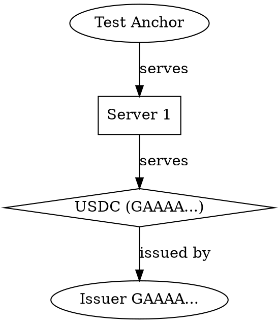

# stellar-toml-lint

Validate a Stellar Info File (`stellar.toml`) against **[SEP-1]** — offline, before you deploy it.

[](https://github.com/anchor-tools/stellar-toml-lint/actions/workflows/ci.yml)
[](https://www.npmjs.com/package/stellar-toml-lint)
[](./LICENSE)

Documentation website: [stellar-toml-lint docs](https://anchor-tools.github.io/stellar-toml-lint/)

```console
$ npx stellar-toml-lint public/.well-known/stellar.toml

public/.well-known/stellar.toml
  12:1      error    NETWORK_PASSPHRASE has stray whitespace; it must match the Public passphrase byte for byte  network/passphrase
            ↳ Replace it with exactly: Public Global Stellar Network ; September 2015
  31:1      error    CURRENCIES[0].issuer is not a valid Stellar account ID  currencies/issuer-or-contract
            ↳ Check for a transcription error — the checksum does not match.
  34:1      error    CURRENCIES[0] sets fixed_number and is_unlimited, but these issuance policies are mutually exclusive  currencies/issuance-exclusive
            ↳ SEP-1 requires exactly one of fixed_number, max_number, or is_unlimited.
  19:1      warning  DOCUMENTATION.ORG_PHONE_NUMBER is not in E.164 format  documentation/phone-e164
            ↳ Use a leading + and digits only, e.g. "+14155552671".

  4 problems (3 errors, 1 warning, 0 infos)
```

## Why this exists

The official [`@stellar/anchor-tests`][anchor-tests] suite is thorough, but it tests a **live
domain**. That means you find out your info file is broken _after_ you have shipped it — and you
cannot run it in the pull request that introduced the mistake.

`stellar-toml-lint` reads a local file. It runs in a pre-commit hook, in CI, or on your laptop before
a domain exists at all. It is complementary to `anchor-tests`, not a replacement: this catches
everything checkable from the file itself, then hands off to `anchor-tests` for the parts that need
running services.

|                                 | `stellar-toml-lint` | `@stellar/anchor-tests` |
| ------------------------------- | ------------------- | ----------------------- |
| Lints a local file              | ✅                  | ❌                      |
| Needs a deployed domain         | ❌                  | ✅                      |
| Line and column for each fault  | ✅                  | ❌                      |
| Validates key checksums         | ✅                  | partial                 |
| SARIF / code scanning output    | ✅                  | ❌                      |
| Tests live SEP-6/10/24/31 flows | ❌                  | ✅                      |

Because it validates Stellar keys with `@stellar/stellar-base`, it verifies the **CRC16 checksum** —
so a single transposed character in an issuer address is caught, which a `/^G[A-Z2-7]{55}$/` regex
would wave straight through.

## Install

```bash
npm install --save-dev stellar-toml-lint   # project dependency
npx stellar-toml-lint                      # or just run it
```

### Homebrew

```bash
brew install anchor-tools/tap/stellar-toml-lint
```

Homebrew installs a self-contained binary; Node.js is not required at runtime.

### Standalone binaries

Download the asset for your platform from the [GitHub Releases](https://github.com/anchor-tools/stellar-toml-lint/releases) page, verify it against `SHA256SUMS.txt`, and place it on your `PATH`:

```bash
curl -fLO https://github.com/anchor-tools/stellar-toml-lint/releases/latest/download/stellar-toml-lint-linux-x64
curl -fLO https://github.com/anchor-tools/stellar-toml-lint/releases/latest/download/SHA256SUMS.txt
sha256sum --check --ignore-missing SHA256SUMS.txt
chmod +x stellar-toml-lint-linux-x64
sudo install -m 0755 stellar-toml-lint-linux-x64 /usr/local/bin/stellar-toml-lint
```

Assets are published for Linux x64 (glibc and musl), Linux ARM64, macOS Intel, macOS Apple Silicon, and Windows x64. These binaries have no Node.js runtime dependency. The npm package remains available for Node.js 20+ users. Runtime dependencies for the npm package are `smol-toml`, `@stellar/stellar-base`, and `openpgp`; the pure-JS `@noble/curves` and `@noble/hashes` are installed transitively by `@stellar/stellar-base`.

Releases are generated from Conventional Commits on `main`: `fix:` creates a patch release, `feat:` creates a minor release, and `BREAKING CHANGE:` creates a major release. The release workflow updates the npm and VS Code versions, changelog, GitHub release, and npm provenance.
Commit a `.stellartomlrc.json` next to your `stellar.toml` to record the project's rule policy once
instead of repeating `--off`/`--warn` flags in every workflow (see [Usage](#usage)).

## Usage

```bash
# Lint a local file (defaults to ./stellar.toml)
stellar-toml-lint public/.well-known/stellar.toml

# Fetch and lint a live site, including CORS and content-type checks
stellar-toml-lint --domain example.com

# Lint a local file *as if* served from a domain, enabling same-domain checks
stellar-toml-lint public/.well-known/stellar.toml --domain example.com

# Read from stdin
cat stellar.toml | stellar-toml-lint -
```

Rule policy discovered from a config file needs no flags at all:

```bash
stellar-toml-lint   # honours .stellartomlrc.json found upward from ./stellar.toml
```

Patterns support `*`, `?`, `[...]`, and `**` across directories, and are expanded by the linter
rather than by the shell — so the same quoted argument works in bash, PowerShell, and CMD, where
whether the shell expands the pattern (or fails to) otherwise decides whether the run starts at
all. A pattern that matches nothing names itself and exits `2`. Hidden files and directories are
left alone unless the pattern names them, so `**` cannot walk `.git`.

Several files keep their own report, and the run closes with a single summary line:

```console
$ stellar-toml-lint "accounts/*/stellar.toml"
accounts/acme/stellar.toml
  No SEP-1 issues found.
accounts/globex/stellar.toml
  12:1      error    ...

Checked 4 files: 3 passed, 1 failed (2 errors, 3 warnings)
```

The exit code is `1` when any file fails and `0` when they all pass. The summary is appended by the
`text` reporter only, so `-f json`, `-f sarif`, and `-f junit` output stays exactly as parseable as
it was before.

### Clawback audit trail

`stellar-toml-lint audit-clawbacks --asset <code:issuer> [--horizon <url>] [--format json|markdown]`
reads the issuer's `clawback` and `clawback_claimable_balance` operations from Horizon, checks that
each transaction memo carries an audit reference (a URL, a 64-hex hash, a hash memo, or a
`LEGAL:`/`ORDER:`/`CASE:`/`AUDIT:` reference), and prints a Markdown (default) or JSON report with
exact 7-decimal amounts. It exits 1 when any clawback lacks a reference. Claimable-balance
clawbacks carry no amount on the operation, so their amount is reported as `n/a`.

### Cross-chain bridge and reserve verifiers

Anchors whose Stellar assets are backed or bridged from other chains can declare that backing in
`stellar.toml` and have it checked. Declarations are validated offline; the chains and Horizon are
only queried with `--check-network`. RPC errors and rate limits (retried once) become warnings, and
all amounts are compared as exact integers across decimal scales.

```toml
[DOCUMENTATION.PROOF_OF_RESERVES]
CHAINLINK_FEEDS = [
  { asset = "USDX", chain = "ethereum", aggregator = "0x...", heartbeat = 86400 },
]

[[CURRENCIES]]
code = "USDS"
issuer = "G..."
solana_bridge = { spl_mint = "EPjF...", escrow_program = "worm...", escrow_token_account = "..." }
collateral_vaults = [
  { chain = "base", vault = "0x...", shares = "1000000", share_price = "1.04", tolerance_bps = 50 },
]
```

- `--verify-por-feed` (or `verify-por-feed --domain <domain>`) reads `latestRoundData()` from each
  Chainlink Proof of Reserve aggregator, requires a complete round updated within its heartbeat (at
  most 24 hours), and checks the reserve covers the Stellar supply, reporting the collateralization
  ratio. Feeds can also be declared per currency as `chainlink_por = { chain, aggregator }`.
- `--verify-solana-bridge` (or `verify-solana-bridge --domain <domain>`) confirms the escrow is an
  SPL token account for `spl_mint`, reads its balance with `getTokenAccountBalance`, and enforces
  `locked on Solana >= minted on Stellar` with exact 9-to-7 decimal normalization.
- `--audit-erc4626-vaults` calls `asset()`, `totalAssets()` and `convertToAssets()` on each vault,
  flags held shares worth more than `totalAssets()`, share prices below par or drifting from the
  declared `share_price`, and vault NAV that does not cover the Stellar supply.
- `stellar-toml-lint audit-wormhole-vaa --vaa <hex|base64> [--guardian-set <file.json>]
[--format text|json]` parses a Wormhole VAA with bounds-checked slices, decodes token transfer
  payloads, recovers every guardian signature (secp256k1, Keccak-256, no native dependencies) and
  requires a two-thirds quorum of the guardian set (`{ "index": 4, "keys": ["0x..."] }`). It exits 1
  on any error.

### TLS cipher audit

`stellar-toml-lint audit-ciphers --domain <domain> [--port <n>]` handshakes with each of TLS 1.0,
1.1, 1.2 and 1.3, requires the legacy versions to be rejected, checks the negotiated suites for
forward secrecy and AEAD and prints an A+, A, B or F grade. It exits 1 on grade F.

### HSTS and bridge audit options

| Flag                      | Effect                                                                                                                                     |
| ------------------------- | ------------------------------------------------------------------------------------------------------------------------------------------ |
| `--audit-hsts`            | Check `Strict-Transport-Security` on the domain and declared hosts against the Chromium preload criteria (use with `--domain`)             |
| `--audit-emergency-pause` | Verify `[[BRIDGES]]` export pause methods, restrict pause authority and publish a 24/7 security contact                                    |
| `--audit-bridge-quorum`   | Verify `[[BRIDGES]]` relayer thresholds meet the 2/3 BFT supermajority and staking evidence (also `audit-bridge-quorum --domain <domain>`) |

`stellar-toml-lint refactor <file> [--deduplicate-assets] [--split] [--max-bytes <n>] [--out-dir <dir>]
[--write] [--json]` merges `[[CURRENCIES]]` entries that share a code and issuer, keeping comments and
non-conflicting metadata from every declaration. Conflicting fields keep the first value and are
both recorded in the summary and preserved as `# refactor: conflict` comments. A post-refactor CST
validation checks that no currency or non-conflicting value was lost; the diff is printed for review
and only `--write` changes the file. `--split` instead emits modular partials grouped by table
(`base`, `currencies`, `validators`, …), optionally written to `--out-dir`.

### Bridge evidence audit options

| Flag                              | Effect                                                                                                                                |
| --------------------------------- | ------------------------------------------------------------------------------------------------------------------------------------- |
| `--audit-bridge-replays <file>`   | Match EVM lock event logs to Stellar mints and flag duplicate, unrecorded or replayable events                                        |
| `--verify-attestations`           | Verify reserve attestation checksums and age; with `--check-network` download the PDFs (also `verify-attestations --domain <domain>`) |
| `--audit-burn-redemptions <file>` | Verify wrapped-asset redemptions burn supply and flag pseudo-burns                                                                    |

### Options

| Flag                          | Effect                                                                                                                              |
| ----------------------------- | ----------------------------------------------------------------------------------------------------------------------------------- |
| `-d, --domain <d>`            | Serving domain. Enables CORS, content-type, TLS, and `ORG_URL` checks                                                               |
| `-f, --format <fmt>`          | `text` (default), `json`, `ndjson`, `sarif`, `github`, `junit`, `html`, `checkstyle`, `markdown`                                    |
| `--strict`                    | Treat warnings as errors                                                                                                            |
| `--max-warnings <n>`          | Fail if warnings exceed `n`                                                                                                         |
| `--check-network`             | Verify accounts, CORS pre-flight responses, `HORIZON_URL`, SEP-8 flags, `ANCHOR_QUOTE_SERVER`, and SEP-6 `/info` online             |
| `--verify-sep10`              | Verify SEP-10 nonce uniqueness and replay resistance (requires `--check-network`)                                                   |
| `--audit-quotes`              | Book an ANCHOR_QUOTE_SERVER SEP-38 quote and execute it on TRANSFER_SERVER (requires `--check-network`)                             |
| `--audit-unicode-security`    | Detect bidi overrides, invisible characters, Cyrillic/Greek homoglyphs, and bad language tags in string values                      |
| `--audit-consumer-protection` | Verify `ORG_COMPLAINTS_EMAIL`, `ORG_DISPUTE_RESOLUTION_URL`, `ORG_JURISDICTION`, `ORG_LICENSES` and print a scorecard               |
| `--audit-sep30-recovery`      | Verify `RECOVERY_SERVER` and recovery signing keys; with `--check-network` probe `/accounts/{address}` for unauthenticated recovery |
| `--verify-promotions`         | Compare promotional fee claims with SEP-38 `/price` fees (also `verify-promotions --domain <domain>`)                               |
| `--audit-sep38-spreads`       | Compare SEP-38 indicative and firm quote rates across small, medium and large tiers, and verify quote expiry handling               |
| `--verify-federation-srv`     | Check `_stellar-federation._tcp.<domain>` SRV records against `FEDERATION_SERVER` (use with `--domain`)                             |
| `--audit-esg-disclosures`     | Verify `DOCUMENTATION.ORG_ESG` disclosures and attestation signature, and print a sustainability rating                             |
| `--audit-opentelemetry`       | Probe SEP-6, SEP-24, SEP-31 and SEP-38 `/info` endpoints with W3C Trace Context headers and inspect response correlation evidence   |
| `--audit-kyc-fsm`             | Audit SEP-12 customer status state machines for stuck or circular onboarding (use with `--domain`)                                  |
| `--audit-cors`                | Probe every declared endpoint for wildcard-plus-credentials and unvalidated `Origin` CORS policies (OWASP)                          |
| `--audit-asset-security`      | Scan linked logos, images and attestations for Content-Type confusion, missing `nosniff` and SVG script vectors                     |
| `--audit-clickjacking`        | Read `Content-Security-Policy: frame-ancestors` and `X-Frame-Options` on every interactive endpoint                                 |
| `--crawl-peers`               | Discover validator peers with overlay `GET_PEERS` messages (requires `--check-network`)                                             |
| `--verify-dnssec`             | Compare A/AAAA answers across Cloudflare, Google, and Quad9 DoH resolvers (requires `--check-network`)                              |
| `--audit-dns-takeover`        | Query CNAME/NS for every referenced domain and flag dangling pointers to claimable cloud resources                                  |
| `--audit-secrets`             | Halt with exit 1 on leaked Stellar seeds, cloud keys, tokens or PEM blocks; all output is redacted                                  |
| `--audit-ssrf`                | Flag advertised URLs resolving to private, loopback, link-local or multicast IPs, including DNS rebinding                           |
| `--follow-links`              | Fetch and lint the `toml` pointers in `CURRENCIES` (implied by `--domain`)                                                          |
| `--check-contracts`           | Verify Soroban contract/WASM TTL and the SEP-45 auth interface online                                                               |
| `--soroban-rpc <url>`         | Soroban RPC endpoint for `--check-contracts` (defaults from `NETWORK_PASSPHRASE`)                                                   |
| `--mock-fixtures <dir>`       | Serve network checks from recorded JSON fixtures under `<dir>`, never the network                                                   |
| `--webhook-slack <url>`       | POST a Slack Block Kit card with the run summary                                                                                    |
| `--webhook-discord <url>`     | POST a Discord embed with the run summary                                                                                           |
| `--off <rule>`                | Disable a rule (repeatable)                                                                                                         |
| `--error <rule>`              | Raise a rule to error (repeatable)                                                                                                  |
| `--warn <rule>`               | Lower a rule to warning (repeatable)                                                                                                |
| `--preset <name>`             | Start from a role's rule bundle: `validator`, `anchor-sep24`, or `issuer`                                                           |
| `--rules-dir <dir>`           | Load rule plugins from a directory of `.js`/`.mjs`/`.cjs` modules (repeatable)                                                      |
| `--plugin <spec>`             | Load a rule plugin from a module path or an installed package name (repeatable)                                                     |
| `-q, --quiet`                 | Show errors only                                                                                                                    |
| `--show-help-urls`            | Print the spec link for each finding                                                                                                |
| `--list-rules`                | Print every rule and exit                                                                                                           |
| `--completion <shell>`        | Print a `bash`, `zsh`, or `fish` completion script and exit                                                                         |
| `--no-suggestions`            | Hide diagnostic suggestions in the output                                                                                           |
| `--color`                     | Force colour on, overriding `NO_COLOR`                                                                                              |
| `--no-color`                  | Force colour off                                                                                                                    |
| `-w, --watch`                 | Watch files and re-run on changes                                                                                                   |
| `-i, --interactive`           | Full-screen dashboard to walk the findings (falls back to text)                                                                     |
| `--lsp`                       | Run as a Language Server on stdio (diagnostics, quick-fixes, hover)                                                                 |
| `--sort-keys`                 | Rewrite files into canonical SEP-1 key order; a comment moves with the key it annotates                                             |
| `--dry-run`                   | With `--sort-keys`, print the diff instead of writing and exit 1 if a file is not already canonical                                 |
| `--graph <fmt>`               | Generate architecture diagram: `mermaid` or `dot`                                                                                   |
| `--graph-contracts`           | Include Soroban contracts in diagram                                                                                                |
| `--graph-validators`          | Include validators in diagram                                                                                                       |
| `--graph-color`               | Color nodes by protocol type                                                                                                        |
| `--policy <file>`             | Evaluate enterprise policy file (JSON or YAML)                                                                                      |
| `--export-ap-config`          | Export Anchor Platform YAML config to stdout                                                                                        |
| `--generate-openapi <file>`   | Generate an OpenAPI 3.1 spec (json or yaml extension)                                                                               |
| `--badge-svg <file>`          | Generate an SVG compliance badge                                                                                                    |
| `--badge-json <file>`         | Generate a Shields.io JSON endpoint                                                                                                 |
| `--json-schema`               | Print a JSON Schema (Draft 2020-12) for stellar.toml to stdout                                                                      |

Every flag above takes precedence over the [configuration file](#configuration-file), and
`--preset` — being a flag — takes precedence over it too.

### OpenTelemetry trace context audit

Run `stellar-toml-lint --audit-opentelemetry stellar.toml` to probe each declared
`TRANSFER_SERVER` (SEP-6), `TRANSFER_SERVER_SEP0024` (SEP-24),
`DIRECT_PAYMENT_SERVER` (SEP-31), and `ANCHOR_QUOTE_SERVER` (SEP-38). The audit
sends a read-only `GET` to the service's `/info` endpoint with a fresh W3C
Trace Context version `00` `traceparent`. It does not send `tracestate`, since
the linter has no vendor-specific state to propagate.

The report inspects a valid `traceresponse` header or a `Server-Timing` `trace`
metric containing trace context. Either may expose a different trace ID because
a service can legitimately restart a trace. No response echo is required by
W3C Trace Context: when there is no observable correlation metadata, the result
is **unobservable**, not a propagation failure. Malformed or conflicting
metadata is reported as **non-compliant**; unsafe URLs, redirects, timeouts and
network failures are **unreachable**. A valid observed response context is
reported as **compliant** for the observable HTTP exchange.

This is an external trace context and response observability audit, not a full
OpenTelemetry instrumentation test. It cannot prove that context reached
invisible downstream services, that spans were exported, or that the trace ID
belongs to the initiating request when the server starts a new trace. Probe
requests require HTTPS, reject private or local destinations, pin public DNS
answers, do not follow redirects, and discard response bodies after headers.
Only the read-only `/info` endpoint is requested; transactions, quotes and
financial operations are never called.

Exit codes: **0** no errors, **1** problems found, **2** bad usage, an unmatched glob, or I/O
failure.

Colour output follows the [NO_COLOR standard](https://no-color.org): setting `NO_COLOR` to any
non-empty value disables it, an empty value counts as unset, and stdout not being a terminal
disables it too. An explicit `--color` is the only thing that overrides `NO_COLOR`.

### Canonical key order

Anchors edit `stellar.toml` by hand, so the fields land in whatever order the last edit happened to
touch. The next person who adds one currency to a five-currency file produces a diff that moves
half the file, and the reviewer has to read all of it to find the one line that matters.

`--sort-keys` reorders the tables SEP-1 defines a reading order for — `[DOCUMENTATION]`,
`[[PRINCIPALS]]`, `[[CURRENCIES]]`, `[[VALIDATORS]]` — into that order, and sorts `[[CURRENCIES]]`
by `code` and `[[VALIDATORS]]` by `PUBLIC_KEY` so the entries themselves are findable:

```bash
stellar-toml-lint --sort-keys                    # apply
stellar-toml-lint --sort-keys --dry-run          # preview; exit 1 if anything is out of order
stellar-toml-lint --sort-keys --dry-run > keys.diff
cat broken.toml | stellar-toml-lint --sort-keys - # stdin to stdout
```

What it guarantees:

- **It only moves lines.** Nothing is reformatted, re-quoted, or re-rendered, so `issuer = "GABC" #
our account` keeps its trailing comment, its quoting, and its multi-line `"""` value byte for byte.
- **A comment travels with the key under it.** A blank line separates a comment from the key below,
  which makes it floating layout rather than an annotation, and floating whitespace stays where the
  author put it.
- **Fields the spec does not name stay last, in the order written.** The codemod has no opinion
  about `sep38`, so it will not invent one and will not reorder your custom keys against each other.
- **It is idempotent.** A second pass reports no change, which is what makes `--dry-run` usable as a
  CI gate and `--sort-keys` safe in a pre-commit hook.
- **A file that does not parse is left alone** and reported on stderr with exit 1. Fix the syntax
  first; a reorder is not the place to guess at intent.

Two limits worth knowing: the keys above the first table header are left where they are, since
there is no canonical order for the global preamble that everyone agrees on, and an array whose
entries are interrupted by another table is not reordered, because moving it would change which
table its keys belong to.

### Semantic diff

A revised `stellar.toml` is published, and the question is never which lines moved. It is which
field changed, and whether a wallet that read the old one breaks. `diff` parses both documents and
compares the configuration they describe, so a file that was hand-edited, re-indented, or run
through `--sort-keys` diffs as nothing.

```bash
stellar-toml-lint diff live.toml candidate.toml                       # two files
stellar-toml-lint diff https://example.com/.well-known/stellar.toml candidate.toml
cat candidate.toml | stellar-toml-lint diff live.toml -                # one side from stdin
stellar-toml-lint diff live.toml candidate.toml --json > changelog.json
```

Exit codes follow the lint run: **0** when nothing a client depends on changed, **1** when the
target has breaking changes, and **2** when the two sides could not be compared at all — a side that
does not parse, an unreachable URL, or a missing file.

```console
$ stellar-toml-lint diff live.toml candidate.toml
# stellar.toml semantic diff

- **source:** `live.toml` (17 fields)
- **target:** `candidate.toml` (15 fields)

2 added · 4 removed · 7 modified · BREAKING: 6 breaking changes

## Changes

- `ANCHOR_QUOTE_SERVER` BREAKING
  - "https://api.example.com/sep38"
  ! ANCHOR_QUOTE_SERVER is how clients discover SEP-38 quotes; it is now gone
~ `SIGNING_KEY` BREAKING
  - "GCM5YCQPFIW4ICBPPSKACX56ZTGG6KZ7A53JGUWWAFRZW462YFIK4BZS"
  + "GA3TONZXG43TONZXG43TONZXG43TONZXG43TONZXG43TONZXG43TO5MU"
  ! SEP-10 and SEP-45 responses are verified against this key, so clients holding the previous one start rejecting the anchor
- `CURRENCIES[EXPL]` BREAKING
  - {code="EXPL", contract="CACTZSQPCQSSZ5YG3PI3N7WO6JEERKEUHTPILKB4MBANF2K4D2UHKDDU", name="Example Points", … 4 more}
  ! the asset is no longer advertised, so wallets and exchanges stop offering it
```

_Excerpt — the report lists all thirteen changes in document order; these three are one removed
endpoint, one modified field, and one removed entry._

What it guarantees:

- **Entries are paired by identity, not position.** `[[CURRENCIES]]` match on `code` and
  `[[VALIDATORS]]` on `PUBLIC_KEY`, so inserting an asset in the middle of a five-asset file is one
  added line rather than five modifications, and a delisting names the asset it took away.
  `[[PRINCIPALS]]` has no key SEP-1 gives it, so it is compared in order and says so as `#1`, `#2`.
- **Syntax is invisible to it.** Key order inside an entry, spacing around `=`, quoting style,
  comments and blank lines are all layout. `1979-05-27T07:32:00Z` and `1979-05-27T09:32:00+02:00`
  are the same instant, and an entry whose fields were merely re-sorted is not a change.
- **`BREAKING` means a client that read the source stops working.** A rotated `SIGNING_KEY`, a
  currency whose `issuer` or `contract` moved, an endpoint that disappears rather than moves, and an
  asset or validator a client can no longer find. Each one says why in its own terms.
- **An addition is never breaking,** and neither is dropping a field SEP-1 already deprecated —
  clients were told to stop reading `AUTH_SERVER`, so removing it is the cleanup working as intended.
- **Fields outside SEP-1 are reported, not graded.** The differ has no idea what your custom
  `sep38` table means for your integrations, so it will tell you it changed and leave the judgement
  to you.

`--json` writes the same report as a changelog: one `changes` array with `path`, `kind`, `section`,
`category`, `breaking`, `reason`, `before` and `after`, plus the per-side counts — which is what a
release notes job or an anchor's status page consumes.

### Migrating deprecated fields

Anchors keep serving files written against an older SEP: `AUTH_SERVER` still appears where SEP-10
now wants `WEB_AUTH_ENDPOINT`, `FEDERATION_SERVER` still gets published over plain `http://`, and
`ORG_NAME` still turns up at the document root instead of inside `[DOCUMENTATION]`.

`stellar-toml-lint migrate` rewrites those into the current form, in place:

```bash
stellar-toml-lint migrate                              # ./stellar.toml
stellar-toml-lint migrate --dry-run                    # preview; exit 1 if anything still needs work
stellar-toml-lint migrate "well-known/*.toml"          # a glob (quote it)
cat stellar.toml | stellar-toml-lint migrate -         # stdin to stdout
stellar-toml-lint migrate --skip-rule legacy-field-alias
stellar-toml-lint migrate --json                       # the plan, as data
```

Four rules ship, and `migrate --help` prints them from the registry so the help text cannot
advertise a rule that no longer exists:

| Rule id                       | What it does                                                                                                                                  |
| ----------------------------- | --------------------------------------------------------------------------------------------------------------------------------------------- |
| `legacy-field-alias`          | renames a legacy spelling to the field SEP-1 defines, and moves it into that field's table (`ORGANIZATION_NAME` → `[DOCUMENTATION].ORG_NAME`) |
| `deprecated-root-field`       | renames a deprecated root field to its successor (`AUTH_SERVER` → `WEB_AUTH_ENDPOINT`, `DEPOSIT_SERVER` → `TRANSFER_SERVER`)                  |
| `federation-server-scheme`    | rewrites `FEDERATION_SERVER` from `http://` to `https://`, leaving the host, path and quoting alone                                           |
| `documentation-field-at-root` | moves a `[DOCUMENTATION]` field that was written at the document root under `[DOCUMENTATION]`                                                 |

What it guarantees:

- **Your formatting survives.** Rules emit offsets into the original text and the engine splices
  them, so quoting, spacing, blank lines and the comments above a field are never re-rendered.
- **A preview is the write.** `--dry-run` and apply mode run the identical plan; only the
  `writeFile` call differs, and the diff is the same unified format `--sort-keys --dry-run` prints.
- **A worse result is refused, not written.** After applying the plan the engine lints the rewritten
  file and compares it with the lint of the original. If the migration introduced an error, the
  file is left exactly as it was, the reason is printed, and the exit code is 1 — that is the
  rollback, and it is what makes the command safe to point at a directory of live configs.
- **Nothing is invented.** A rename is skipped with a note when the successor is already in the
  file, a deprecation that needs an endpoint no value here can supply (`KYC_SERVER` for SEP-12) is
  reported instead of guessed, and two rules that reach for overlapping text cancel that edit rather
  than picking an order.
- **It is idempotent, and a clean file exits 0.** A file with nothing to migrate prints
  `No deprecated fields to migrate.` and changes nothing, which is what lets `migrate --dry-run` sit
  in CI.

### Orphaned keys and dead tables

`stellar-toml-lint --detect-orphans` reports the keys and table headers in a file that configure
nothing any SEP defines, and exits 1 when a file has any:

```bash
stellar-toml-lint --detect-orphans                          # report
stellar-toml-lint --detect-orphans --format json
stellar-toml-lint --prune-orphaned --dry-run                # preview the rewrite
stellar-toml-lint --prune-orphaned                          # apply it
stellar-toml-lint --detect-orphans --allow-key 'X_ACME_*'   # bless a vendor section
```

Because it reads the concrete syntax tree rather than the parsed value model, it sees the things a
value-scoped linter cannot: `[[CURRENCY]]` (one letter short, and the whole block below it
silently configures nothing) and a `[DOCUMENTATION]` field parked at the root. The recognized
catalog is read from `src/spec.ts`, so a field added to the spec is recognized by the scanner, the
schema and autocompletion in the same commit.

Findings are `warning`s under the `general/unknown-key` and `general/unknown-table` rule ids, so
they follow `--strict` and `--format` like any other diagnostic. The false-positive discipline is
the point of the check:

- Nothing under an unrecognized table is reported — the table itself is reported once, instead of
  twelve keys saying the same thing.
- Vendor extensions (`X_…` by default) are accepted before any comparison.
- `--allow-key` takes an exact name, a dotted path (`DOCUMENTATION.ORG_NAME`), a table name, or a
  `PREFIX_*` glob; the `knownKeys` array in `.stellartomlrc.json` holds the same names, and flags
  join on top of it rather than replacing it.
- A "did you mean" hint only appears when the spelling is a near-miss at the same distance
  threshold the preset typo hints use; a legacy spelling is reported as a `migrate` move, not a
  deletion.

Pruning splits by whether the intent is known. A near-miss is a misspelling, so it is renamed in
place; an unrecognized name with no near match is removed, with the comments attached to it; and an
unrecognized table that has entries is never deleted wholesale — that is a data-loss decision, not
a cleanup, so it stays with a warning.

### Rule presets

Nobody is all of the ecosystem at once. A validator operator publishes `[[VALIDATORS]]` and little
else; a standalone issuer publishes `[[CURRENCIES]]` and `[DOCUMENTATION]` and runs no servers; a
SEP-24 anchor publishes service endpoints and the currencies they transfer. The default rule set
assumes the union of all three, so each role silences the rest — normally with a long `--off` chain
copied into every workflow, Makefile, and pre-commit hook, each copy drifting a little further from
the last.

`--preset` is that chain, written once and reviewed as a unit:

- **`validator`** — for node operators. `[[VALIDATORS]]` and the general file checks stay on; the
  currency issuance and anchor service rules are off. Two validators sharing a `HOST` or an `ALIAS`
  fails the build, because that is a quorum bug rather than a style note.
- **`anchor-sep24`** — for hosted anchors. SEP-24, SEP-10, and currency requirements at `error`: a
  `TRANSFER_SERVER` with no `[[CURRENCIES]]`, a half-declared SEP-45 pair, an anchored asset that
  does not say what backs it. Validator rules are off, since an anchor runs no validator nodes.
- **`issuer`** — for asset issuers. Currency, collateral, and documentation completeness at `error`.
  Anchor service rules are off, since a standalone issuer serves nothing.

```bash
# In CI, instead of --off currencies/... --off sep12/... --off sep38/... (x20)
stellar-toml-lint --preset validator public/.well-known/stellar.toml
```

A preset is a **baseline, not a policy**: an explicit `--off`, `--warn`, or `--error` on the same
command line still wins, whatever order the flags appear in, so the one-off deviation never needs a
new preset.

```bash
# The bundle says a duplicate validator host is an error; this run disagrees.
stellar-toml-lint --preset validator --warn validators/duplicate-host stellar.toml
```

An unknown name lists the available presets and exits `2`:

```console
$ stellar-toml-lint --preset valdator stellar.toml
Unknown preset "valdator". Available presets:
  validator     Validator operator: validator and general file checks, no anchor or currency rules
  anchor-sep24  SEP-24 anchor: SEP-24, SEP-10, and currency requirements at error
  issuer        Asset issuer: currency, collateral, and documentation completeness at error
Did you mean: validator?
```

### Configuration file

A `.stellartomlrc.json` next to your `stellar.toml` records the project's rule policy once, instead of
repeating `--off`/`--warn` flags in every workflow. It is discovered by walking up from the linted
file's directory (from the current directory for stdin and `--domain`), stopping at the filesystem
root, so a repository-level file covers everything beneath it.

```json
{
  "rules": {
    "general/unknown-field": "off",
    "currencies/regulated-missing-auth-revocable-flag": "error"
  },
  "strict": true,
  "maxWarnings": 10
}
```

`rules` maps rule ids to `off`, `error`, `warning`, or `info`; `strict` and `maxWarnings` mirror
`--strict` and `--max-warnings`. CLI flags always override the file, and so does `--preset`. A
malformed file, an unknown top-level field, or an unknown rule id exits `2` — a config that is
silently ignored is worse than one that fails, because the team believes the policy is recorded. A
[rule plugin's](#rule-plugins) id counts as a rule id here, so a third-party check is tuned in this
file like a built-in one; that is why `--rules-dir` and `--plugin` are read before the config is
validated.

### Rule plugins

Checks your team needs that SEP-1 does not define go in a JavaScript module, named on the command
line. `--rules-dir <dir>` loads every `.js`, `.mjs`, or `.cjs` module directly inside a directory
(sorted by name), and `--plugin <spec>` loads one module by path or by installed package name. Both
are repeatable, and both are the only way a plugin is ever loaded: nothing is discovered from
`node_modules`, and nothing is autoloaded from a directory beside `stellar.toml`, because a rule
module is arbitrary code that runs with this process's permissions.

```js
// rules/attestation-required.mjs
export default {
  id: 'acme/attestation-required',
  category: 'currencies',
  severity: 'error',
  description: 'Fiat assets must publish an attestation of reserve.',

  create({ report }) {
    return {
      visitCurrency(node) {
        if (
          node.values.anchor_asset_type === 'fiat' &&
          node.values.attestation_of_reserve === undefined
        ) {
          report({
            message: `${node.code} is live without an attestation of reserve`,
            path: node.path,
            position: node.position,
            suggestion: 'Add attestation_of_reserve, as SEP-1 requires of regulated assets.',
          });
        }
      },
    };
  },
};
```

```console
$ stellar-toml-lint stellar.toml --rules-dir ./rules
Loaded 1 plugin rule(s): acme/attestation-required

stellar.toml
  62:1      error    EXPL is live without an attestation of reserve  acme/attestation-required
            ↳ Add attestation_of_reserve, as SEP-1 requires of regulated assets.

  1 problem (1 error, 0 warnings, 0 infos)
```

A module exports one rule as its `default`, a list of rules as `rules`, or both. The `id` is
`<namespace>/<name>` in lower kebab-case, and the namespace is yours: `--off`, `--warn`, `--error`
and the configuration file address a plugin exactly as they address a built-in rule, so
`--off acme/attestation-required` above silences it. `category` is one of the diagnostic categories
the [Programmatic API](#programmatic-api) lists, which is what lets the SARIF, JUnit and HTML
reporters group a plugin's findings with the catalog's instead of beside them.

The document is walked once for the whole set of rules, and a rule implements only the node kinds it
cares about:

| Node      | Hooks                             | Fires for                                                                           |
| --------- | --------------------------------- | ----------------------------------------------------------------------------------- |
| document  | `visitDocument` / `leaveDocument` | the file's root, once per run                                                       |
| table     | `visitTable` / `leaveTable`       | a `[DOCUMENTATION]` section, one `[[VALIDATORS]]` entry, or an inline `{ ... }`     |
| currency  | `visitCurrency` / `leaveCurrency` | one `[[CURRENCIES]]` entry, with `code`, `issuer`, `contract` and `status` read off |
| key-value | `visitKeyValue` / `leaveKeyValue` | any key that is not a table, including a list of strings                            |

Every node carries `path` in the dotted notation diagnostics use (`CURRENCIES[1].issuer`), `name`,
and `position` when the run had a file to locate it in. `create` runs once per lint call and may
close over state, so a rule can accumulate across a table's keys and summarise in its `leave` hook
without leaking into the next file. The enter hook fires before the node's children and the leave
hook after them.

Two kinds of failure, treated differently on purpose:

- A source that cannot be read, or a module exporting something rule-shaped but invalid — a missing
  `category`, an `id` a built-in rule or another plugin already owns — stops the run with exit `2`
  and says which source was at fault. A silently ignored rule is a check the team believes it has
  and does not.
- A rule that throws _while running_ is contained. The other rules keep going, the run keeps the
  verdict the remaining findings give, and the failure collapses into one
  `internal/plugin-error` warning naming the rule and the number of nodes it failed on, so a buggy
  plugin cannot bury the file or the pipeline.

Overhead is what decides whether a hundred rules is a sane thing to ask a CI job to run. A hundred
and twenty rules over a file with a hundred assets and a hundred validators — larger than any
deployed `stellar.toml` we have seen — cost a median 2.2ms per run on a laptop core, against a 10ms
budget `npm run bench` gates on. The same set over ten times as much file costs 19ms, which the same
run prints without gating so the shape of the curve is visible. The numbers follow from the design:
the rules share one traversal, and every node kind keeps its own list of the rules that asked for it,
so a rule costs one call per node it listens for and nothing for the rest.

One place does not see them: `--lsp` runs the catalog with no run options, so plugin rules do not
appear in editor diagnostics yet, the same way a `.stellartomlrc.json` does not.

### Walking the findings in a terminal

```console
$ stellar-toml-lint public/.well-known/stellar.toml --interactive
```

A full-screen view for runs with more findings than fit on one screen: `j`/`k` or the arrow keys
move, `Enter` opens the details panel (message, suggestion, spec link), `s` cycles the severity
filter, `/` searches rule names, `f` asks for a fix, `q` quits.

It is deliberately quiet about where it cannot work. If stdout is not a terminal — a pipe, a CI log,
a redirected file — the text reporter is used instead, so nothing ever sprays box-drawing characters
into a build log. Combining `--interactive` with `--format` is refused for the same reason the flag
draws its own view: drop the format flag.

`--quiet` opens it already filtered to errors, which is the same view the text reporter gives with that flag.

`f` currently reports that no fix engine is wired up; #9 tracks the mechanical fixes it will call
into, and the dashboard already routes the keystroke through a callback so that lands as a one-line
change rather than a rewrite.

### Shell completion

`--completion <shell>` prints a script that teaches bash, zsh, or fish how to complete the linter's
flags, its output formats, and the rule ids accepted by `--off`/`--warn`/`--error`. The rule ids are
read from the same registry the linter runs, so they never drift.

```bash
# bash: append once, then restart the shell
echo 'eval "$(stellar-toml-lint --completion bash)"' >> ~/.bashrc

# zsh
echo 'eval "$(stellar-toml-lint --completion zsh)"' >> ~/.zshrc

# fish
stellar-toml-lint --completion fish > ~/.config/fish/completions/stellar-toml-lint.fish
```

An unsupported shell name is a usage error: it prints to stderr and exits `2`.

### Editor integration (LSP)

```console
$ stellar-toml-lint --lsp
```

Speaks the Language Server Protocol on stdio so editors can show live diagnostics and offer
quick-fix code actions for mechanically safe findings (strip a trailing slash from an endpoint,
normalize a near-miss `NETWORK_PASSPHRASE`, reduce a social URL to a bare handle, format a phone
number as E.164). Unfixable parse errors never produce a code action. Point your editor's LSP
client at the `stellar-toml-lint` binary with `--lsp`.

Hovering a key or a table header shows the SEP-1 documentation for what is under the cursor: the
qualified name (`[[CURRENCIES]].display_decimals`), its type (`integer (0-7)`), the specification's
own description, the permitted values where SEP-1 enumerates them (`live`, `dead`, `test`,
`private`), and a link to the section of SEP-1 that defines the field. Hovering whitespace, a
comment, or a key SEP-1 does not define shows nothing at all.

Hovering a line that names a Soroban contract (`[[CURRENCIES]].contract`, `WEB_AUTH_CONTRACT_ID`,
or a `contract_id` key) can also show the contract's custom errors: every `#[contracterror]` enum
in the deployed WASM's `contractspecv0` section, as a Markdown table of integer codes, case names,
and doc comments, so `Error(Contract, #7)` is readable without opening the Rust source. This
needs the Soroban RPC, so like `--check-contracts` it is off unless the editor opts in through
`initializationOptions`:

```json
{ "checkContracts": true, "sorobanRpc": "https://soroban-testnet.stellar.org" }
```

`sorobanRpc` is optional; without it the endpoint is derived from the file's
`NETWORK_PASSPHRASE`. Each contract is fetched once per session and cached. An unreachable RPC,
an archived contract, or a module without a spec leaves the SEP-1 hover unchanged.

### Tree-sitter grammar

Underneath the LSP sits a tree-sitter grammar for `stellar.toml`, in
[`grammars/tree-sitter-stellar-toml`](grammars/tree-sitter-stellar-toml/README.md). It is a TOML 1.0
grammar plus concrete nodes for the five things an anchor file is made of — `public_key`,
`contract_id`, `asset_code`, `sep_table` and `currency_entry` — so a highlighter, a fold, or a
symbol list can name a Stellar account instead of pattern-matching one out of a string. It ships
with `highlights.scm`, `folds.scm` and `tags.scm`, a Node binding, a WASM entry point, and a parse
corpus that includes a full production anchor.

Install instructions for **Neovim** (0.10+, no plugin required) and **Helix** (`[[grammar]]` +
`hx --grammar build`), and the `tree-sitter generate / test / build --wasm` procedure, are in
[the grammar's README](grammars/tree-sitter-stellar-toml/README.md). The grammar validates shapes,
not checksums: a key with a broken CRC16 still highlights, and `stellar-toml-lint` is what reports
it.

### Monaco and CodeMirror language bundles

The web editors get the same language features as the terminal, as two small ESM bundles built by
`npm run build:editor` (esbuild, `format: 'esm'`, `target: 'es2022'`, minified, with source maps):

| Import                                | Bundle                             | gzipped |
| ------------------------------------- | ---------------------------------- | ------- |
| `stellar-toml-lint/editor/monaco`     | `dist/editor/monaco.bundle.js`     | 8.1 KB  |
| `stellar-toml-lint/editor/codemirror` | `dist/editor/codemirror.bundle.js` | 7.1 KB  |

The budget is 150 KB per bundle and the build fails when a bundle overshoots it, so the numbers
above are the gate's output, not a promise. Neither bundle imports `monaco-editor` or CodeMirror:
each declares the slice of the host API it uses structurally, which is why a page can load its
editor from a CDN, from AMD, or from `@monaco-editor/react` and pass whichever instance it has.
Neither bundle contains the linter core — that one gzips to ~146 KB on its own — so findings arrive
from outside, pushed in by the page or pulled through the existing worker protocol.

```ts
import * as monaco from 'monaco-editor';
import { register, createWorkerValidator } from 'stellar-toml-lint/editor/monaco';

const worker = new Worker(new URL('stellar-toml-lint/worker', import.meta.url), { type: 'module' });
const bundle = register(monaco, { validator: createWorkerValidator(worker) });
bundle.observe(model); // markers land in monaco.editor.setModelMarkers as you type
```

```ts
import { StreamLanguage } from '@codemirror/language';
import { linter } from '@codemirror/lint';
import { lintBrowser } from 'stellar-toml-lint/browser';
import {
  stellarTomlStreamParser,
  toCodeMirrorDiagnostics,
} from 'stellar-toml-lint/editor/codemirror';

const language = StreamLanguage.define(stellarTomlStreamParser);
const check = linter(async (view) => {
  const content = view.state.doc.toString();
  return toCodeMirrorDiagnostics(await lintBrowser(content), content);
});
```

Both tokenise from one shared catalog in `src/editor/language.ts`, so the same key is the same
_thing_ in either editor even though the two hosts name their tags differently: a SEP-1 field is
`propertyName.sep` for CodeMirror and `identifier.key.sep` for Monaco, a SEP table header is
`keyword.sep` and `keyword.table.sep`, and a Stellar primitive in a quoted value is `string.stellar`
in both — Monaco appends the kind, `string.stellar.account-id` or `string.stellar.asset-code`.
Completions come from the same SEP-1 catalog the CLI uses
(`completionsFor(content, lineNumber, column)` for CodeMirror, a registered provider for Monaco),
and both map the core's three severities onto the host's without inventing a fourth.

[`test/fixtures/editor-demo.html`](test/fixtures/editor-demo.html) is the reference page — it
imports the built bundles directly, needs no build step, and shows markers, completions, and the
worker validator together.

### Alerting a Slack or Discord channel

```console
$ stellar-toml-lint public/.well-known/stellar.toml \
    --webhook-slack "$SLACK_WEBHOOK" \
    --webhook-discord "$DISCORD_WEBHOOK"
```

One `POST` per channel summarises the whole run: a colour bar that follows the worst severity found
(red for errors, yellow for warnings only, green when clean), the error and warning counts, the most
frequent rules with a line number each, and links into SEP-1. Slack gets a Block Kit card with spec
buttons; Discord gets a Rich Embed with the links inline.

Delivery retries network errors, timeouts and 408/425/429/5xx twice with a 250 ms backoff, and every
request is capped at 5 s. A 4xx is not retried, because a rejected payload will not fix itself. The
exit code always follows the diagnostics and never the webhook: when delivery fails the problem is
reported on stderr and the verdict is unchanged, so a broken alert endpoint cannot turn a clean file
into a failing build.

## In the browser

The linter itself is free of Node built-ins, so it also runs in a page or a worker under dedicated browser packages and bundles:

```ts
import { createVirtualFileSystem, lintBrowserFile } from 'stellar-toml-lint/browser';

const files = createVirtualFileSystem({ 'stellar.toml': textareaValue });
const result = await lintBrowserFile('stellar.toml', { files });
```

### Browser API & Bundles

- `lintBrowser(content, options)` — lint a string asynchronously.
- `lintBrowserFile(path, { files })` and `lintBrowserRun(paths, { files })` — lint out of an in-memory virtual file system (`createVirtualFileSystem`), replacing `node:fs`.
- `lintBrowserDomain(domain, { fetchImpl })` — fetch `/.well-known/stellar.toml` with the page's standard `globalThis.fetch`. CORS applies exactly as it does to a wallet, so a host without `Access-Control-Allow-Origin: *` produces the same `network/cors` finding.

Pre-bundled minified outputs are compiled to `dist/browser/`:

- `dist/browser/stellar-toml-lint.esm.min.js` (`index.js`): ESM bundle for bundlers, Vite, and ES module imports.
- `dist/browser/stellar-toml-lint.umd.min.js` (`index.umd.js`): UMD/IIFE bundle for direct browser script tags, exposing `window.stellarTomlLint`.
- `dist/browser/stellar-toml-lint.worker.min.js` (`worker.js`): Dedicated Web Worker script.

```html
<!-- Direct script tag usage -->
<script src="dist/browser/stellar-toml-lint.umd.min.js"></script>
<script>
  stellarTomlLint.lintBrowser('VERSION="2.0.0"\n').then((result) => {
    console.log('Valid:', result.ok, result.counts);
  });
</script>
```

### Web Worker

A worker wrapper is published as `stellar-toml-lint/worker` (and `dist/browser/worker.js`). Send `{ type: 'lint', content, options }` and get back `{ type: 'result', result }`, or `{ type: 'error', message }` when the request itself was malformed — the handler answers errors rather than throwing, because a worker that throws loses the request silently. `{ type: 'ping' }` lets a page check the worker is alive before a long run.

```ts
const worker = new Worker(new URL('stellar-toml-lint/worker', import.meta.url));
worker.onmessage = (e) => console.log('Lint result:', e.data.result);
worker.postMessage({ type: 'lint', content: tomlString });
```

### Capabilities & Typings

One capability does not survive the move: a page cannot observe a TLS session, so the `security/*` audit is skipped in the browser and reported as not observed rather than guessed. `browserCapabilities` says the same thing at runtime, for callers that branch on it.

Both entry points ship their own TypeScript declarations (`dist/browser.d.ts`, `dist/worker.d.ts`), and build tests verify static import boundaries and execution in browser sandbox environments.

To build the browser bundles:

```bash
npm run build:browser
```

## In CI

### GitHub Action

```yaml
- uses: anchor-tools/stellar-toml-lint@v1
  with:
    file: public/.well-known/stellar.toml
    strict: true
```

Findings appear as inline annotations on the pull request diff.

To route them into the Security tab instead:

```yaml
- uses: anchor-tools/stellar-toml-lint@v1
  with:
    file: public/.well-known/stellar.toml
    sarif-file: stellar-toml.sarif
  continue-on-error: true

- uses: github/codeql-action/upload-sarif@v3
  with:
    sarif_file: stellar-toml.sarif
```

### Multi-environment matrix workflow

Anchors that publish one `stellar.toml` per tenant (development, staging,
testnet, production) can generate a complete workflow instead of writing one:

```sh
stellar-toml-lint init-ci --matrix testnet,public
# writes .github/workflows/stellar-toml-lint-matrix.yml
```

By default it validates `environments/<env>/stellar.toml`. Change that with
`--file-pattern 'tenants/{environment}/.well-known/stellar.toml'`, or override
one tenant with `--file public=public/.well-known/stellar.toml`. Each cell of
the environment × Node.js matrix (`--node 20,22` by default):

- lints the tenant's file. On `testnet` and `public` it also runs
  `--check-network` (link reachability, TLS, Horizon). Force it on or off with
  `--check-network` / `--no-check-network`.
- **checks network isolation**: the file's `NETWORK_PASSPHRASE` and well-known
  `HORIZON_URL` must belong to that environment's network, and the production
  file must not point at `localhost`, private IPs or `staging`/`dev`/`qa` hosts.
  These findings use `ci/*` rule ids.
- uploads **SARIF** to code scanning under the `stellar-toml-lint/<env>`
  category, so each tenant's alerts stay separate.
- caches the tool install and fetched **remote assets** (logos, JSON schemas,
  IPFS content) with `actions/cache`, so warm runs finish in seconds.

A final job posts one **scorecard comment** on the pull request: a per-environment
table with a 0–100 score, counts, and network-isolation status. It edits that
comment in place on later pushes instead of adding new ones.

The generated workflow follows GitHub's hardening guidance:

- every action is pinned to a full commit SHA, with a version comment Dependabot
  can bump;
- the default token has `permissions: {}`, and each job grants only the scopes
  it needs;
- checkout uses `persist-credentials: false`, and the tool installs with
  `--ignore-scripts`;
- matrix and event values reach scripts only through `env`;
- the commenting job never checks out PR code;
- fork PRs skip the steps that need a write token.

`--no-sarif`, `--no-pr-comment`, `--no-cache` and `--strict` adjust it, and
`--stdout` prints the workflow instead of writing it. The building blocks are
also commands:

- `ci-report` turns one cell's linter JSON into SARIF, a markdown fragment and a
  JSON report.
- `ci-scorecard` combines those reports into the comment.

Setting `STELLAR_TOML_LINT_ASSET_CACHE=<dir>` enables the asset cache for any
run.

### Azure DevOps

Copy [`templates/azure-pipelines.yml`](templates/azure-pipelines.yml) into your repository and
reference it as a steps template:

```yaml
# azure-pipelines.yml
steps:
  - template: templates/azure-pipelines.yml
    parameters:
      stellarTomlPath: public/.well-known/stellar.toml
      strict: true
      publishTestResults: true
```

| Parameter            | Default                    | Effect                                                                                                              |
| -------------------- | -------------------------- | ------------------------------------------------------------------------------------------------------------------- |
| `stellarTomlPath`    | `stellar.toml`             | File to lint.                                                                                                       |
| `format`             | `text`                     | Output format: `text`, `json`, `sarif`, `github`, or `junit`.                                                       |
| `strict`             | `false`                    | Treat warnings as errors.                                                                                           |
| `args`               | `''`                       | Extra space-separated CLI flags appended verbatim.                                                                  |
| `nodeVersion`        | `20.x`                     | Node installed by `NodeTool@0` when running via `npx`.                                                              |
| `containerImage`     | `''`                       | Run the published `ghcr.io/anchor-tools/stellar-toml-lint` container instead of `npx`.                              |
| `publishTestResults` | `false`                    | Switch to `--format junit` and publish the report with `PublishTestResults@2`, so the run appears in the Tests tab. |
| `resultsFile`        | `stellar-toml-results.xml` | Where the JUnit report is written when `publishTestResults` is set.                                                 |

The template installs a Node.js 18+ toolchain (or pulls the container image), runs the linter,
and, when `publishTestResults` is set, publishes the JUnit report.

### Bitbucket Pipelines

Bitbucket has no cross-file include for step definitions, so copy the `definitions.steps` block
from [`templates/bitbucket-pipelines.yml`](templates/bitbucket-pipelines.yml) into your
`bitbucket-pipelines.yml` and merge a definition into any pipeline by name:

```yaml
# bitbucket-pipelines.yml
pipelines:
  default:
    - step: *stellar-toml-lint-step
```

Two variants ship in the template:

- `stellar-toml-lint-step` — Node.js 18+ via `npx`, with the `npm` cache enabled so the linter is
  only downloaded once between runs.
- `stellar-toml-lint-container-step` — the published
  `ghcr.io/anchor-tools/stellar-toml-lint` container, whose entrypoint is the linter CLI.

Configure the run with pipeline variables, all optional:

| Variable              | Default        | Effect                                             |
| --------------------- | -------------- | -------------------------------------------------- |
| `STELLAR_TOML_PATH`   | `stellar.toml` | File to lint.                                      |
| `STELLAR_TOML_FORMAT` | `text`         | Output format.                                     |
| `STELLAR_TOML_STRICT` | `false`        | Set to `true` to treat warnings as errors.         |
| `STELLAR_TOML_ARGS`   | `''`           | Extra space-separated CLI flags appended verbatim. |

Both templates are validated by a YAML parser in `test/templates.test.ts`, exercised by the
`test-templates.yml` workflow, so a broken copy-paste template fails CI before it can be merged.

### JUnit XML reports

Jenkins, Bamboo, CircleCI, and Azure DevOps read JUnit XML to draw test pass/fail charts and suite
summaries. `--format junit` emits it for them:

```bash
stellar-toml-lint public/.well-known/stellar.toml --format junit > stellar-toml.xml
```

Each diagnostic becomes a `<testcase>` named after its rule, carrying the message, the suggestion,
the spec link, and the source line. Since only errors fail the run, they are reported as `<failure>`
elements and the warnings and info as `<error>` elements, so a dashboard that counts failures agrees
with the exit code while the softer findings stay visible. Lint one file per report — each run emits
a complete `<testsuites>` document, as the other machine-readable formats do.

### HTML audit reports

For compliance audits, security reviews, and anchor governance, `--format html` writes a
standalone, single-page audit report you can archive, attach to compliance documentation, or host
as a static artifact:

```bash
stellar-toml-lint public/.well-known/stellar.toml --format html > report.html
```

The report is fully self-contained — inlined styles, one small inline script for the severity
filters, zero external scripts or fonts — so it renders from a `file://` URL, an air-gapped
machine, or a static host without touching the network. It includes the file name, timestamp, and
a Pass/Fail badge in the header, the Wallet Readiness grade and score bar, a diagnostic table with
severity filters (All, Errors, Warnings, Info), and expandable suggestion blocks with line/column
code frames and links into SEP-1. Every string from the linted file is HTML-escaped, so a hostile
`stellar.toml` cannot inject markup into the report. As with the other document formats, lint one
file per report.

### Checkstyle XML reports

Jenkins (via the Warnings NG plugin) and other pipelines that ingest the Checkstyle schema read
per-file static-analysis results. `--format checkstyle` emits them:

```bash
stellar-toml-lint public/.well-known/stellar.toml --format checkstyle > stellar-toml-checkstyle.xml
```

Each linted file becomes one `<file>` element and each diagnostic an `<error>` carrying `line`,
`column`, `severity`, `message`, and `source` — the rule id, so a dashboard can group, baseline, or
suppress findings the way it would a Checkstyle check. Severity maps straight across (`error`,
`warning`, `info`). Lint one file per report, as with the other machine-readable formats.

### GitHub step summaries

GitHub Actions renders GitHub-flavored Markdown written to `$GITHUB_STEP_SUMMARY` as a status panel
on the run's overview page. `--format markdown` emits exactly that, because the inline annotations
`--format github` produces are capped at ten per run and scattered across commits:

```yaml
- run: npx stellar-toml-lint public/.well-known/stellar.toml --format markdown >> "$GITHUB_STEP_SUMMARY"
```

The report opens with a pass/fail header and the error, warning, and info counts, then a table with
a row per finding — `Location`, `Severity`, `Rule`, `Message` — and folds the suggestions and spec
links into a collapsible `<details>` block so the summary stays scannable. Table cells and the
header escape `|`, `<`, and `>`, so a hostile `stellar.toml` cannot break the table or inject markup
into the summary.

### Pre-commit

```yaml
# .pre-commit-config.yaml
repos:
  - repo: local
    hooks:
      - id: stellar-toml-lint
        name: Lint stellar.toml
        entry: npx stellar-toml-lint
        language: system
        files: '\.well-known/stellar\.toml$'
```

### Offline and air-gapped CI

Enterprise pipelines run in hermetic sandboxes with no outbound network. `--mock-fixtures <dir>`
replaces the transport every network check uses — `--check-network`, `--check-contracts`, and the
`--domain` fetch — with recorded responses read from `<dir>`, so those checks stay deterministic and
never touch the internet:

```bash
stellar-toml-lint public/.well-known/stellar.toml \
  --check-network --check-contracts \
  --mock-fixtures ./ci/fixtures
```

A request maps onto the fixture tree by host and path: `https://horizon.stellar.org/accounts/GABC...`
is served from `<dir>/horizon.stellar.org/accounts/GABC....json`, with a fallback to the shorter host
label (`<dir>/horizon/accounts/GABC....json`) for trees that drop the TLD. A URL ending in `/` reads
`index.json`, and query strings are ignored — `GET /prices?sell_asset=...` reads
`<dir>/<host>/prices.json`.

Each fixture file holds the response body. Wrap it in an object with a `body` key to also set the
status and headers; a string `body` is served verbatim as text, everything else is JSON-encoded:

```json
{
  "status": 404,
  "headers": { "content-type": "application/json" },
  "body": { "type": "not_found" }
}
```

Fixture mode is strict on purpose: a request with no matching file **fails** with a message naming
the URL and the paths it looked for, instead of quietly falling through to the network. The only I/O
performed is reading files under `<dir>`.

### Monitoring a deployed anchor

```yaml
on:
  schedule:
    - cron: '23 7 * * *'
jobs:
  check:
    runs-on: ubuntu-latest
    steps:
      - uses: anchor-tools/stellar-toml-lint@v1
        with:
          domain: example.com
```

This catches the failure mode nobody notices: a CDN or hosting change quietly dropping the
`Access-Control-Allow-Origin` header, which makes the file unreadable to every browser-based wallet
while looking perfectly fine to `curl`.

### GitOps drift detection

If your stellar.toml lives in Git and a pipeline deploys it, `detect-drift` checks that production
still serves what Git says it should:

```sh
stellar-toml-lint detect-drift --domain example.com --git-path ./site
```

The comparison is semantic: comments, whitespace, key order and `[[CURRENCIES]]` order are ignored,
and currencies are matched by `code`/`issuer`. The command walks the file's Git history to find the
revision that is actually deployed, then sorts every difference into one of three groups:

- **unreleased**: committed to Git but not deployed yet. The unreleased commits are listed; re-run
  the deployment.
- **uncommitted**: changed on production outside Git. Commit the change, or redeploy to revert it.
- **diverged**: changed on both sides, or no Git history was available to tell which side changed.

`--git-path` takes the file itself or a directory containing `.well-known/stellar.toml` or
`stellar.toml`. `--ref` compares a branch or tag other than `HEAD`. `--format diff` prints a
line-level unified diff, and `--format json` prints a structured alert for webhooks. Failures use
the same JSON envelope with `"status": "error"`.

Exit codes for CI: `0` in sync, `1` drift detected, `2` the check could not run (timeout, HTTP
error, missing file, invalid TOML). `--timeout <ms>` defaults to 10000.

### Telemetry and SLA tooling

Four subcommands audit how a live anchor behaves operationally. Every network probe is a
read-only `GET`; none of them creates, updates or deletes anything. Exit codes match the
rest of the CLI: `0` clean, `1` findings, `2` bad usage or I/O failure.

```sh
# Prometheus text 0.0.4 / OpenMetrics 1.0.0 compliance of a /metrics endpoint
stellar-toml-lint verify-metrics --url https://anchor.example/metrics
stellar-toml-lint verify-metrics --domain anchor.example   # finds METRICS_URL etc. in stellar.toml

# p50 / p95 / p99 TTFB, TCP connect and TLS handshake for each SEP server's /info
stellar-toml-lint probe-sla --domain anchor.example --samples 20 --threshold-ms 500

# Invalid read-only requests to each SEP endpoint: are errors RFC 7807 or {"error": "..."}?
# Flags HTML error pages, plain-text errors, and leaked stack traces, secrets or DB URLs.
stellar-toml-lint --audit-error-taxonomy --domain anchor.example

# Availability over 24h / 7d / 30d, incidents and the longest downtime streak
stellar-toml-lint calculate-uptime --log-file health.csv --format markdown \
  --badge-svg uptime.svg --badge-json uptime.json --min-availability 99.9
```

- **`verify-metrics`** streams the scrape through an incremental parser, so very large expositions
  validate in bounded memory. It checks metric and label names, `TYPE` (per standard), missing
  `HELP`/`TYPE`, NaN gauges, negative counters, histogram `le`/`+Inf`/`_sum`/`_count`, `# EOF` for
  OpenMetrics, and the anchor metrics `stellar_anchor_balance`, `stellar_tx_processed_total` and
  `stellar_sep_request_duration_seconds` (override with `--require <name>` or `--no-required-metrics`).
- **`probe-sla`** probes `TRANSFER_SERVER`, `TRANSFER_SERVER_SEP0024`, `DIRECT_PAYMENT_SERVER` and
  `ANCHOR_QUOTE_SERVER` on a fresh connection each time and prints an ASCII TTFB histogram. A p50 or
  p95 above the threshold is an error; a slow p99 tail is a warning.
- **`--audit-error-taxonomy`** sorts every response into `client-input`, `authentication`,
  `authorization`, `not-found`, `conflict`, `rate-limited`, `server`, `unexpected-success` or `other`.
- **`calculate-uptime`** reads JSON arrays, `{ "records": [...] }`, NDJSON or CSV with flexible
  column names (`timestamp`/`time`/`ts`, `status`/`up`/`ok`/HTTP code, optional `service`).
  Availability is time-weighted and truncated, never rounded up, so 99.989% is never reported as
  99.99%.

## Programmatic API

```ts
import { lint, lintDomain, formatText } from 'stellar-toml-lint';
import { readFile } from 'node:fs/promises';

const result = lint(await readFile('stellar.toml', 'utf8'), {
  domain: 'example.com',
  strict: true,
  rules: { 'general/unknown-field': 'off' },
});

// The reporters mirror `--format`: formatText (shown here), formatJson, formatNdjson,
// formatJunit, formatCheckstyle, formatSarif, formatGithub, and formatMarkdown.
if (!result.ok) {
  console.error(formatText(result, { color: true }));
  process.exit(1);
}

// Or check a live site. CORS, content type, size, and the negotiated TLS
// session are checked too.
const live = await lintDomain('example.com');
```

`lintDomain` inspects the TLS session by opening one extra handshake to the host, because Node's
`fetch` does not expose the socket it used. A caller that injects its own `fetch` owns the transport,
so it injects a `tlsProbe` too — otherwise the audit is skipped rather than guessed at:

```ts
const result = await lintDomain('example.com', {}, myFetch, async (host, port) => {
  return { protocol: 'TLSv1.3', cipher: 'TLS_AES_256_GCM_SHA384' };
});
```

Tests and hermetic CI inject recorded responses with the same mechanism that backs `--mock-fixtures`:

```ts
import { createFixtureFetch } from 'stellar-toml-lint';

const result = await lintDomain('example.com', {}, createFixtureFetch('./ci/fixtures'));
```

The [rule presets](#rule-presets) are exported too, so an embedder can hand a role's bundle to
`lint` the same way the CLI does:

```ts
import { lint, PRESETS, resolvePreset } from 'stellar-toml-lint';

// What `--preset issuer` applies...
const bundle = resolvePreset('issuer').rules;
// ...laid under the caller's own overrides, so an explicit severity still wins.
const result = lint(source, { rules: { ...bundle, 'general/version': 'off' } });
```

The engine behind [rule plugins](#rule-plugins) is exported too, so an embedder can run a team's own
checks without the command line:

```ts
import { lint, loadPluginRules, SemanticRuleEngine } from 'stellar-toml-lint';

// The same sources `--rules-dir` and `--plugin` read...
const rules = await loadPluginRules({ dirs: ['./rules'] });

// ...handed to `lint`, where they run beside the built-in catalog and take the
// same `rules` overrides.
const result = lint(source, { semanticRules: rules, rules: { 'acme/x': 'off' } });

// Or drive the traversal directly over a document you already have.
const findings = new SemanticRuleEngine(rules).run({ doc, source });
```

Every diagnostic carries a stable `rule` id, a `severity`, a dotted `path` to the offending value, a
source `position`, a link to the relevant part of the spec, and a concrete `suggestion`.

```ts
interface Diagnostic {
  rule: string; // 'currencies/issuance-exclusive'
  severity: 'error' | 'warning' | 'info';
  category:
    | 'file'
    | 'general'
    | 'documentation'
    | 'principals'
    | 'currencies'
    | 'validators'
    | 'network'
    | 'security'
    | 'policy'
    | 'sep12';
  message: string;
  path?: string; // 'CURRENCIES[1].issuer'
  position?: { line: number; column: number };
  helpUri?: string;
  suggestion?: string;
}
```

## What it checks

Run `stellar-toml-lint --list-rules` for the authoritative list. In summary:

**File and general fields** — 100KB size limit, TOML syntax with line and column, UTF-8 BOM
detection, `https://` on every endpoint field, and trailing-slash detection on service endpoints;
checksum-valid `SIGNING_KEY`, `URI_REQUEST_SIGNING_KEY`, `WEB_AUTH_CONTRACT_ID`, and `ACCOUNTS`;
uppercase-only Stellar public keys; unknown fields; and empty string values in documentation fields.
Deprecated configuration emits actionable `general/deprecated-field` warnings for `AUTH_SERVER`,
legacy `DEPOSIT_SERVER`, unencrypted `FEDERATION_SERVER`, and documentation keys placed at the
top level instead of under `[DOCUMENTATION]`. Under `--check-network`, validates that the domain
portion of `ORG_OFFICIAL_EMAIL` has MX records for email deliverability.

**File** — 100KB size limit, TOML syntax with line and column, UTF-8 BOM detection.
`https://` on every endpoint field; trailing-slash detection; checksum-valid `SIGNING_KEY`,
`URI_REQUEST_SIGNING_KEY`, `WEB_AUTH_CONTRACT_ID`, and `ACCOUNTS`; deprecated fields; unknown fields;
and empty string values in documentation fields. Under `--check-network`, validates that the domain
portion of `ORG_OFFICIAL_EMAIL` has MX records for email deliverability.

`https://` on every endpoint field; no trailing slashes on service endpoints
(`WEB_AUTH_ENDPOINT`, `TRANSFER_SERVER`, `TRANSFER_SERVER_SEP0024`, `KYC_SERVER`,
`ANCHOR_QUOTE_SERVER`, `DIRECT_PAYMENT_SERVER` — a trailing `/` turns client sub-routes into
`//info` and triggers redirects that strip `Authorization`); checksum-valid `SIGNING_KEY`,
`URI_REQUEST_SIGNING_KEY`, `WEB_AUTH_CONTRACT_ID`, and `ACCOUNTS`; deprecated fields; unknown fields; empty string values in documentation fields; and uppercase-only Stellar public keys
(`SIGNING_KEY`, `[[CURRENCIES]].issuer`, `[[VALIDATORS]].PUBLIC_KEY`) — lowercase base32 letters are
flagged with the corrected uppercase form, since wallets compare the string when matching accounts.

**Cross-field dependencies** — `DIRECT_PAYMENT_SERVER` (SEP-31) requires `KYC_SERVER` (SEP-12);
`WEB_AUTH_ENDPOINT` (SEP-10) requires `SIGNING_KEY`; SEP-45 needs both its endpoint and contract ID;
`TRANSFER_SERVER_SEP0024` (SEP-24), `KYC_SERVER` (SEP-12), and `ANCHOR_QUOTE_SERVER` (SEP-38) each
require `WEB_AUTH_ENDPOINT`; and a declared `TRANSFER_SERVER` or `TRANSFER_SERVER_SEP0024` needs a
non-empty `[[CURRENCIES]]` list.

**`[DOCUMENTATION]`** — completeness against what wallets weigh when listing an asset; `https://`
URLs; `ORG_URL` matching the serving domain; attestation documents hosted on your own domain;
`ORG_OFFICIAL_EMAIL` at the `ORG_URL` domain; E.164 phone format; handles that are handles, not URLs;
and `ORG_GITHUB` as a valid GitHub username or `https://github.com/<username>` profile URL.

**`[[PRINCIPALS]]`** — name and email present and well-formed; hex photo hashes of plausible length.
**`[[CURRENCIES]]`** — code length and charset, with separate errors for codes over 12 characters
and non-alphanumeric codes; exactly one of `issuer` or `contract`, both checksum
validated; the native XLM asset handled as the special case it is; exactly one issuance policy;

**`[[CURRENCIES]]`** — code length and charset; exactly one of `issuer` or `contract`, both checksum
validated; the native XLM asset handled as the special case it is (including a `display_decimals`
setting on it, which the protocol makes meaningless, reported as `info`); exactly one issuance policy;

`status` and `anchor_asset_type` enums; `display_decimals` in 0–7; asset-anchored currencies
requiring a valid `anchor_asset_type` and warning when `anchor_asset` is absent; anchored fiat
requiring a declared transfer server; SEP-8 regulated assets carrying an approval server, with
`regulated = true` rejected on the native asset and on Soroban contract tokens; collateral address,
message, and signature lists of equal length; `toml` pointer entries carrying nothing else;
duplicate assets.

Asset-anchored currencies (`is_asset_anchored = true`) must use one of `fiat`, `crypto`, `stock`,
`bond`, `commodity`, `real_estate`, or `other` for `anchor_asset_type`. Missing or invalid values
emit `currencies/missing-anchor-asset-type` as an error. Missing `anchor_asset` metadata emits the
`currencies/missing-anchor-asset-code` warning.

Classic assets (without a Soroban `contract`) that configure `display_decimals > 7` emit the
`currencies/display-decimals-exceeds-max` warning, since the Stellar classic ledger supports at most 7
decimal places of precision (1 stroop = 0.0000001 XLM).

**`[[VALIDATORS]]`** — `ALIAS` matching `^[a-z0-9-]{2,16}$`, unique, and not colliding with a
reserved stellar-core config keyword (`self`, `all`, `default`, `none`, `quorum`, `peers`,
`manual`, `auto`); checksum-valid, unique `PUBLIC_KEY`; `HOST` as `host:port`; `HISTORY` as a
well-formed archive URL, with the `{0}` template parameter accepted and its braces required to
balance.

**Network** (with `--domain`) — reachability, `Access-Control-Allow-Origin: *`, `text/plain` content
type, size, and the security of the TLS session: a negotiated protocol of TLS 1.0, TLS 1.1, SSLv2,
or SSLv3, and cipher suites built on 3DES, DES, RC4, CBC, NULL, or EXPORT primitives. A 404 on
`/.well-known/stellar.toml` triggers one probe of `https://<host>/stellar.toml`: if the file is
served there, `network/wrong-path` (error) says to move it under `.well-known`. Nothing here fires
for a local file, so offline linting never depends on a network connection.

**Network** (with `--check-network`) — queries the `HORIZON_URL` endpoint the file advertises and
asserts it answers with a valid Horizon root document. An endpoint that is offline, misconfigured,
or returns something other than Horizon JSON emits `network/horizon-unreachable` (error); a
`current_protocol_version` that the instance's `core_supported_protocol_version` does not cover
emits `network/horizon-protocol-outdated` (warning). The same flag also verifies `SIGNING_KEY` and
`ACCOUNTS` exist on the network, and when `ANCHOR_QUOTE_SERVER` is declared it GETs
`/prices?sell_asset=...` for each classic currency and asserts a 200 whose body carries a
`buy_assets` array of valid price objects — a 5xx, unreachable server, or HTML where a price object
belongs emits `sep38/prices-endpoint-error` or `sep38/malformed-price-response` (both errors), so a
wallet that cannot negotiate exchange rates fails the run instead of at transfer time. The
`/quote` route is probed too: a 5xx emits `sep38/quote-endpoint-error`, and a 200 that is not a JSON
object emits `sep38/malformed-quote-response`, while the 400/401/404 a bare unauthenticated GET
legitimately earns stays silent.

**History publish validation** (with `--check-network`) — each validator `HISTORY` archive is
checked for the three most recent checkpoints. The audit verifies that `ledger-*.xdr.gz`,
`transactions-*.xdr.gz`, and `results-*.xdr.gz` are present and non-empty, and compares
previous-ledger pointers when checkpoint metadata provides them. A missing category emits
`history/missing-category-archive` (error); an inconsistent hash or pointer emits
`history/broken-checkpoint-chain` (error). The check uses the injected network transport, so
`--mock-fixtures` remains hermetic.

**Detached archive signature verification** — `verify-archive-gpg` reads the standard
`.well-known/stellar-history.json` History Archive State document, takes its `currentLedger`, and
downloads that checkpoint's ledger-header XDR gzip file using Stellar Core's documented
`ledger/aa/bb/cc/ledger-XXXXXXXX.xdr.gz` naming scheme. It verifies the exact downloaded bytes with
OpenPGP.js and a caller-supplied public key:

```sh
stellar-toml-lint verify-archive-gpg \
  --url https://history.example.org/prd/core-live/core_live_001/ \
  --pubkey ./operator-public-key.asc

# Pin an independently obtained fingerprint if you know which operator key is expected.
stellar-toml-lint verify-archive-gpg \
  --url https://history.example.org/prd/core-live/core_live_001/ \
  --pubkey ./operator-public-key.asc \
  --trusted-fingerprint 0123456789abcdef0123456789abcdef01234567 \
  --format json
```

Stellar Core's archive format does **not** define GPG signatures, a `.sig` sidecar, or a GPG public
key field in `stellar.toml`. The verifier therefore checks the optional sidecar at
`<ledger-file>.sig` as a best-effort convention, or uses an explicit `--signature-url`; it does not
claim that ordinary Stellar archives publish signatures. A missing signature fails verification.
The public key must be provided locally with `--pubkey`; the verifier does not download keys from
the archive host or a keyserver. OpenPGP verification accepts RSA signing keys of at least 2048 bits
and Ed25519 signing keys, checks key and signature expiry and revocation, and permits SHA-256,
SHA-384, or SHA-512 signature hashes. Other key or signature algorithms are rejected.

`Cryptographic verification: VALID` means that OpenPGP.js verified the detached signature over the
downloaded bytes using the supplied key. It does not prove that the key belongs to the validator
operator. The result reports `Operator identity trust: UNKNOWN` unless `--trusted-fingerprint`
matches the signing key's primary fingerprint; the fingerprint must come from an independent
trusted source. A cryptographically valid result without a pin exits successfully but is not
reported as identity-trusted. `--format json` emits the structured result. Requests require HTTPS,
reject redirects and non-public DNS destinations, and have bounded time and response sizes.

This standalone check is not included in the general linter or a health scorecard: SEP-1 has no
operator GPG-key field, and the project has no cross-check scorecard for arbitrary archive trust.

**Overlay peer discovery** (with `--check-network --crawl-peers`) — each `VALIDATORS[i].HOST`
is contacted over TCP and sent a Stellar overlay `GET_PEERS` XDR message. Returned `PEERS`
records are decoded, deduplicated, and crawled recursively with bounded depth and timeouts. A
node with no peers emits `overlay/isolated-node-zero-peers` (error); a node with one to five
peers emits `overlay/low-peer-count` (warning). The raw TCP transport is skipped in
`--mock-fixtures` mode, which remains a no-network mode.

**Tier-1 quorum alignment** (`--verify-tier1-alignment`) — reads the quorum configuration from
the linted file, either an explicit `[QUORUM_SET]` (`THRESHOLD_PERCENT`, `VALIDATORS` as `G...` keys
or `$NAME` references, nested `[QUORUM_SET.<name>]` inner sets) or stellar-core's automatic quorum
from `QUALITY`-rated `[[VALIDATORS]]` / `[[HOME_DOMAINS]]`, and cross-references it against a catalog
of Tier-1 organizations (SDF, SatoshiPay, LOBSTR, PublicNode, Blockdaemon, Franklin Templeton). It
reports, with a bar per organization, how much of each Tier-1 organization and each quorum set is
present, and computes the fewest Tier-1 organizations that must agree before the slice is satisfied
(assuming every non-Tier-1 validator in it cooperates):

| Rule                                 | Severity | When                                                                                                      |
| ------------------------------------ | -------- | --------------------------------------------------------------------------------------------------------- |
| `overlay/tier1-independent-quorum`   | error    | The slice can agree with no Tier-1 organization at all                                                    |
| `overlay/tier1-split-quorum`         | error    | The Tier-1 organizations needed cannot be guaranteed to overlap a core quorum (two thirds of the catalog) |
| `overlay/tier1-narrow-agreement`     | warning  | A minority of Tier-1 organizations is enough                                                              |
| `overlay/tier1-low-representation`   | warning  | Fewer than two thirds of Tier-1 organizations appear                                                      |
| `overlay/tier1-partial-organization` | info     | An organization is listed with less than a majority of its nodes                                          |
| `overlay/tier1-unverified-validator` | warning  | A key claims a Tier-1 `HOME_DOMAIN` but is not in the catalog (a new node or an impostor)                 |
| `overlay/tier1-unresolved-validator` | warning  | A quorum entry is neither a valid key nor a known `$NAME`                                                 |
| `overlay/tier1-threshold-invalid`    | error    | A threshold is out of range or can never be met                                                           |
| `overlay/tier1-quorum-undeclared`    | info     | No quorum configuration was found                                                                         |

The bundled catalog is a dated snapshot. When Tier-1 membership changes (for example a newly
registered validator), pass an updated list with `--tier1-catalog <file.json>`; the format is
described by [`docs/schemas/tier1-catalog.schema.json`](docs/schemas/tier1-catalog.schema.json).

```text
Tier-1 quorum alignment (catalog 2026-11-23, 6 organizations)
  quorum source: explicit [QUORUM_SET]
  ✔ Stellar Development Foundation ███ 3/3
  ⚠ LOBSTR                         █░░░░ 1/5
  ✘ SatoshiPay                     ░░░ 0/3
  ...
  agreement: needs 2 Tier-1 organization(s) to agree (core quorum: 4)
  verdict: MISALIGNED
```

**Overlay cryptography** (used by the peer and session audits) — the auditor validates RFC 5869
HKDF derivation, big-endian 4-byte message length framing, monotonic sequence numbers, and
HMAC authentication tags. A malformed frame or replayed sequence emits
`overlay/invalid-crypto-framing` (error); a failed MAC emits
`overlay/mac-authentication-failure` (error).

**Peer connection flooding defenses** (`ConnectionFloodingDefenseTester`)
— checks that an overlay port you operate sheds connection bursts without locking out real peers.
`ConnectionFloodingDefenseTester` opens a baseline connection and an authenticated overlay `HELLO`
handshake, then a paced burst of TCP connections, polls until the port accepts again, and repeats the
handshake and a latency check:

| Rule                                    | Severity | When                                                                                           |
| --------------------------------------- | -------- | ---------------------------------------------------------------------------------------------- |
| `overlay/peer-port-unreachable`         | error    | The baseline connection is refused or times out                                                |
| `overlay/peer-unresponsive-after-burst` | error    | The port stops accepting after the burst and does not recover (crash or descriptor exhaustion) |
| `overlay/peer-handshake-dropped`        | error    | A handshake that worked before the burst fails after it                                        |
| `overlay/peer-slow-recovery`            | warning  | Recovery takes longer than 3 s                                                                 |
| `overlay/peer-latency-degraded`         | warning  | Connect latency rises more than 5× (and above 200 ms)                                          |
| `overlay/peer-no-throttling-observed`   | info     | Every burst connection was accepted                                                            |
| `overlay/peer-handshake-unverified`     | info     | The baseline handshake failed, so preservation was not checked                                 |

The tester is deliberately not a load generator and its limits cannot be raised: at most **32**
connections per burst (default 16), at least **20 ms** between attempts (≤ 50 per second), accepted
sockets held for at most 2 s, and recovery polled with single connections every 250 ms for at most
15 s. It reports how many of its own sockets were left open (always 0 unless the platform failed to
close one). Only run it against nodes you operate.

```text
Peer defense test core.example.com:11625
  limits: 16 connections, 50ms apart (<= 20/s), held 250ms
  baseline: accepted in 31ms, handshake accepted
  burst: 12/16 accepted, 4 refused, 0 reset, 0 timed out, 0 errors (rejection 25%)
  throttling: first rejection at attempt 13
  recovery: accepting again after 512ms (3 poll(s)), latency 33ms, handshake accepted
  tester sockets left open: 0
  verdict: PASS
```

**DNS integrity** (with `--check-network --verify-dnssec`) — A and AAAA answers are queried from
Cloudflare (`1.1.1.1`), Google (`8.8.8.8`), and Quad9 (`9.9.9.9`) through their DNS-over-HTTPS
endpoints. Resolver sets are normalized and compared; disagreement emits
`security/dns-resolver-divergence` (error), while an explicit unauthenticated response emits
`security/dnssec-not-enabled` (warning).

**Transaction flood propagation and mempool eviction** (`stellar-toml-lint audit-flood-policy --host <host>`)
— `FloodPropagationVerifier` reads stellar-core's admin `/info` and `/metrics` (port `11626` by
default, or saved copies via `--info-file` / `--metrics-file`) and checks three things:

- **Propagation metrics**: the flood duplicate-to-unique ratio, the share of `GET_TX_SET` traffic
  answered with `DONT_HAVE`, banned transactions, and transactions stuck in the oldest pending-age bucket.
- **Transaction set exchanges** (`--exchanges-file`): recorded `GET_TX_SET` requests and their
  `TX_SET`, `GENERALIZED_TX_SET`, or `DONT_HAVE` responses, decoded as standard `StellarMessage` XDR.
  Answered sets are split into fee tiers; `DONT_HAVE` misses, `DONT_HAVE` for hashes that were never
  requested, and undecodable frames are counted.
- **Queue behavior under bursts**: a deterministic model of the queue (capacity `maxTxSetSize ×
TRANSACTION_QUEUE_SIZE_MULTIPLIER`, one pending transaction per account with 10× replace-by-fee,
  eviction of the cheapest fee-per-operation transactions when full) is driven by a burst across
  `low`/`medium`/`high`/`priority` fee tiers. By default the burst is 150% of capacity; set it with
  `--profile low=300,medium=150,high=60,priority=15`. An observed log from a real node
  (`--submissions-file`, including rejected and evicted transactions) is checked the same way.
  Nothing is submitted to the network.

| Rule                                                             | Severity | When                                                                         |
| ---------------------------------------------------------------- | -------- | ---------------------------------------------------------------------------- |
| `overlay/flood-priority-inversion`                               | error    | A transaction is evicted or rejected while a lower fee-rate one stays queued |
| `overlay/flood-premature-drop`                                   | error    | A `high`/`priority` transaction is rejected while the queue still has room   |
| `overlay/flood-dont-have-mismatch`                               | error    | `DONT_HAVE` names a transaction set hash that was never requested            |
| `overlay/flood-txset-unavailable`                                | warning  | Over 20% of `GET_TX_SET` requests get `DONT_HAVE`                            |
| `overlay/flood-duplicate-overhead`                               | warning  | More than two duplicate flood messages per unique one                        |
| `overlay/flood-stale-pending`                                    | warning  | Transactions sit in the oldest pending-age bucket                            |
| `overlay/flood-malformed-frame`                                  | warning  | An overlay frame is not valid `StellarMessage` XDR                           |
| `overlay/flood-queue-saturated` / `overlay/flood-queue-pressure` | info     | The burst saturates the queue, or passes 80% of it                           |
| `overlay/flood-metrics-unavailable`                              | info     | No `/metrics` were available                                                 |

The report states the queue's saturation thresholds (80% pressure, 100% saturation), the submission
at which the burst saturates it, the entry fee once it is full, per-tier accepted, rejected, evicted
and retained counts, and a 0–100 mempool health score (`healthy` ≥ 80, `degraded` ≥ 50). Mock
fixtures for every input live in `test/fixtures/overlay/flood/`.

```text
Flood propagation and mempool policy
  queue: 200 ops (pressure at 160, saturation at 200), base fee 100
  simulated burst: 300 submissions, peak 200/200 ops [####################] 100%
    saturated at submission 200, entry fee now 101 stroops/op
    evictions 46, rejections: insufficient-fee 54
    priority  submitted 15, accepted 15, rejected 0, evicted 0, retained 15
    fairness: no violations
  exchanges: 3 GET_TX_SET, 1 answered, 2 DONT_HAVE (1 mismatched), 1 malformed, 5 transactions decoded
  mempool health: 15/100 (unhealthy)
```

**DNS takeover and SSRF** (`--audit-dns-takeover`, `--audit-ssrf`) — the takeover audit collects the
apex domain and every hostname referenced by the file, then queries CNAME and NS records through a
DNS-over-HTTPS resolver. A CNAME whose target matches a known cloud signature (S3, GitHub Pages,
Fastly, Cloudflare, Azure, Heroku, Netlify or Vercel) and does not resolve is reported as
`security/dns-takeover-cname` at **critical** severity; dangling Route 53 delegations are reported as
`security/dns-takeover-ns`. The SSRF audit resolves every advertised URL twice (passively, through
the same resolver) and reports RFC 1918, loopback, link-local, multicast and IPv4-mapped IPv6 targets
as `security/ssrf-private-ip`, with public→private answer changes reported as
`security/ssrf-dns-rebinding`. Both audits carry per-query timeouts, so a slow resolver degrades to a
warning instead of hanging CI. Neither audit connects to the target resource.

**Secret leak detection** (`--audit-secrets`) — scans the raw source, its comments and the parsed
values for checksum-valid Stellar seeds (`S…`), AWS keys, GitHub tokens, PEM blocks, bearer tokens and
high-entropy values in credential-looking fields. A finding halts the run immediately with exit 1;
only masked values (`SABC...XYZ`) ever reach stdout, stderr or reports, and public `G…`/`C…` keys are
never flagged.

The same flag sends browser-shaped `OPTIONS` requests to each declared `WEB_AUTH_ENDPOINT`,
`TRANSFER_SERVER`, `KYC_SERVER`, and `ANCHOR_QUOTE_SERVER`. The response must allow the requesting
origin (or `*`) and include `GET`, `POST`, and `OPTIONS` in `Access-Control-Allow-Methods`. A failed
request or invalid origin/method response emits `network/cors-preflight-failed` (error). A response
without `Access-Control-Allow-Headers` emits `network/missing-allow-headers` (warning). Endpoints
that are not declared are skipped.

**SEP-6 transfer servers** (with `--domain` or `--check-network`) — when `TRANSFER_SERVER` is
declared, GETs `<TRANSFER_SERVER>/info` with redirects followed and asserts it answers 200 with
`application/json` carrying the `deposit` and `withdraw` maps. Every non-native `[[CURRENCIES]]`
entry that appears in neither map — keyed by bare asset code or `CODE:issuer` — emits
`network/sep6-missing-asset` (warning), because the file would otherwise advertise a deposit the
anchor cannot service. An unreachable endpoint, a non-200, or a body that is not JSON degrades to
`network/sep6-info-error` or `network/sep6-info-malformed` (warnings) rather than failing the run.

**SEP-10 client domain attribution** (with `--check-network --verify-sep10`) — SEP-10 v3 lets a wallet
prove its home domain: the challenge request carries `client_domain`, the anchor resolves
`https://<client_domain>/.well-known/stellar.toml`, and the challenge must carry a `manageData`
operation named `client_domain` sourced by the signing key that document publishes. The audit walks the
whole attributed handshake with a mock wallet account and client domain keypair, co-signs the challenge
with both, and decodes the JWT the anchor returns. A challenge that omits the operation, or a token that
omits or misstates the `client_domain` claim, is an anchor that ignored the attribution the wallet
proved and emits `sep10/missing-client-domain-claim` (error). An envelope that does not decode under the
advertised network passphrase, or whose `client_domain` value is not `auth` or is sourced by a foreign
key, emits `sep10/invalid-client-domain-operation` (error). A file without `WEB_AUTH_ENDPOINT` or
`SIGNING_KEY`, and an endpoint that cannot be reached, stay silent — reachability is already reported by
the other network rules.

**Cross-SEP quote binding** (with `--check-network --audit-quotes`) — an anchor that declares both
`ANCHOR_QUOTE_SERVER` and `TRANSFER_SERVER` is expected to bind them. The audit POSTs `/quote` for the
first classic currency the file declares, passes the returned `quote_id` to `GET /deposit`, and asserts
the firm quote survives the trip. A `total_fee` that differs from the sum of the declared SEP-38 `fees`,
a price that is not the quoted one, or an execution window that closes before the quoted `expire_after`
emits `quotes/mismatched-quote-fee` (error), because the wallet committed to terms the anchor no longer
honours. A `/deposit` that refuses the `quote_id` advertises programmatic conversion it cannot execute
and emits `quotes/quote-binding-unsupported` (warning). Either endpoint missing, unusable, or
unreachable keeps this audit silent.

**Indicative vs firm quote spreads** (with `--check-network --audit-sep38-spreads`, or
`sep38-spreads --domain <domain>`) — `GET /prices` is an indicative estimate and `POST /quote` is a
binding price. The audit prices the same trade at small, medium and large volumes through both
endpoints, derives the effective firm rate from `buy_amount / sell_amount`, and compares it with the
indicative price using exact integer arithmetic. A firm spread wider than the 50 bps tolerance (plus
any fee the file discloses) emits `sep38/spread-exceeds-tolerance` (error). A firm fee above the
percentage disclosed in `DOCUMENTATION` or a currency description emits `sep38/fee-exceeds-disclosure`
(error), and a lifetime over 300s emits `sep38/quote-lifetime-exceeds-limit` (warning). Quotes without a
parseable `expires_at` emit `sep38/quote-expiry-missing` (error); a quote already expired when issued
emits `sep38/firm-quote-expired` (error). When the file declares `TRANSFER_SERVER`, the audit also waits
for a short-lived quote to lapse and passes its `quote_id` to SEP-6 `/deposit`: an accepted expired quote
emits `sep38/expired-quote-accepted` (error). Unreachable endpoints and unpriceable pairs stay silent or
degrade to `sep38/quote-audit-unverifiable` (info) rather than failing the run.

For every `[[CURRENCIES]]` entry marked `regulated=true` with a classic `issuer`, the issuer's
account flags are read from Horizon: a missing `AUTH_REQUIRED_FLAG` emits
`currencies/regulated-missing-auth-required-flag` (error) and a missing `AUTH_REVOCABLE_FLAG` emits
`currencies/regulated-missing-auth-revocable-flag` (warning), since SEP-8 needs the issuer to
control who may hold the asset and to be able to freeze offenders. A Horizon outage, missing
account, or unparseable response degrades to the `currencies/regulated-issuer-flags-unverifiable`
warning instead of failing the run.

**Contracts** (with `--check-contracts`) — queries the Soroban RPC for the contract instance and
WASM behind every `[[CURRENCIES]].contract` and `WEB_AUTH_CONTRACT_ID`, comparing each
`liveUntilLedgerSeq` against the network's `latestLedger`. When the effective TTL is within roughly a
day of expiry it emits `soroban/contract-ttl-expiring-soon` (warning); past that point, or when the
instance or WASM entry is absent entirely, it emits `soroban/contract-expired` (error). An
unreachable or malformed RPC degrades to `soroban/contract-ttl-unavailable` (warning). The RPC
endpoint is derived from `NETWORK_PASSPHRASE` (Public, Testnet, or Futurenet) and can be overridden
with `--soroban-rpc`.

For `WEB_AUTH_CONTRACT_ID`, the deployed WASM's `contractspecv0` custom section is read and its
exported functions checked. A contract whose spec declares functions but not `web_auth_verify`
emits `soroban/invalid-auth-contract-interface` (error): the file would pass SEP-45 discovery but
no wallet could ever complete authentication. A contract whose interface cannot be read — an
unreachable RPC, an archived entry, or a module with no spec section — stays silent rather than
failing on a guess.

Contract specs are also audited for contract upgrade functions (`upgrade`, `set_wasm`, `update_wasm`).
An upgrade function exported without admin protection or authorization checks emits
`soroban/unprotected-upgrade-function` (error), and an upgrade admin account secured by only a single signer
emits `soroban/single-signer-upgrade-admin` (warning).

Contract initialization is verified from the same `contractspecv0` section. A contract that exports the
Protocol 23 `__constructor` is initialized atomically inside the deployment operation; one that relies on a
custom `initialize`/`init` instead is checked against its instance storage and persistent
initialization-marker keys. A contract with an initializer but no initialization state emits
`soroban/constructor-uninitialized` (error), because the first caller can claim it; initialization state
that is not guarded by a single-use boolean flag emits `soroban/constructor-no-replay-protection`
(warning), because the initializer can be invoked again. Constructor and initializer signatures are
compared with the file's metadata — `CURRENCIES[].display_decimals` is derived automatically, and admin
or governance-quorum expectations can be supplied by the caller — with a missing or mistyped parameter
emitting `soroban/constructor-argument-mismatch` (error). An unreachable RPC, an archived entry, a
Stellar Asset Contract, or a module without a readable spec stays silent.

Each deployed WASM also gets a static resource estimate, read from the module's sections without
executing it. A Memory section that reserves more than 10 pages (640 KiB) at instantiation emits
`soroban/excessive-static-memory-pages` (warning); the message also reports the static heap the
Data section's initialisers occupy. The cyclomatic complexity of each exported SEP-41 function
(`transfer`, `balance`, `approve`, …) is counted from its branch instructions (`if`, `br_if`, and
each extra `br_table` target), and one above 50 emits `soroban/high-cyclomatic-complexity`
(warning). The limit sits well above source-level thresholds because compiled WASM inlines helpers
into each entry point. A module that cannot be fetched or parsed is skipped, not guessed at.

In addition, under `--check-network`, Soroban Stellar Asset Contracts (SAC) total supply (`total_supply()`) is
verified against the classic asset's issued supply from Horizon `/assets`. If the supplies diverge within a
consistent ledger-close window, `soroban/supply-invariant-violation` (error) is emitted.

Also under `--check-network`, the authorization call-tree simulator dry-runs the SAC `mint` and `clawback` calls with
`simulateTransaction` in recording mode and traces the `SorobanAuthorizationEntry` tree the RPC
returns: a tree that authorizes an identity other than the account the file publishes as
`SIGNING_KEY` or a designated issuer, or delegates into an unapproved contract, emits
`soroban/unauthorized-cross-contract-call` (error), and a grant that names no address boundary or
lets the contract authorize itself emits `soroban/unbounded-auth-grant` (warning).

**SEP-12 customer schemas** (with `--check-network`) — queries `KYC_SERVER/customer` and checks the
customer type schemas the anchor declares (`sep31-sender`, `sep31-receiver`, `sep6-deposit`, …).
Required field keys that are not standard [SEP-9][sep9] names (`first_name`, `last_name`,
`email_address`, `id_country_code`, …) emit `sep12/unknown-kyc-field-name` (warning), and a customer
type whose name is not a lowercase identifier emits `sep12/invalid-customer-type-syntax` (error).
Nothing here fires for a local file without the flag: offline linting never opens a connection.

### Response header and key hygiene audits

**CORS policy** (with `--audit-cors`, `src/security/corsAuditor.ts`) — every endpoint the file
declares is probed three times the way a browser would send it: an `OPTIONS` pre-flight, an actual
request from a wallet origin, and an actual request from an origin no whitelist should ever contain.
`/.well-known/stellar.toml` and the SEP-38 `/info` reads are public by specification, so a served
`Access-Control-Allow-Origin` other than `*` emits `cors/public-endpoint-missing-wildcard` (error).
On an authenticated or interactive endpoint the opposite is the defect: `*` together with
`Access-Control-Allow-Credentials: true` emits `cors/wildcard-origin-with-credentials` (error), and an
endpoint that echoes back the unlisted origin has no whitelist at all, so any site can read a
logged-in user's SEP-10 or SEP-12 responses (`cors/unlisted-origin-echoed`, error). A refused
pre-flight is `cors/preflight-not-allowed` (warning). No request is ever sent with credentials.

**Linked assets** (with `--audit-asset-security`, `src/security/mimeScanner.ts`) — `ORG_LOGO`,
`CURRENCIES[].image`, and the attestation URLs are fetched and read from their headers first. A
payload served without `X-Content-Type-Options: nosniff` emits `mime/missing-nosniff` (warning), one
served as a type the client may execute emits `mime/active-content-type` (error), and one whose
`Content-Type` contradicts the extension in the URL emits `mime/content-type-mismatch` (warning).
Text-bearing bodies are then scanned as raw markup for `<script>`, an `on*=` handler, a
`javascript:` href, `foreignObject`, an embedded document, or a `DOCTYPE`/`ENTITY` declaration —
`svg/embedded-script` (error) and `svg/entity-declaration` (warning). The scan is a token match, not
an XML parse: no entity is expanded, so an XXE or billion-laughs payload is reported rather than
dereferenced. Binary payloads are classified from headers alone and never buffered, and a text body
is read up to a bound (`svg/embedded-script` says how many bytes were scanned).

**Key separation** (`stellar-toml-lint audit-key-separation --domain <domain>`,
`src/security/keySeparationAuditor.ts`) — builds the role graph from the file: which account signs
SEP-10 sessions, which one issues each asset, which are operational `ACCOUNTS`, which vote as
validators, and which hold collateral. One account in two roles is a NIST SP 800-57 separation
failure, so `SIGNING_KEY` reuse as an issuer emits `keys/signing-issuer-reuse` (error), an issuer in
`ACCOUNTS` emits `keys/issuer-operational-account` (error), and a validator identity reused for an
anchor role emits `keys/validator-key-reuse` (error). Horizon then answers the two questions the file
cannot: a root key held by one signer at one threshold emits `keys/single-signer-root-account`
(warning), and an issuer with recent payment or offer operations of its own emits
`keys/issuer-operational-activity` (warning). Issuer administration (`allow_trust`, `set_options`) is
not counted as operational traffic. Accounts Horizon cannot serve stay silent. The report prints the
role graph as a tree, and `--format json` adds the diagnostics.

**Frame embedding** (with `--audit-clickjacking`, `src/security/clickjackingAuditor.ts`) — the URLs a
wallet opens in an iframe (SEP-24 interactive endpoints, `KYC_SERVER`, `DIRECT_PAYMENT_SERVER`,
`WEB_AUTH_ENDPOINT`, `CURRENCIES[].approval_server`, and `ORG_URL`) are requested as an embedded
navigation with `Sec-Fetch-Dest: iframe`, and both framing headers are read. `frame-ancestors *`
frames the page for every site on the internet and emits `clickjacking/wildcard-frame-ancestors`
(error); an endpoint that states no policy at all emits `clickjacking/missing-frame-protection`
(warning); `X-Frame-Options: ALLOW-FROM`, which no current browser implements, emits
`clickjacking/deprecated-allow-from` (warning). CSP wins when both headers are present, exactly as it
does in a browser, and a report-only policy counts as nothing sent.

### Severity

- **error** — violates SEP-1, or will break a client. Fails the build.
- **warning** — valid but likely wrong, or materially incomplete.
- **info** — worth a look; usually an unrecognised field name.

Tune any rule with `--off`, `--warn`, or `--error`.

## Cloud KMS hardware signers

Anchors that keep master signing keys in a cloud HSM can sign a transaction envelope without ever
exporting the key:

```bash
stellar-toml-lint test-kms-signer \
  --key-id arn:aws:kms:us-east-1:111122223333:key/1234abcd \
  --envelope "AAAAAgAAAAA..." \
  --threshold medium
```

The coordinator asks the provider to sign the envelope's 32-byte transaction hash, packs the result
into a Stellar `DecoratedSignature` XDR, verifies it locally against the key's public key, and reads
the account's signer list from Horizon to confirm the key's weight meets the requested threshold
(`low`, `medium`, or `high`). `--json` emits the same report for a pipeline; `--no-quorum` skips the
Horizon audit for offline runs, and `--mock-fixtures <dir>` serves it from recorded responses.

| Provider         | Key identifier                                                | Standard credentials                                                                   |
| ---------------- | ------------------------------------------------------------- | -------------------------------------------------------------------------------------- |
| AWS KMS          | `arn:aws:kms:<region>:<account>:key/<id>` or `alias/<name>`   | `AWS_ACCESS_KEY_ID`, `AWS_SECRET_ACCESS_KEY`, optional `AWS_SESSION_TOKEN`             |
| Google Cloud KMS | `projects/.../cryptoKeys/<key>[/cryptoKeyVersions/<version>]` | `GOOGLE_APPLICATION_CREDENTIALS` or `GOOGLE_OAUTH_ACCESS_TOKEN`                        |
| Azure Key Vault  | `https://<vault>.vault.azure.net/keys/<name>[/<version>]`     | `AZURE_ACCESS_TOKEN`, or `AZURE_TENANT_ID` + `AZURE_CLIENT_ID` + `AZURE_CLIENT_SECRET` |

Credentials are read from those standard environment sources at call time and are never written to
a report, an error, or a descriptor. Ed25519 signatures pass through as 64 raw bytes; secp256k1
signatures are converted from DER to `r || s`. Throttling (`429`, `ThrottlingException`, `5xx`) is
retried with exponential backoff, honouring `Retry-After`; authorization failures are reported
immediately instead of being retried.

## Architecture Diagram Generator

Generate visual architecture diagrams from your `stellar.toml` showing the relationships between organizations, servers, issued assets, validators, and Soroban contracts.

```bash
# Generate Mermaid diagram (renderable in GitHub, GitLab, MkDocs, etc.)
stellar-toml-lint --graph mermaid public/.well-known/stellar.toml > architecture.mmd

# Generate Graphviz DOT format
stellar-toml-lint --graph dot public/.well-known/stellar.toml > architecture.dot

# Include Soroban contracts
stellar-toml-lint --graph mermaid --graph-contracts public/.well-known/stellar.toml

# Include validators
stellar-toml-lint --graph mermaid --graph-validators public/.well-known/stellar.toml

# Color nodes by protocol type (SEP-10, SEP-24, SEP-38, Soroban, etc.)
stellar-toml-lint --graph mermaid --graph-color public/.well-known/stellar.toml
```

The diagram shows:

- **Organization** (root node) linked to declared servers and issued assets
- **Servers** with protocol badges (SEP-10, SEP-24, SEP-38, etc.)
- **Assets** linked to their issuing accounts and Soroban contract IDs
- **Validators** (with `--graph-validators`)
- **Soroban contracts** for assets and SEP-45 (with `--graph-contracts`)
- **Anchored asset relationships** (SEP-38)
- **Color-coded nodes** by protocol type (with `--graph-color`)

### Mermaid Example

```mermaid
graph TD
  org((Test Anchor))
  server_0[Server 1]
  asset_0{USDC (GAAAA...)}
  issuer_0((Issuer GAAAA...))
  org --> server_0
  server_0 --> asset_0
  asset_0 --> issuer_0
```

### Graphviz Example



## Enterprise Policy Enforcement

Enforce custom organizational compliance rules beyond the public SEP-1 specification using policy files.

```bash
# Evaluate against a JSON policy
stellar-toml-lint --policy policy.json public/.well-known/stellar.toml

# Evaluate against a YAML policy
stellar-toml-lint --policy policy.yaml public/.well-known/stellar.toml
```

### Policy File Format

Policies are declarative JSON or YAML files defining custom rules:

```json
{
  "version": "1.0",
  "name": "enterprise-compliance",
  "description": "Enterprise compliance policy for Stellar anchors",
  "rules": [
    {
      "id": "kyc-required",
      "description": "All assets must have KYC enabled",
      "severity": "error",
      "match": {
        "jsonPath": "$.CURRENCIES[*]",
        "objectMatch": { "regulated": true }
      },
      "message": "Regulated asset must have KYC server configured",
      "suggestion": "Add KYC_SERVER to SERVERS section"
    },
    {
      "id": "min-validators",
      "description": "Minimum 3 validator nodes required",
      "severity": "error",
      "match": {
        "jsonPath": "$.VALIDATORS",
        "objectMatch": {}
      },
      "message": "At least 3 validators are required",
      "suggestion": "Add more validators to the VALIDATORS array"
    },
    {
      "id": "sep10-requires-signing-key",
      "description": "SEP-10 requires SIGNING_KEY",
      "severity": "error",
      "match": {
        "allOf": [
          { "jsonPath": "$.SERVERS[*].WEB_AUTH_ENDPOINT" },
          { "not": { "jsonPath": "$.SIGNING_KEY" } }
        ]
      },
      "message": "WEB_AUTH_ENDPOINT (SEP-10) requires SIGNING_KEY",
      "suggestion": "Add SIGNING_KEY to the stellar.toml"
    }
  ]
}
```

### Match Conditions

Rules use JSONPath expressions with optional object matching:

| Condition     | Description                                                   |
| ------------- | ------------------------------------------------------------- |
| `jsonPath`    | JSONPath expression to select nodes (e.g., `$.CURRENCIES[*]`) |
| `objectMatch` | Object pattern that matched nodes must satisfy                |
| `allOf`       | All sub-conditions must match                                 |
| `anyOf`       | At least one sub-condition must match                         |
| `not`         | Negates a sub-condition                                       |

Policy violations appear as diagnostics with the `policy/` prefix and include the custom message, severity, and suggestion from the policy.

Sample policies are available in [`docs/policy/`](docs/policy/).

## Packaging

### Arch Linux AUR

Install from the Arch User Repository:

```bash
# Using yay
yay -S stellar-toml-lint

# Using paru
paru -S stellar-toml-lint

# Manual build
git clone https://aur.archlinux.org/stellar-toml-lint.git
cd stellar-toml-lint
makepkg -si
```

The AUR package is automatically updated on every release via GitHub Actions.

### Nix / NixOS

Run directly with Nix:

```bash
# Run without installing
nix run github:anchor-tools/stellar-toml-lint

# Enter development shell
nix develop github:anchor-tools/stellar-toml-lint

# Add to your flake
{
  inputs.stellar-toml-lint.url = "github:anchor-tools/stellar-toml-lint";
  outputs = { self, stellar-toml-lint, ... }: {
    packages.x86_64-linux.default = stellar-toml-lint.packages.x86_64-linux.default;
  };
}
```

The flake provides:

- `packages.${system}.default` — the linter binary
- `apps.${system}.default` — runnable app
- `devShells.${system}.default` — development shell with Node.js, npm, and lint dependencies

Supported platforms: `x86_64-linux`, `aarch64-linux`, `x86_64-darwin`, `aarch64-darwin`.

## Contributing

New contributors are genuinely welcome — see [CONTRIBUTING.md](./CONTRIBUTING.md). Issues labelled
[`good first issue`][gfi] are scoped to be completable in an afternoon, and adding a rule is mostly a
matter of appending one object to a list and one fixture to a test.

## Integrations

### JetBrains IDE Plugin

Official plugin for IntelliJ IDEA and WebStorm with real-time SEP-1 linting.
Provides inline diagnostics, quick-fix intentions, and hover documentation.

```bash
cd integrations/jetbrains && ./gradlew buildPlugin
```

See [integrations/jetbrains/README.md](./integrations/jetbrains/README.md) for details.

### GitHub App Bot

Official GitHub App for automated `stellar.toml` linting in pull requests.
Creates interactive Check Runs with inline code suggestions.

See [integrations/github-app/](integrations/github-app/) for details.

### Sublime Text LSP Package

Official Sublime Text LSP helper package providing diagnostics, completions, and hover documentation.

See [integrations/sublime/](integrations/sublime/) for details.

### Performance Benchmarks

Automated performance benchmark and stress-testing harness.

```bash
npm run bench
```

See [benchmarks/](benchmarks/) for details.

## Maintainers

- [@Kaybee973](https://github.com/Kaybee973)
- [@Olasunkanmi975](https://github.com/Olasunkanmi975)

General enquiries: <anchortools23@gmail.com>. Please use
[issues](https://github.com/anchor-tools/stellar-toml-lint/issues) for bugs and feature requests, and
a [private advisory](https://github.com/anchor-tools/stellar-toml-lint/security/advisories/new) for
anything security-related.

## Funding

This project participates in [Drips](https://www.drips.network). See [FUNDING.json](./FUNDING.json).

## License

[Apache-2.0](./LICENSE)

Not affiliated with or endorsed by the Stellar Development Foundation.

[SEP-1]: https://github.com/stellar/stellar-protocol/blob/master/ecosystem/sep-0001.md
[sep9]: https://github.com/stellar/stellar-protocol/blob/master/ecosystem/sep-0009.md
[anchor-tests]: https://github.com/stellar/stellar-anchor-tests
[gfi]: https://github.com/anchor-tools/stellar-toml-lint/labels/good%20first%20issue

### Editor autocompletion with `--json-schema`

`stellar-toml-lint --json-schema` prints a JSON Schema (Draft 2020-12) describing every SEP-1
field — top-level keys, `[DOCUMENTATION]`, `[[PRINCIPALS]]`, `[[CURRENCIES]]`, and
`[[VALIDATORS]]`, including the `status` and `anchor_asset_type` enums — and exits 0. Save it and
point your editor at it, e.g. in VS Code with the Even Better TOML extension:

```sh
stellar-toml-lint --json-schema > stellar-toml.schema.json
```

```jsonc
// .vscode/settings.json
{
  "evenBetterToml.schema.associations": {
    "stellar\\.toml": "file://./stellar-toml.schema.json",
  },
}
```
